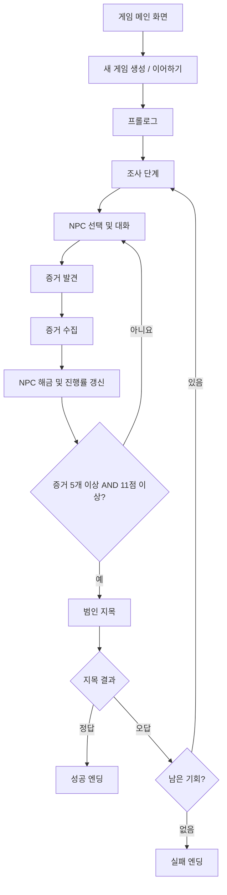
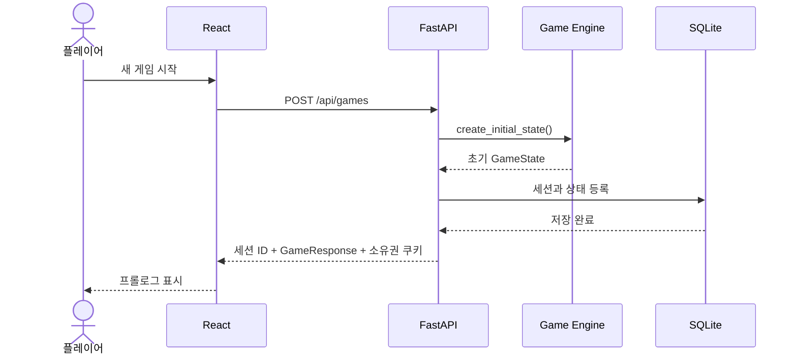
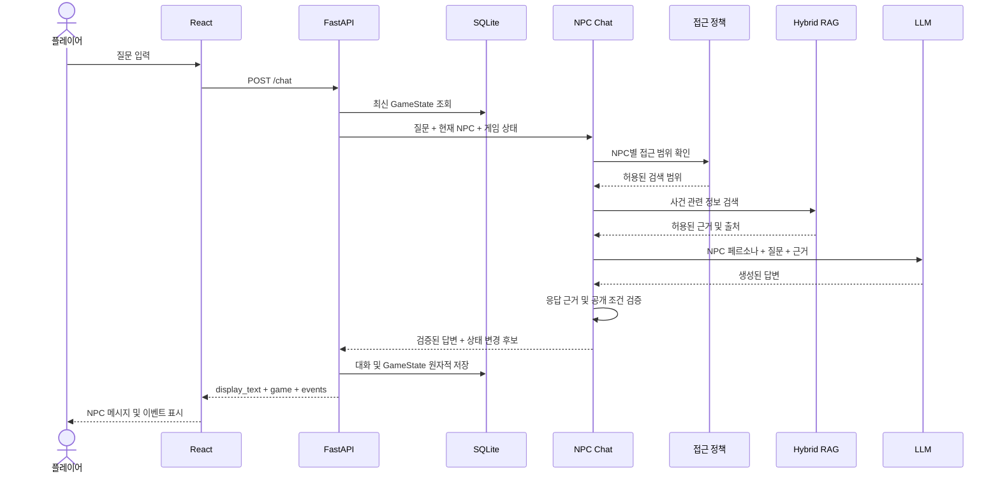
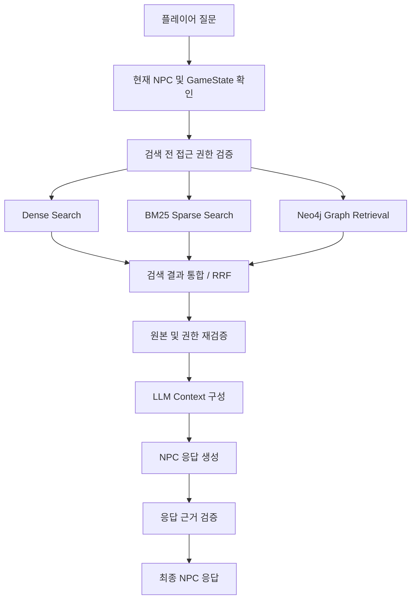
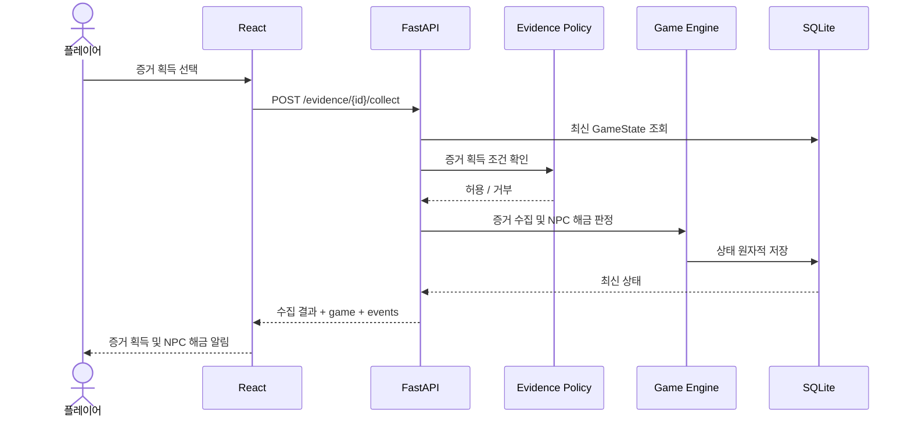
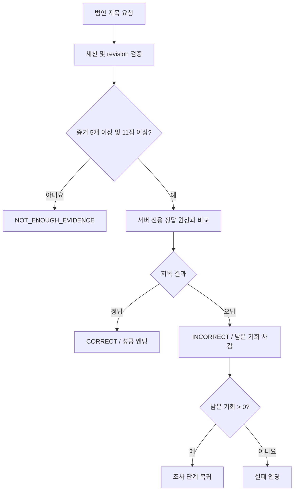
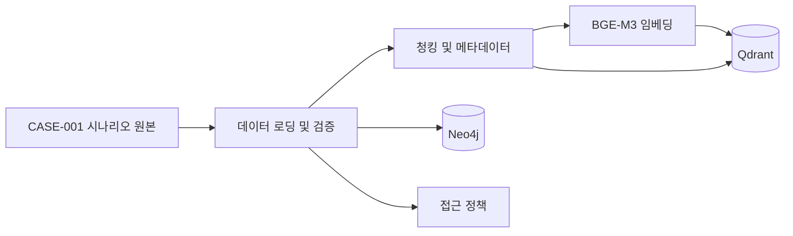

# CASE-001 — 시스템 처리 흐름

## 1. 개요

본 문서는 《마지막 기록: 사라진 공동체》의 실제 서비스 흐름을 설명합니다.

주요 대상은 다음과 같습니다.

- 게임 세션 생성 및 상태 복원
- NPC 선택 및 AI 대화
- Hybrid RAG 검색
- 증거 제시 및 수집
- NPC 해금
- 범인 지목 및 엔딩
- 게임 상태의 영구 저장

시스템은 React 클라이언트의 요청을 FastAPI가 처리하는 구조입니다.

---

## 2. 게임 전체 진행 흐름



### 게임 단계

| 단계 | 설명 |
|---|---|
| `PROLOGUE` | 사건 시작 |
| `INVESTIGATION` | NPC 조사, 대화, 증거 수집 |
| `ACCUSATION` | 범인 지목 및 판정 |
| `FINISHED` | 성공 또는 실패 엔딩 |

---

## 3. 게임 세션 생성 및 복원

### 3.1 새 게임 생성

API: `POST /api/games`



초기 GameState:

- `phase = PROLOGUE`
- `unlocked_characters = ["C01"]`
- `evidence = {}`
- `score = 0`
- `attempts_left = 3`
- `revision = 0`

### 3.2 기존 게임 복원

API: `GET /api/games/{session_id}`

서버는 세션 소유권을 확인한 뒤 SQLite에서 최신 GameState를 조회합니다.

프론트엔드는 반환된 상태를 기준으로 잠금 상태, 진행률 및 화면을 복원합니다.

---

## 4. NPC 대화 처리 흐름

API: `POST /api/games/{session_id}/chat`

### 4.1 요청 형식

```json
{
  "question": "어젯밤에 어디에 계셨나요?",
  "presentedEvidenceId": null
}
```

`presentedEvidenceId`는 일반 대화에서는 `null`이며, 증거를 제시할 때 증거 ID를 전달합니다.

### 4.2 대화 처리 시퀀스



일상적인 인사처럼 사건 지식 검색이 필요 없는 질문은 별도 사회적 대화 처리 경로를 사용할 수 있습니다.

### 4.3 응답 처리 원칙

- NPC에게 허용된 문서만 검색합니다.
- GameState에 따라 공개 가능한 정보를 제한합니다.
- 검증되지 않은 사건 관련 응답은 차단하거나 안전한 대체 응답을 사용합니다.
- NPC의 대화 기록은 세션별로 저장합니다.
- UI에는 검증된 `display_text`를 표시합니다.
- 게임 규칙과 사건 판정은 LLM이 직접 결정하지 않습니다.

---

## 5. Hybrid RAG 검색 흐름

### 5.1 검색 파이프라인



### 5.2 Dense Search

- Ollama의 BGE-M3 임베딩 사용
- 질문을 1024차원 벡터로 변환
- Qdrant의 Cosine 유사도 검색 사용

### 5.3 BM25 Search

- Kiwi 형태소 분석
- 한국어 키워드 추출
- Qdrant Sparse Vector 검색

### 5.4 Graph Retrieval

- Neo4j 그래프 활용
- 인물·사건·증거 관계 탐색
- 현재 NPC에게 공개 가능한 관계만 사용

### 5.5 검색 결과 통합

Dense, BM25 및 Graph 검색 결과는 다중 소스 통합 로직에서 처리합니다.

검색 후보는 접근 정책에 따라 제한하며, 최종 컨텍스트 구성 단계에서 다시 검증합니다.

---

## 6. 증거 제시 및 수집 흐름

### 6.1 증거 제시

NPC에게 증거를 제시할 때는 기존 채팅 API를 사용합니다.

```json
{
  "question": "이 증거에 대해 설명해 주세요.",
  "presentedEvidenceId": "E04"
}
```

서버는 현재 NPC, 증거 보유 여부, 기존 수집 상태 및 접근 조건을 확인합니다.

증거 제시 기록은 이후 다른 증거를 획득하기 위한 선행 조건으로 사용될 수 있습니다.

### 6.2 수집 가능한 증거 조회

API: `GET /api/games/{session_id}/evidence/available`

서버가 현재 수집을 허용하는 증거 목록을 반환합니다.

### 6.3 증거 수집

API: `POST /api/games/{session_id}/evidence/{evidence_id}/collect`



### 6.4 수집 조건

- 조사 단계인지 확인
- 현재 NPC가 해금되어 있는지 확인
- 증거 보유 NPC 확인
- 선행 증거 충족 여부 확인
- 필요한 증거 제시 기록 확인
- 필요한 NPC 지식 카드 공개 여부 확인
- 획득 정책 승인 여부 확인

증거 수집은 서버가 판정하며, 클라이언트가 점수를 임의로 변경할 수 없습니다.

---

## 7. NPC 해금 및 진행률 갱신

초기 NPC는 C01입니다.

증거를 수집하거나 진행 조건을 충족하면 새로운 NPC가 해금됩니다.

해금 결과는 다음 GameState 필드에 반영됩니다.

```json
{
  "unlocked_characters": ["C01", "C02", "C04"],
  "score": 3
}
```

위 JSON은 해당 필드만 발췌한 구조 예시입니다.

프론트엔드는 서버에서 반환하는 `unlockedCharacters`, `collection`, `events`를 이용하여 UI를 갱신합니다.

---

## 8. 범인 지목 및 엔딩 처리

### 8.1 범인 지목

API: `POST /api/games/{session_id}/accusations`

요청 예시:

```json
{
  "suspectId": "C02",
  "expectedRevision": 12
}
```

`expectedRevision`은 예시 값이며, 실제 요청에서는 서버에서 조회한 최신 revision을 사용합니다.

### 8.2 판정 흐름



### 판정 규칙

| 결과 | 처리 |
|---|---|
| `CORRECT` | 성공 처리 및 게임 종료 |
| `INCORRECT` | 기회 차감, 필요 시 조사 복귀 |
| `NOT_ENOUGH_EVIDENCE` | 기회 차감 없이 거부 |

동일한 오래된 revision을 사용하는 중복 요청은 차단합니다.

### 8.3 엔딩 조회

API: `GET /api/games/{session_id}/ending`

게임이 `FINISHED` 단계에 도달한 뒤 엔딩을 조회할 수 있습니다.

실패 엔딩에서는 실제 사건 정답을 공개하지 않습니다.

---

## 9. SQLite 저장 및 트랜잭션

### 주요 테이블

- `npc_sessions`
- `npc_exchanges`
- `game_states`

### 저장 원칙

1. 게임 상태는 서버가 SQLite에서 직접 조회합니다.
2. 상태 변경 시 현재 revision을 검증합니다.
3. 대화 기록과 상태 변경은 하나의 트랜잭션으로 처리합니다.
4. 트랜잭션 처리 실패 시 일부 변경만 저장하지 않습니다.
5. NPC별 대화 기록과 게임 상태는 `session_id`로 구분합니다.

### 관련 구현

- `chat/npc_session_repository.py`
- `trigger/atomic_dialogue.py`
- `scenario/evidence_service.py`
- `scenario/accusation_service.py`

위 경로는 모두 `backend/src/crimescene/` 기준입니다.

---

## 10. 원본 데이터 적재 흐름

RAG 데이터 구축은 일반적인 게임 요청과 별도로 실행됩니다.



시나리오 원본은 GitHub에 포함되지 않으며, 승인된 로컬 데이터와 데이터베이스 적재 결과를 사용합니다.

실제 NPC 대화를 활성화할 때는 CASE-001 데이터, Qdrant 컬렉션 및 Neo4j 연결 상태를 검증합니다.

---

## 11. 오류 처리 및 보안

### API 오류

- 잘못된 요청은 HTTP 오류로 처리합니다.
- 프론트엔드는 서버가 반환한 `message` 또는 `detail`을 표시합니다.
- 요청이 이미 서버에서 처리됐을 가능성이 있는 경우, 상태를 확인하지 않고 자동으로 재전송하지 않습니다.

### 정보 보안

- 비공개 사건 정답을 프론트엔드에 하드코딩하지 않습니다.
- 세션 소유권을 검증합니다.
- 권한이 없는 NPC와 증거에 대한 요청을 거부합니다.
- LLM에 전달하는 근거를 제한합니다.
- 게임 판정 결과를 서버에서 결정합니다.

---

## 12. 관련 문서

- [시스템 개요](./01-system-overview.md)
- [모듈 인터페이스](./03-module-interfaces.md)
- [데이터 저장 구조](./04-data-storage.md)
- [프로젝트 README](../../README.md)