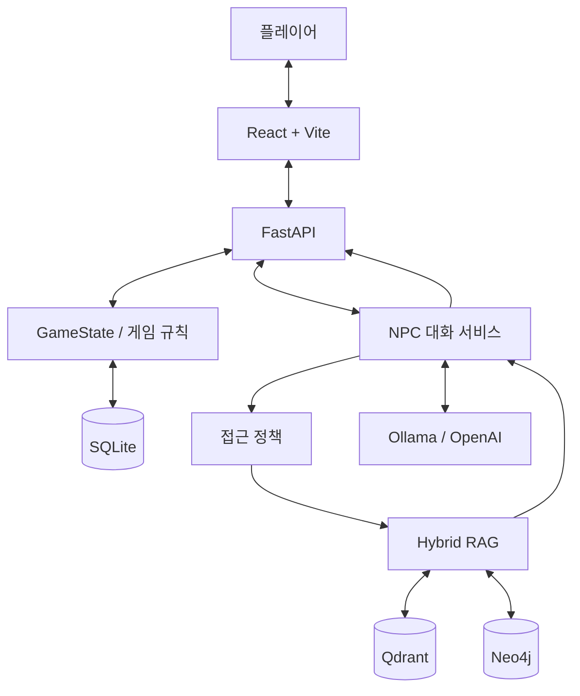

# 마지막 기록: 사라진 공동체

### LLM + Hybrid RAG 기반 AI 대화형 추리 게임

**SKN AI CAMP 3차 단위 프로젝트 | 2Team**

> 누군가는 거짓말을 하고 있습니다. 진실은 그들의 대화 속에 숨어 있습니다.

《마지막 기록: 사라진 공동체》는 플레이어가 AI 등장인물 10명과 자연어로 대화하며, 증거와 진술을 수집하고 사건의 진실을 추리하는 웹 기반 미스터리 게임입니다.

정해진 선택지를 고르는 대신 직접 질문할 수 있으며, 등장인물은 각자의 성격과 지식 범위를 기반으로 응답합니다.

단순한 LLM 챗봇과 달리 Hybrid RAG와 게임 상태 기반 접근 제어를 결합하여 사건 정보의 정확성과 게임 진행 규칙을 관리합니다.

---

## 1. 프로젝트 개요

| 항목 | 내용 |
|---|---|
| 프로젝트명 | 마지막 기록: 사라진 공동체 |
| 사건 ID | CASE-001 |
| 프로젝트 유형 | AI 기반 웹 추리 게임 |
| 장르 | 미스터리 / 추리 / 인터랙티브 스토리 |
| Frontend | React 18, TypeScript, Vite |
| Backend | Python 3.13+, FastAPI |
| LLM | Ollama Qwen3 8B, 선택적 OpenAI API |
| Embedding | BGE-M3 |
| Vector DB | Qdrant |
| Graph DB | Neo4j |
| Game DB | SQLite |
| 등장인물 | 10명 |
| 수집 증거 | 10개 |
| 증거 총점 | 21점 |

### 주요 목표

기존 추리 게임의 선택지 기반 대화 구조를 자연어 기반 자유 대화로 확장합니다.

AI가 사건을 임의로 생성하는 문제를 줄이기 위해 실제 사건 데이터, NPC별 지식과 접근 정책을 분리하여 관리합니다.

게임 규칙은 LLM이 아닌 Python 엔진에서 판정합니다.

---

## 2. 주요 기능

### 2.1 AI NPC 자유 대화

- NPC 10명과 자연어 대화
- NPC별 페르소나 및 말투
- NPC별 독립적인 지식 범위
- 대화 기록 유지 및 조회
- 상황과 증거에 따른 응답 변화
- RAG 근거 기반 응답 검증

### 2.2 Hybrid RAG 검색

- BGE-M3 기반 Dense Search
- Kiwi 기반 한국어 BM25 Search
- Neo4j 기반 Graph Retrieval
- RRF 검색 결과 통합
- NPC별 접근 권한 필터링
- 검색 결과 출처 및 신뢰성 검증

### 2.3 증거 수집

- 증거 E01~E10 수집
- 증거 상세 내용 조회
- 획득 조건 및 선행 증거 검사
- NPC에게 증거 제시
- 증거 점수 및 진행률 관리
- 중복 수집 방지

### 2.4 NPC 해금

- 초기 등장인물 C01
- 증거와 진행 조건에 따른 NPC 해금
- 해금되지 않은 NPC의 대화 차단
- 인물별 지식 카드 공개 조건 관리

### 2.5 추리 및 범인 지목

- 수집한 증거 및 인물 관계 확인
- 증거 5개 이상 및 11점 이상에서 범인 지목 가능
- 최대 3회 지목
- 오답 후 조사 재개
- 성공·실패 엔딩
- 사건 정답 및 비공개 진상 접근 제한

### 2.6 게임 저장 및 복원

- SQLite 기반 GameState 저장
- NPC 대화 기록 영구 저장
- 세션별 게임 진행 상태 분리
- 새로고침 및 재접속 시 상태 조회
- revision 기반 동시 요청 검증

---

## 3. 기술 스택

### Frontend

| 기술 | 활용 |
|---|---|
| React 18 | 게임 화면 |
| TypeScript | 정적 타입 검증 |
| Vite | 개발 서버 및 빌드 |
| React Router | 화면 라우팅 |
| Zustand | 클라이언트 상태 관리 |
| Framer Motion | 화면 전환 및 연출 |
| CSS Modules | 컴포넌트별 스타일 |

### Backend

| 기술 | 활용 |
|---|---|
| Python 3.13+ | 백엔드 및 AI 시스템 |
| FastAPI | 게임 API |
| Uvicorn | ASGI 서버 |
| Pydantic | 데이터 및 상태 검증 |
| SQLite | 게임 저장 |
| pytest | 자동화 테스트 |
| Ruff | 코드 검사 |

### AI 및 데이터

| 기술 | 활용 |
|---|---|
| Ollama | 로컬 LLM 추론 |
| Qwen3 8B | NPC 답변 생성 |
| OpenAI API | 선택 가능한 LLM 공급자 |
| BGE-M3 | 문서 및 질문 임베딩 |
| Qdrant | Dense·Sparse 검색 |
| Kiwi / BM25 | 한국어 키워드 검색 |
| Neo4j | 인물·사건·증거 관계 탐색 |
| RRF | 다중 검색 결과 통합 |

---

## 4. 시스템 아키텍처



### 핵심 설계

- React는 사용자 인터페이스를 담당합니다.
- FastAPI는 요청·응답과 세션 소유권 검증을 담당합니다.
- GameState는 게임 진행 상황을 관리합니다.
- Hybrid RAG는 NPC에게 허용된 사건 정보를 검색합니다.
- LLM은 검증된 근거를 기반으로 NPC 대화를 생성합니다.
- SQLite는 게임 상태와 대화 기록을 저장합니다.
- Qdrant와 Neo4j는 사건 검색 데이터와 관계 정보를 관리합니다.

자세한 내용은 [시스템 아키텍처 문서](./docs/architecture/README.md)를 참고하세요.

---

## 5. 프로젝트 디렉터리 구조

```text
SKN36-3rd-2Team/
│
├── backend/
│   ├── data/                 # 공개 데이터 구조 및 로컬 데이터 위치
│   ├── scripts/              # RAG·NPC 평가 및 검증 스크립트
│   ├── src/
│   │   └── crimescene/
│   │       ├── api/          # FastAPI
│   │       ├── chat/         # LLM 및 NPC 대화
│   │       ├── db/           # Qdrant·Neo4j 적재 및 연결
│   │       ├── ingest/       # 데이터 로딩·청킹·임베딩
│   │       ├── retriever/    # Hybrid RAG
│   │       ├── scenario/     # 게임 규칙 및 접근 정책
│   │       └── trigger/      # 대화 및 증거 트리거
│   ├── tests/                # pytest
│   ├── pyproject.toml
│   └── uv.lock
│
├── frontend/
│   ├── public/assets/       # 게임 이미지
│   ├── scripts/             # 프론트엔드 검사
│   ├── src/
│   │   ├── api/             # 실제 API 및 Mock API
│   │   ├── components/      # 공통 UI
│   │   ├── data/            # 공개 정적 데이터
│   │   ├── mock/            # Mock 데이터
│   │   ├── screens/         # 게임 화면
│   │   ├── store/           # Zustand 상태 관리
│   │   └── styles/          # 공통 스타일
│   └── package.json
│
├── docs/
│   ├── architecture/        # 시스템 설계 문서
│   └── reports/             # RAG 평가 보고서
│
├── compose.yaml             # Qdrant·Neo4j
├── .env.example
└── README.md
```

각 디렉터리의 상세 파일 설명은 해당 폴더의 `README.md`에 작성되어 있습니다.

### 주요 문서

- [백엔드 안내](./backend/README.md)
- [백엔드 모듈 구성](./backend/src/crimescene/README.md)
- [프론트엔드 안내](./frontend/README.md)
- [기술 문서](./docs/README.md)
- [테스트 안내](./backend/tests/README.md)
- [평가 스크립트](./backend/scripts/README.md)

---

## 6. 개발 환경 및 실행 방법

아래 명령은 Windows PowerShell을 기준으로 작성했습니다.

### 6.1 사전 준비

- Git
- Python 3.13 이상
- uv
- Node.js 및 npm
- Docker Desktop
- Ollama

### 6.2 프로젝트 다운로드

```powershell
git clone https://github.com/SKNETWORKS-FAMILY-AICAMP/SKN36-3rd-2Team.git

cd SKN36-3rd-2Team

git switch dev
```

### 6.3 환경변수 준비

프로젝트 루트에서 실행합니다.

```powershell
Copy-Item .env.example .env
Copy-Item backend/.env.example backend/.env
```

프로젝트 루트 `.env`에는 Docker Neo4j 비밀번호를 설정합니다.

`backend/.env`에는 동일한 Neo4j 비밀번호와 다음 환경변수를 설정해야 합니다.

```dotenv
CRIMESCENE_SESSION_SECRET=<32바이트 이상의 무작위 비밀키>
CRIMESCENE_ENABLE_CHAT=true
CRIMESCENE_COOKIE_SECURE=false
```

비밀키는 Python으로 생성할 수 있습니다.

```powershell
python -c "import secrets; print(secrets.token_urlsafe(48))"
```

출력된 값을 `CRIMESCENE_SESSION_SECRET`에 설정합니다.

`CRIMESCENE_COOKIE_SECURE=false`는 HTTP 로컬 개발 환경용입니다. HTTPS 운영 환경에서는 `true`로 설정해야 합니다.

### 6.4 로컬 사건 데이터

실제 RAG 대화를 실행하려면 별도로 배포된 CASE-001 시나리오 데이터가 필요합니다.

기본 데이터 위치:

```text
.local/case001_v7_1/
```

이 경로는 프로젝트 루트 기준입니다.

`backend/.env`의 설정:

```dotenv
CRIMESCENE_CASE001_ROOT=.local/case001_v7_1
```

데이터 원본의 디렉터리 구조와 해금 규칙이 올바른지 확인해야 합니다.

범인 판정 기능에는 서버 전용 사건 정답 파일도 필요합니다.

```dotenv
CRIMESCENE_CASE_TRUTH_PATH=<서버 전용 case_truth.json의 실제 경로>
```

비공개 사건 원장, 시나리오 원본 및 API Key는 GitHub에 커밋하지 않습니다.

### 6.5 Docker 실행

Docker Desktop을 실행한 뒤:

```powershell
docker compose up -d
```

실행 상태 확인:

```powershell
docker compose ps
```

접속 주소:

| 서비스 | 주소 |
|---|---|
| Qdrant | http://localhost:6333 |
| Neo4j Browser | http://localhost:7474 |
| Neo4j Bolt | bolt://localhost:7687 |

Docker 실행만으로 Qdrant의 사건 문서와 Neo4j의 관계 데이터가 자동 적재되지는 않습니다.

실제 대화를 사용하려면 검증된 CASE-001 데이터가 두 데이터베이스에 적재되어 있어야 합니다.

### 6.6 Ollama 모델 준비

```powershell
ollama pull bge-m3
ollama pull qwen3:8b
```

Ollama 서비스가 실행 중인지 확인합니다.

기본 설정:

```dotenv
LLM_PROVIDER=ollama
OLLAMA_MODEL=qwen3:8b
OLLAMA_BASE_URL=http://localhost:11434
```

LLM 응답 생성 공급자는 OpenAI API로 전환할 수 있으나, 현재 임베딩은 Ollama BGE-M3를 사용합니다.

### 6.7 백엔드 실행

새 PowerShell 터미널에서:

```powershell
cd backend

uv sync

uv run uvicorn crimescene.api.main:app --reload --host 127.0.0.1 --port 8000
```

백엔드 API:

http://127.0.0.1:8000

Swagger API 문서:

http://127.0.0.1:8000/docs

`CRIMESCENE_ENABLE_CHAT=true`인 경우 서버 시작 시 실제 시나리오 데이터, Ollama 모델, Qdrant 및 Neo4j 연결을 검증합니다.

개발용 API 구조만 확인하려면 채팅을 비활성화할 수 있으나, 해당 상태에서는 실제 NPC RAG 대화를 사용할 수 없습니다.

### 6.8 프론트엔드 실행

다른 PowerShell 터미널에서 프로젝트 루트의 `frontend` 폴더로 이동합니다.

```powershell
cd frontend

npm ci

npm run dev
```

프론트엔드 주소:

http://localhost:5173

실제 FastAPI 연결:

http://localhost:5173/?api=http#/

백엔드 없이 Mock 모드 실행:

http://localhost:5173/?api=mock#/

기본 API 모드는 환경변수 `VITE_API_MODE`로 설정할 수 있습니다. 주소의 `api` 쿼리 파라미터를 이용하면 빌드 없이 전환할 수 있습니다.

---

## 7. API 구성

주요 API는 다음과 같습니다.

| 메서드 | 경로 | 기능 |
|---|---|---|
| POST | `/api/games` | 게임 생성 |
| GET | `/api/games/{session_id}` | 상태 조회 |
| POST | `/api/games/{session_id}/prologue/complete` | 프롤로그 완료 |
| POST | `/api/games/{session_id}/characters/{character_id}/select` | NPC 선택 |
| GET | `/api/games/{session_id}/chats/{character_id}` | 대화 기록 조회 |
| POST | `/api/games/{session_id}/chat` | NPC 대화 및 증거 제시 |
| GET | `/api/games/{session_id}/evidence` | 수집 증거 목록 |
| GET | `/api/games/{session_id}/evidence/available` | 수집 가능한 증거 |
| POST | `/api/games/{session_id}/evidence/{evidence_id}/collect` | 증거 수집 |
| GET | `/api/games/{session_id}/progress` | 진행률 |
| GET | `/api/games/{session_id}/relationships` | 인물 관계 |
| POST | `/api/games/{session_id}/accusations` | 범인 지목 |
| GET | `/api/games/{session_id}/ending` | 엔딩 조회 |

API 응답 중 `collection`, `canAccuse`, `attemptsLeft`, `events` 등은 프론트엔드의 화면 갱신에 사용됩니다.

---

## 8. Hybrid RAG

본 프로젝트는 세 가지 검색 방식을 결합합니다.

### Dense Search

BGE-M3 임베딩을 이용하여 질문과 의미적으로 유사한 문서를 검색합니다.

### BM25 Search

Kiwi 형태소 분석을 이용하여 인물명, 사건명 및 장소명 등 주요 키워드를 검색합니다.

### Graph Retrieval

Neo4j를 이용하여 인물, 사건 및 증거 사이의 연결 관계를 검색합니다.

### RRF

서로 다른 검색 결과를 통합하여 관련성 높은 근거를 구성합니다.

### Access Control

현재 NPC의 지식 범위와 게임 진행 상태를 기준으로 접근 가능한 문서를 제한합니다.

검색 이전과 LLM 호출 이전에 권한을 검증하며, 생성된 NPC 응답도 근거 검증을 거칩니다.

---

## 9. 게임 진행 규칙

| 항목 | 규칙 |
|---|---|
| 등장인물 | C01~C10 |
| 초기 NPC | C01 |
| 수집 증거 | E01~E10 |
| 증거 총점 | 21점 |
| 지목 최소 증거 | 5개 |
| 지목 최소 점수 | 11점 |
| 지목 기회 | 3회 |
| 성공 조건 | 실제 사건 정답 지목 |
| 실패 조건 | 남은 지목 기회 소진 |

GameState는 서버에서 관리하며, SQLite에 저장합니다.

LLM은 증거 점수, NPC 해금 및 범인 정답을 직접 결정하지 않습니다.

---

## 10. 테스트 및 평가

### 10.1 백엔드 테스트

```powershell
cd backend

uv run ruff check .
uv run pytest -q
```

특정 게임 진행 회귀 테스트:

```powershell
uv run pytest -q tests/test_issue33_npc_scenario.py
```

### 10.2 프론트엔드 테스트

```powershell
cd frontend

npm run build

npm run spoiler
```

`spoiler`는 정답 및 관리자 전용 정보가 프론트엔드 파일에 포함되었는지 검사하는 스크립트입니다.

### 10.3 RAG 평가 결과

Issue #32 잠정 평가:

| 검색 방식 | Recall@5 | Recall@10 | MRR@10 | nDCG@10 |
|---|---:|---:|---:|---:|
| Dense | 1.0000 | 1.0000 | 0.9828 | 0.9793 |
| BM25 | 0.9655 | 1.0000 | 0.9770 | 0.9669 |
| Hybrid | 1.0000 | 1.0000 | 1.0000 | 0.9921 |

평가 질문 29개 기준입니다.

Gold Label의 독립 검수가 남아 있으므로 잠정 결과이며, LLM 답변 정확도와 동일한 의미는 아닙니다.

상세 내용: [Issue #32 RAG 평가 보고서](./docs/reports/issue-32-rag-evaluation.md)

### 10.4 게임 E2E 검증

로컬 실제 데이터 기반 수동 통합 테스트에서 확인한 결과:

| 항목 | 결과 |
|---|---|
| 증거 수집 | 10/10 PASS |
| NPC 해금 | 10/10 PASS |
| 증거 총점 | 21/21 PASS |
| 범인 지목 및 엔딩 | PASS |
| SQLite 상태 복원 | PASS |
| 기존 게임 진행 회귀 테스트 | 16 PASS |
| Issue #33 신규 회귀 테스트 | 3 PASS |
| Ruff 정적 검사 | PASS |

실제 RAG E2E와 지목·엔딩 통합 검증은 로컬 수동 실행 결과이며, 새로 추가한 Issue #33 테스트 3개는 외부 서비스 없이 실행하는 회귀 테스트입니다.

---

## 11. 보안 및 데이터 관리

- CASE-001 비공개 사건 원장은 공개 저장소에서 제외합니다.
- `.env` 및 API Key는 GitHub에 커밋하지 않습니다.
- NPC별 문서 접근 권한을 검증합니다.
- 미수집 증거와 미해금 NPC 정보는 접근을 제한합니다.
- 세션 소유권은 서버에서 검증합니다.
- 상태 변경에는 revision 검증을 적용합니다.
- 게임 상태 및 대화 기록은 SQLite 트랜잭션으로 저장합니다.
- 범인 정답은 서버 전용 원장으로 판정합니다.
- 프론트엔드에는 공개 가능한 정보만 전달합니다.

---

## 12. 개발 방식

프로젝트는 GitHub Issue 및 Pull Request 기반으로 개발합니다.

```text
Issue 등록
    ↓
기능별 브랜치 생성
    ↓
구현 및 테스트
    ↓
Pull Request 생성
    ↓
코드 리뷰
    ↓
dev 병합
```

하위 Issue 1개당 독립적인 작업 브랜치를 사용합니다.

---

## 13. 기술 문서

| 문서 | 내용 |
|---|---|
| [시스템 개요](./docs/architecture/01-system-overview.md) | 전체 기술 구성 및 설계 |
| [시스템 처리 흐름](./docs/architecture/02-system-flow.md) | 게임 진행 및 API·RAG 처리 흐름 |
| [모듈 인터페이스](./docs/architecture/03-module-interfaces.md) | 주요 모듈 책임 및 호출 관계 |
| [데이터 저장 구조](./docs/architecture/04-data-storage.md) | Qdrant·Neo4j·SQLite·GameState |
| [RAG 평가 보고서](./docs/reports/issue-32-rag-evaluation.md) | 검색 정확도 및 정보 접근 제어 평가 |
| [백엔드 파일 안내](./backend/README.md) | 백엔드 파일별 역할 |
| [프론트엔드 파일 안내](./frontend/README.md) | 화면 및 상태 관리 구조 |
| [테스트 파일 안내](./backend/tests/README.md) | pytest 테스트 구성 |

---

## 14. 향후 개선 사항

- 검색 단계별 처리 시간 측정 및 최적화
- LLM 응답 지연 및 프롬프트 품질 개선
- NPC 대화 자연스러움과 일관성 평가 확대
- RAG 평가 Gold Label 독립 검수
- 심층 엔딩 자격 판정 경로 보완
- 게임 이미지 및 스토리 연출 고도화
- 추가 사건 시나리오 지원
- 향후 PC 게임 및 Steam 출시 검토

---

**SKN AI CAMP 3차 단위 프로젝트 | 2Team**