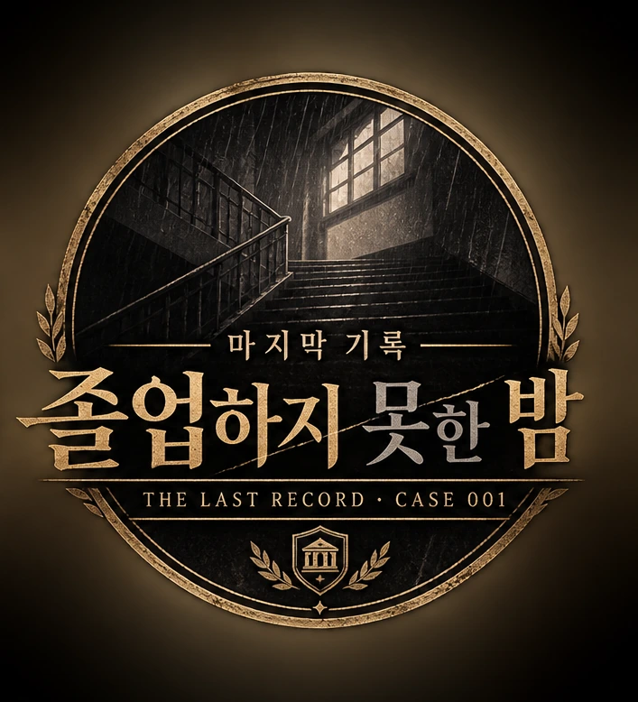
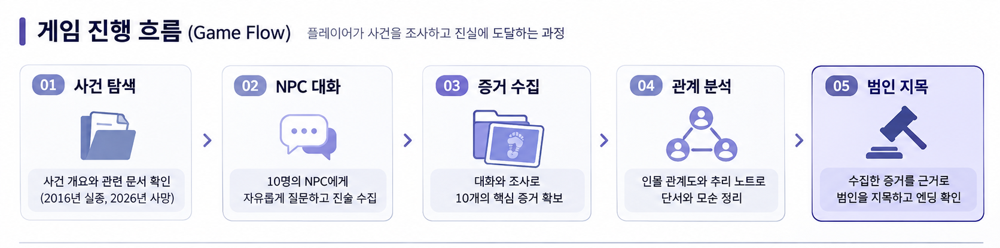
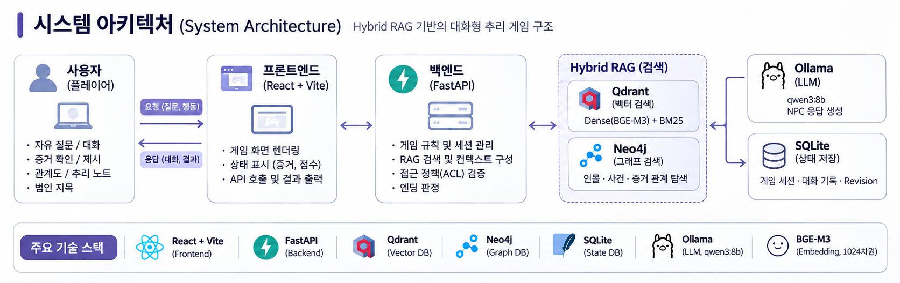

# 마지막 기록: 졸업하지 못한 밤



### LLM × Hybrid RAG × Graph Database 기반 AI 크라임씬 추리 게임

**SK Networks Family AI Camp 36기 · 3차 단위 프로젝트 · 2팀**

> **10년 전 사라진 학생, 그리고 다시 발생한 의문의 죽음.**  
> **사람들은 저마다 다른 이야기를 합니다. 무엇을 믿을지는 당신의 몫입니다.**

**선택지가 아닌 질문으로 사건을 추적하는 인터랙티브 미스터리 게임**

`React` · `TypeScript` · `FastAPI` · `Ollama` · `Qdrant` · `Neo4j` · `SQLite`

[게임 소개](#-게임-소개) · [핵심 기능](#-핵심-기능) · [시스템 아키텍처](#-시스템-아키텍처) · [실행 방법](#-로컬-실행-방법) · [검증 결과](#-테스트-및-성능-검증)


---

## 🎬 게임 소개

**《마지막 기록: 졸업하지 못한 밤》**은 플레이어가 사건 관계자와 자유롭게 대화하고, 증거와 인물 관계를 분석해 진실을 밝혀내는 **웹 기반 AI 추리 게임**입니다.

2016년, 세린국제학교에서 **백서윤 실종 사건**이 발생합니다. 그리고 10년 뒤인 2026년, **신기범 사망 사건**이 벌어집니다. 플레이어는 서로 다른 시기에 발생한 두 사건의 기록과 관계자들의 진술을 추적합니다.

기존의 선택지형 추리 게임과 달리, 플레이어는 NPC에게 **직접 질문을 입력**할 수 있습니다. 인물들은 각자의 성격·과거·지식 범위에 따라 대답하며, 수집한 증거와 게임 진행 상태에 따라 새로운 정보가 공개됩니다.

이 프로젝트에서 AI의 역할은 **인물을 연기하고 대화를 생성하는 것**입니다. 증거 획득, NPC 해금, 범인 판정처럼 결과가 반드시 일관되어야 하는 규칙은 **서버의 게임 엔진**이 담당합니다.

| 구분 | 내용 |
| --- | --- |
| 장르 | 미스터리 · 크라임씬 · 인터랙티브 스토리 |
| 사건 ID | `CASE-001` |
| 등장인물 | 10명 (`C01`~`C10`) |
| 핵심 증거 | 10개 (`E01`~`E10`) |
| 수집 점수 | 총 21점 |
| 상호작용 | 자유로운 자연어 대화, 증거 수집·제시, 관계 조사, 범인 지목 |
| 플레이 방식 | React 기반 웹 게임 |

## ✨ 핵심 기능

| 기능 | 설명 |
| --- | --- |
| **자연어 기반 NPC 대화** | 미리 정해진 선택지 없이 질문하고, NPC별 말투·페르소나를 반영한 답변을 받습니다. |
| **근거 기반 Hybrid RAG** | Qdrant의 Dense/BM25 검색과 Neo4j 관계 탐색을 결합해 사건 문서를 참조합니다. |
| **게임 상태에 따른 정보 공개** | NPC 지식, 증거 획득 여부, 해금 조건을 확인해 공개 가능한 정보만 답변에 사용합니다. |
| **증거 수집·제시** | 단서 발견·수집과 NPC에게 증거를 제시하는 행동을 구분합니다. |
| **인물 관계도·수첩** | 확인한 정보와 관계를 추적해 플레이어가 직접 추리할 수 있습니다. |
| **범인 지목·엔딩** | 증거 조건을 만족한 뒤 범인을 지목하며, 서버에서 정답과 남은 기회를 판정합니다. |
| **진행 상태 복원** | SQLite에 저장된 게임 상태·대화 기록을 기반으로 진행 내용을 복원합니다. |

### 게임 진행 흐름



게임은 **프롤로그 → NPC 자유 대화 → 증거 발견·수집·제시 → 관계 분석 → 범인 지목 → 엔딩** 순서로 진행됩니다. 조건을 충족하지 못했거나 오답 지목 후 기회가 남으면 조사 단계로 돌아갈 수 있습니다.

**범인 지목 조건:** 증거 **5개 이상**을 수집하고, 수집 점수가 **11점 이상**이어야 합니다. 지목 기회는 최대 **3회**이며, 오답 후 기회가 남으면 조사를 이어갈 수 있습니다.

### 엔딩 구성

프론트엔드에는 `FULL`(사건 해결), `ESTIMATED`(추정 성립), `NO_EVIDENCE`(증거 부족), `UNSOLVED`(수사 실패), `DEEP`(심화 엔딩) **5종의 엔딩 도감 UI**가 구현되어 있습니다.

다만 **서버에서 구현·검증된 핵심 최종 판정은 성공과 실패**입니다. `NO_EVIDENCE`는 클라이언트의 수사 포기 경로에 사용되며, `ESTIMATED`·`DEEP`의 일반 플레이 도달 조건은 추가 검증이 필요합니다. **5종 모두의 서버 E2E 도달이 검증되었다는 뜻은 아닙니다.**

---

## 🧠 기술적 차별점

일반 LLM만으로 추리 게임을 구현하면 **존재하지 않는 단서 생성**, **NPC 성격·진술 불일치**, **아직 공개되면 안 되는 진실 노출** 문제가 발생할 수 있습니다.

이 프로젝트는 다음 원칙으로 이를 완화합니다.

1. **LLM과 게임 규칙 분리:** 생성형 AI는 대화를 만들고, 게임 상태 변경·정답 판정은 FastAPI/Python이 처리합니다.
2. **Hybrid RAG 검색:** 의미 유사도·키워드·그래프 관계를 함께 활용합니다.
3. **Fail-Closed 접근 제어:** 허용 정책이 없거나 검증에 실패하면 정보를 공개하지 않습니다.
4. **서버 권위 상태 관리:** 증거·점수·지목 기회·정답을 클라이언트 입력만으로 변경할 수 없도록 검증합니다.

## 🏗️ 시스템 아키텍처



프론트엔드(React)는 게임 화면과 사용자 입력을 담당하고, 백엔드(FastAPI)는 세션·게임 규칙·접근 권한을 관리합니다. Qdrant는 사건 문서의 Dense/BM25 검색, Neo4j는 관계 탐색, SQLite는 게임 상태와 대화 기록 저장을 담당합니다. 검증된 근거만 LLM에 전달하여 NPC 답변을 생성합니다.

### 기술 스택

| 영역 | 기술 | 담당 역할 |
| --- | --- | --- |
| Frontend | React 18, TypeScript, Vite | 게임 화면 및 사용자 입력 |
| UI·상태 | React Router, Zustand, Framer Motion | 화면 전환, 화면 상태, 애니메이션 |
| Backend | Python 3.13+, FastAPI, Pydantic | REST API, 검증, 게임 규칙 |
| LLM | Ollama `qwen3:8b` / 선택적 OpenAI API | NPC 답변 생성 |
| Embedding | Ollama `bge-m3` | 1,024차원 Dense 임베딩 |
| Vector DB | Qdrant | Dense 및 BM25 검색 |
| Keyword | Kiwi, BM25 | 한국어 단어 기반 검색 |
| Graph DB | Neo4j | NPC·사건·장소·증거 간 관계 검색 |
| Game DB | SQLite | 세션, 게임 상태 및 대화 기록 |
| Infrastructure | Docker Compose | Qdrant·Neo4j 로컬 구동 |
| Quality | pytest, Ruff, TypeScript Build | 회귀 테스트, 정적 검사, 빌드 |

### CASE-001 데이터 설계

사건 설정은 원본 문서, 인물별 지식, 검색 청크, 관계 정보, 접근 정책으로 **분리해 관리**합니다.

| 데이터 | 규모 |
| --- | ---: |
| 플레이어용 사건 문서 | 28개 |
| NPC 지식 카드 | 88개 |
| Qdrant 검색 청크 | 116개 |
| 접근 정책 | 153개 |
| Neo4j 엔티티 | 39개 |
| Neo4j 관계 | 37개 |

원본 문서에 **의미 기반 + 고정 길이 청킹**을 적용하고, 식별자·출처·접근 정책 메타데이터를 유지합니다. 검색 후에도 서버가 공개 가능 여부를 재검증합니다. 사건의 정답을 담은 **비공개 진상 원장(`CaseTruth`)**은 일반 RAG 검색 대상과 분리합니다.

---

## 📊 테스트 및 성능 검증

> 아래 결과는 **2026년 11월 11일 기준 종합보고서와 개발 PR에 기록된 측정값**입니다. README 작성 과정에서 테스트를 새로 실행한 값은 아닙니다.

### 자동화·플레이 검증

| 검증 항목 | 기록된 결과 |
| --- | ---: |
| pytest 회귀 테스트 | **1,559 PASS / 9 SKIP** |
| 실제 플레이 E2E 점검 | **12/12 PASS** |
| 핵심 증거 수집 | **10/10 PASS** |
| NPC 해금 | **10/10 PASS** |
| 증거 점수 검증 | **21/21 PASS** |

### 오프라인 검색 품질 비교

동일한 **29개 평가 질문**에서 Dense, BM25, Dense+BM25 Hybrid(RRF)를 비교했습니다.

| 검색 방식 | Recall@5 | Recall@10 | MRR@10 | nDCG@10 |
| --- | ---: | ---: | ---: | ---: |
| Dense | 1.0000 | 1.0000 | 0.9828 | 0.9793 |
| BM25 | 0.9655 | 1.0000 | 0.9770 | 0.9669 |
| **Hybrid** | **1.0000** | **1.0000** | **1.0000** | **0.9921** |

29문항에서 Hybrid는 Dense와 Recall은 같았지만 **MRR@10, nDCG@10은 더 높았습니다.** 반면 별도 3문항 회귀에서는 Hybrid가 항상 우세하지 않아, 평가셋 확장과 Gold Label 독립 검수가 필요합니다.

이 비교는 **실제 사용자 무작위 A/B 테스트가 아닌 검색 알고리즘의 오프라인 비교 실험**입니다. Neo4j 적용 전후 기여도를 직접 측정한 결과도 아닙니다.

### RAG 검색 지연 최적화

| 지표 | 변경 전 | 변경 후 |
| --- | ---: | ---: |
| RAG 검색 평균 | 약 **6.47초** | 약 **0.50초** |
| Dense Qdrant 요청 | 약 2,044ms | 약 10~31ms |
| BM25 Qdrant 요청 | 약 2,048ms | 약 6~31ms |

Qdrant 로컬 연결 경로를 명시한 뒤의 **관측 결과**이며, 검색 평균 지연은 약 **92.3% 감소**했습니다. 단, 서로 다른 반복 측정 집합을 비교했고 **LLM 생성 시간과 브라우저 렌더링 시간은 포함하지 않습니다.**

자세한 내용: [RAG 평가 보고서](./docs/reports/issue-32-rag-evaluation.md)

---

## 🚀 로컬 실행 방법

**Windows PowerShell 기준**입니다. 실행에는 Git, **Python 3.13**, `uv`, Node.js/npm, Docker Desktop, Ollama가 필요합니다.

> **중요:** 이 저장소만 `git clone`해서는 실제 사건을 진행할 수 없습니다. **비공개 CASE-001 v7.1 원본 데이터와 서버 전용 사건 정답 파일**을 팀 담당자로부터 별도로 전달받아야 합니다. 실제 시나리오는 GitHub에 포함하지 않습니다.

### 1. 저장소 내려받기

```powershell
git clone https://github.com/SKNETWORKS-FAMILY-AICAMP/SKN36-3rd-2Team.git
cd SKN36-3rd-2Team
git switch dev
```

### 2. 환경 설정

```powershell
Copy-Item .env.example .env
Copy-Item backend/.env.example backend/.env
```

루트 `.env`에는 `NEO4J_PASSWORD`를 설정하고, `backend/.env`에는 동일한 `NEO4J_PASSWORD`와 다음 값을 **각각 별도의 줄**에 설정합니다.

```dotenv
CRIMESCENE_ENABLE_CHAT=true
CRIMESCENE_COOKIE_SECURE=false
CRIMESCENE_CASE001_ROOT=.local/case001_v7_1
CRIMESCENE_DB_PATH=data/game_state.sqlite3
CRIMESCENE_SESSION_SECRET=충분히_긴_무작위_비밀키
CRIMESCENE_CASE_TRUTH_PATH=서버_전용_정답_파일_경로
LLM_PROVIDER=ollama
OLLAMA_MODEL=qwen3:8b
OLLAMA_BASE_URL=http://localhost:11434
QDRANT_URL=http://127.0.0.1:6333
```

비밀키 생성: `python -c "import secrets; print(secrets.token_urlsafe(48))"`

비공개 원본은 프로젝트 루트의 `.local/case001_v7_1/`에 배치합니다. `CRIMESCENE_COOKIE_SECURE=false`는 **HTTP 로컬 개발 환경 전용**입니다.

### 3. 데이터베이스 및 모델 준비

```powershell
docker compose up -d
ollama pull bge-m3
ollama pull qwen3:8b
```

### 4. 백엔드 설치 및 사건 데이터 적재

```powershell
cd backend
uv sync --locked

# 먼저 데이터·DB 차이 검사(Dry Run)
uv run python -m crimescene.db.data_pipeline --root ../.local/case001_v7_1

# 초기 적재가 필요한 환경에서만 실행
uv run python -m crimescene.db.data_pipeline --root ../.local/case001_v7_1 --apply

uv run uvicorn crimescene.api.main:app --host 127.0.0.1 --port 8000
```

- API 문서: <http://127.0.0.1:8000/docs>
- Qdrant: <http://127.0.0.1:6333>
- Neo4j Browser: <http://127.0.0.1:7474>

### 5. 프론트엔드 실행

새 PowerShell 창에서 **프로젝트 루트 기준**:

```powershell
cd frontend
npm ci
npm run dev -- --host 127.0.0.1 --port 5173 --strictPort
```

게임 접속: **<http://127.0.0.1:5173/>**

환경 설정, 비공개 데이터 배치, DB 초기화, 실행 중 오류 대응은 **[팀원 로컬 실행 가이드](./docs/TEAM_SETUP.md)**를 참고하세요.

### 테스트 및 빌드

```powershell
# backend/에서
uv run ruff check .
uv run pytest -q

# frontend/에서
npm run build
npm run spoiler
```

---

## 🔐 보안 및 설계 원칙

- **서버 권위:** NPC 해금, 증거 수집, 점수, 지목 가능 여부와 결과를 FastAPI에서 판정합니다.
- **정보 공개 최소화:** 미수집 증거, 미해금 NPC 지식, 관리자 전용 진상을 검색 결과와 응답에서 차단합니다.
- **Fail-Closed:** 접근 정책이 누락되거나 검증에 실패하면 기본적으로 공개하지 않습니다.
- **상태 무결성:** SQLite 트랜잭션과 `GameState.revision` 검증으로 중복·오래된 요청을 통제합니다.
- **비밀 관리:** `.env`, API 키, 비공개 시나리오·진상 원장은 공개 저장소나 프론트엔드 정적 파일에 포함하지 않습니다.

## 📁 프로젝트 구조

```text
SKN36-3rd-2Team/
├── backend/
│   ├── src/crimescene/
│   │   ├── api/          # FastAPI API
│   │   ├── chat/         # NPC 페르소나·LLM 대화
│   │   ├── db/           # Qdrant·Neo4j 적재/연결
│   │   ├── ingest/       # 문서 분할·임베딩
│   │   ├── retriever/    # Hybrid RAG 검색·권한 검증
│   │   ├── scenario/     # 게임 규칙·데이터 모델
│   │   └── trigger/      # 증거·대화 이벤트
│   ├── tests/            # pytest
│   └── scripts/          # 검색·NPC 평가
├── frontend/
│   ├── public/assets/    # 인물·배경·엔딩 이미지
│   └── src/
│       ├── screens/      # 게임 화면
│       ├── components/   # UI 컴포넌트
│       ├── api/          # FastAPI 연동
│       └── store/        # Zustand 상태
├── docs/
│   ├── architecture/     # 설계 문서
│   ├── reports/          # 평가 보고서
│   └── TEAM_SETUP.md     # 팀원 설치·실행 가이드
├── compose.yaml
└── README.md
```

## 🛠️ 향후 개선 방향

- NPC별 답변 자연스러움·페르소나 일관성 평가 확대
- Gold Label 독립 검수 및 질문 유형별 RAG 성능 분석
- Neo4j 적용 전후 기여도 검증과 LLM 응답 지연 측정
- `ESTIMATED`·`DEEP` 등 추가 엔딩의 서버 도달 경로·E2E 보강
- 신규 사건 시나리오 및 배포 환경 확장

---

> **“마지막 기록은 남아 있습니다. 진실을 완성하는 것은 플레이어의 질문입니다.”**

**SK Networks Family AI Camp 36기 · 3차 단위 프로젝트 · 2팀**
