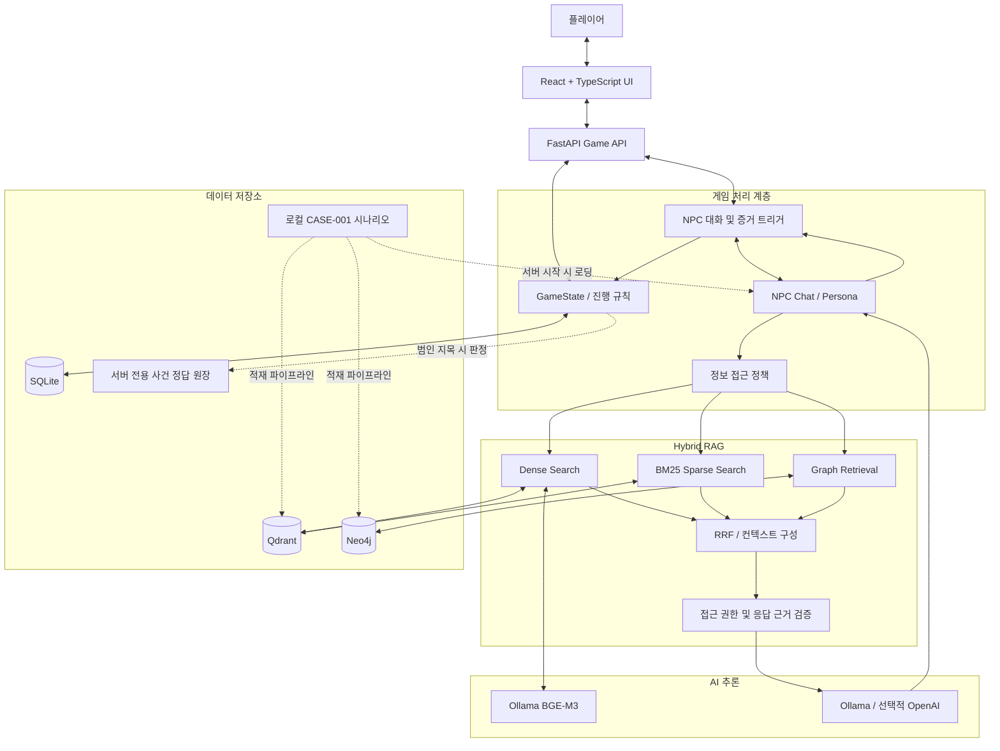

# CASE-001 — 시스템 아키텍처 개요

## 1. 프로젝트 개요

**《마지막 기록: 사라진 공동체》**는 LLM과 Hybrid RAG를 기반으로 하는 AI 대화형 추리 게임입니다.

플레이어는 사건 관계자 10명과 직접 대화하고, 진술과 증거를 수집하며, 인물 간 관계를 조사하여 사건의 진실을 추리합니다.

일반적인 선택지 기반 추리 게임과 달리 자연어로 질문할 수 있습니다. 단, AI가 사건의 진실을 임의로 생성하지 않도록 정해진 사건 데이터, NPC별 지식 범위, 게임 진행 규칙을 적용합니다.

### 핵심 기능

- NPC 10명과 자연어 기반 자유 대화
- NPC별 페르소나 및 대화 기록 관리
- Dense Search + BM25 + Graph Retrieval 기반 Hybrid RAG
- 게임 상태에 따른 정보 접근 제한
- 증거 10개 수집 및 21점 진행률 관리
- 수집 조건에 따른 NPC 해금
- 인물 관계 및 증거 보관함 조회
- 최대 3회 범인 지목 및 엔딩 판정
- SQLite 기반 게임 상태 저장 및 복원

---

## 2. 기술 스택

| 영역 | 기술 | 목적 |
|---|---|---|
| Frontend | React 18, TypeScript, Vite | 게임 UI |
| UI | React Router, Zustand, Framer Motion | 화면 이동, 상태 관리, 연출 |
| Backend | Python 3.13+, FastAPI, Uvicorn | 게임 API 및 비즈니스 로직 |
| LLM | Ollama, Qwen3 8B | NPC 응답 생성 |
| 선택적 LLM | OpenAI API | 대체 응답 생성 공급자 |
| Embedding | BGE-M3 | 1024차원 임베딩 |
| Vector DB | Qdrant | Dense 및 Sparse 검색 |
| Keyword Search | Kiwi, BM25 | 한국어 키워드 검색 |
| Graph DB | Neo4j | 인물·사건·증거 관계 검색 |
| Game DB | SQLite | 게임 상태 및 대화 기록 |
| Validation | Pydantic | 데이터·상태 검증 |
| Infrastructure | Docker Compose | Qdrant·Neo4j 실행 |
| Testing | pytest, Ruff | 자동화 테스트 및 정적 검사 |

현재 구현은 React + FastAPI를 사용합니다. 이전 개발 계획에 포함된 Streamlit과 Django는 현재 실행 아키텍처가 아닙니다.

---

## 3. 전체 시스템 아키텍처



### 아키텍처 특징

1. UI, 게임 엔진, 검색 시스템의 책임을 분리합니다.
2. LLM은 NPC 대화를 생성하며 게임 판정은 수행하지 않습니다.
3. RAG 검색 전후에 접근 권한을 검증합니다.
4. 게임 상태 변경은 SQLite에 저장합니다.
5. 비공개 사건 정답 원장은 일반 검색 컨텍스트와 분리합니다.

---

## 4. 주요 소프트웨어 계층

### 4.1 Presentation Layer

경로: `frontend/src/`

React 기반 웹 게임 화면을 담당합니다.

주요 기능:

- 게임 시작 및 이어하기
- 사건 프롤로그와 장면 연출
- NPC 대화
- 증거 수첩 및 관계도
- 범인 지목 및 엔딩
- 서버 이벤트 기반 화면 갱신

프론트엔드는 서버에서 반환한 상태를 표시하고 사용자 행동을 API에 전달합니다.

### 4.2 API Layer

경로: `backend/src/crimescene/api/`

FastAPI가 사용자 요청을 수신합니다.

담당 기능:

- 세션 생성 및 소유권 확인
- 저장된 GameState 조회
- NPC 대화 요청 처리
- 증거 수집과 관계도 조회
- 지목 요청 및 엔딩 조회
- 요청 형식 및 권한 검증

주요 파일:

- `app.py`
- `main.py`
- `chat_bootstrap.py`

### 4.3 Game Logic Layer

주요 경로:

- `backend/src/crimescene/scenario/`
- `backend/src/crimescene/trigger/`

담당 기능:

- 게임 단계 전환
- 증거 획득 조건 검증
- NPC 해금
- 플래그 및 공개 지식 카드 관리
- 증거 제시 처리
- 범인 지목 가능 여부 검증
- 사건 결과 판정

게임 규칙은 Python 코드로 결정적으로 처리합니다.

### 4.4 NPC Chat Layer

경로: `backend/src/crimescene/chat/`

담당 기능:

- NPC 10명 페르소나 적용
- NPC별 대화 세션 관리
- 이전 대화 기록 활용
- LLM 응답 생성
- 근거 기반 대화 처리
- 게임 상황에 따른 응답 조정

NPC마다 허용된 정보 범위가 다르므로 게임 상태와 접근 정책을 함께 확인합니다.

### 4.5 Retrieval Layer

경로: `backend/src/crimescene/retriever/`

담당 기능:

- Dense 벡터 검색
- BM25 Sparse 검색
- Neo4j 그래프 검색
- RRF 기반 검색 결과 통합
- 검색 전 접근 권한 검사
- 검색 결과 컨텍스트 검증
- 생성된 NPC 답변의 근거 검증

### 4.6 Data Processing Layer

주요 경로:

- `backend/src/crimescene/ingest/`
- `backend/src/crimescene/db/`

담당 기능:

- CASE-001 문서 로딩
- 의미 기반 및 고정 길이 청킹
- 임베딩 생성
- Qdrant 적재
- Neo4j 엔티티 및 관계 적재
- 데이터 무결성 및 동기화 확인

---

## 5. 데이터베이스 구성

| 저장소 | 주요 데이터 | 역할 |
|---|---|---|
| Qdrant | 임베딩, 청크, 검색 메타데이터 | 사건 정보 검색 |
| Neo4j | 사건 엔티티, 관계 및 이벤트 | 그래프 관계 탐색 |
| SQLite | GameState, NPC 선택, 대화 기록 | 게임 상태 저장 |
| 로컬 JSON·JSONL | 원본 문서, 지식 카드, 정책 | 시나리오 기준 데이터 |

### Qdrant

컬렉션: `case001_rag_v1`

- Dense Vector: `dense`, 1024차원
- Sparse Vector: `bm25`
- Dense 유사도: Cosine
- Sparse IDF 적용

### Neo4j

주요 구성 요소:

- `CaseEntity`
- `CASE_RELATION`
- `AdminEvent`
- `AdminEntity`
- `ADMIN_MENTIONS`

관리자 전용 사건 정보는 일반 플레이어 접근 정책과 구분합니다.

### SQLite

핵심 테이블:

- `npc_sessions`
- `npc_exchanges`
- `game_states`

GameState는 JSON으로 직렬화하여 저장하며, `revision`으로 동시 상태 변경을 검증합니다.

---

## 6. CASE-001 데이터 구성

실제 CASE-001 데이터 로더에서 검증하는 데이터 수량입니다.

| 데이터 | 수량 |
|---|---:|
| 등장인물 | 10명 |
| 플레이어 문서 | 28개 |
| NPC 지식 카드 | 88개 |
| 접근 정책 | 153개 |
| RAG 청크 | 116개 |
| 증거 규칙 | 10개 |
| 신뢰 관계 데이터 | 37개 |

이 데이터는 사건 설정과 NPC별 지식 범위를 구성하는 데 사용됩니다.

관리자 전용 원본과 사건 정답 파일은 공개 저장소에 포함하지 않습니다.

---

## 7. 게임 상태 관리

### GameState

주요 상태 필드:

| 필드 | 설명 |
|---|---|
| `session_id` | 게임 세션 |
| `phase` | 현재 진행 단계 |
| `unlocked_characters` | 해금된 NPC |
| `evidence` | 수집 증거 |
| `presented` | 증거 제시 기록 |
| `disclosed_cards` | 공개된 지식 카드 |
| `flags` | 게임 진행 플래그 |
| `score` | 수집 점수 |
| `attempts_left` | 남은 지목 기회 |
| `outcome` | 게임 결과 |
| `revision` | 상태 변경 버전 |

### 진행 단계

```text
PROLOGUE
    ↓
INVESTIGATION
    ↓
ACCUSATION
    ↓
FINISHED
```

오답을 지목하고 기회가 남아 있으면 조사 단계로 돌아갈 수 있습니다.

### 핵심 규칙

- 초기 NPC: C01
- 증거: E01~E10
- 증거 총점: 21점
- 지목 조건: 증거 5개 이상 및 11점 이상
- 지목 기회: 최대 3회
- 정답 판정: 서버 전용 사건 원장 기준

---

## 8. 보안 설계

### 8.1 세션 소유권

FastAPI는 서버가 생성한 세션 ID와 서명 기반 소유권 토큰을 사용합니다.

세션 쿠키는 `HttpOnly`로 설정하며, 운영 HTTPS 환경에서는 `Secure` 쿠키를 사용해야 합니다.

### 8.2 정보 접근 제어

- 등록되지 않은 정책은 기본 거부합니다.
- 해금되지 않은 NPC의 정보는 차단합니다.
- 수집하지 않은 증거에 의존하는 정보는 차단합니다.
- 관리자 전용 사건 원장은 일반 RAG 검색 대상에서 제외합니다.
- 생성된 NPC 응답도 근거를 검증합니다.

### 8.3 데이터 무결성

- Pydantic 모델을 통한 입력값 검증
- 서버 관리 GameState 사용
- SQLite 트랜잭션 및 revision 검증
- 중복 증거 수집의 멱등 처리
- 종료된 게임의 잘못된 진행 요청 제한

---

## 9. 테스트 및 검증

### RAG 평가

Issue #32의 잠정 평가 결과입니다.

| 지표 | Hybrid RAG |
|---|---:|
| Recall@5 | 1.0000 |
| Recall@10 | 1.0000 |
| MRR@10 | 1.0000 |
| nDCG@10 | 0.9921 |

평가 질문은 29개이며, Gold Label의 독립 검수가 완료되지 않은 잠정 결과입니다.

검색 정확도 지표는 LLM 답변 정확도나 전체 게임 성공률을 의미하지 않습니다.

### 게임 E2E 검증

로컬 실제 데이터 기반 수동 테스트에서 다음 흐름을 확인했습니다.

- 증거 10개 수집
- NPC 10명 해금
- 총점 21점
- 범인 지목 성공·실패 경로
- 지목 횟수 제한
- 엔딩 접근 제어
- SQLite 상태 복원

Issue #33에서는 게임 진행 조건을 자동으로 확인하는 회귀 테스트 3개를 추가했습니다.

---

## 10. 향후 개선 사항

- LLM 응답 속도 및 품질 개선
- 다양한 질문에 대한 NPC 페르소나 일관성 평가 확대
- RAG 평가 Gold Label 독립 검수
- 심층 엔딩 자격 판정 및 실제 도달 경로 검증
- 배포 환경의 인증·보안 설정 강화
- 추가 사건 시나리오와 게임 플랫폼 확장

---

## 11. 관련 문서

- [시스템 처리 흐름](./02-system-flow.md)
- [모듈 인터페이스](./03-module-interfaces.md)
- [데이터 저장 구조](./04-data-storage.md)
- [RAG 검색 평가](../reports/issue-32-rag-evaluation.md)
- [프로젝트 README](../../README.md)