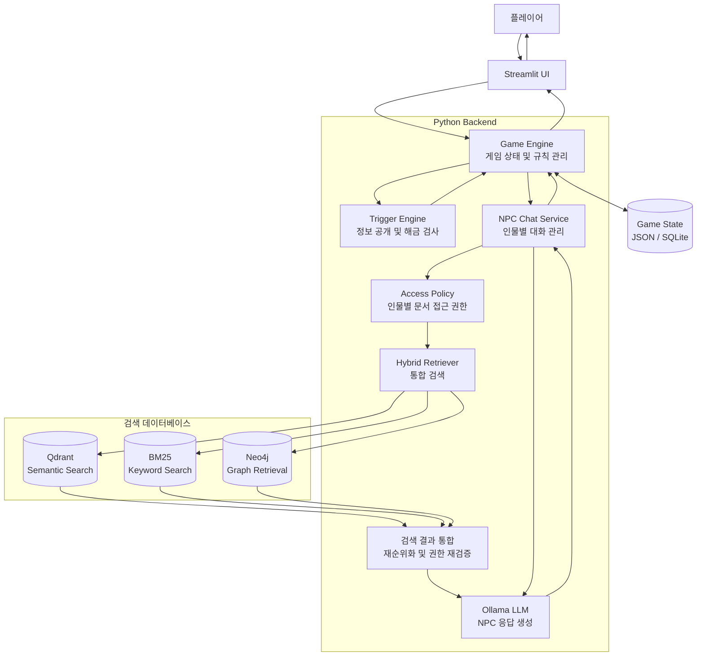
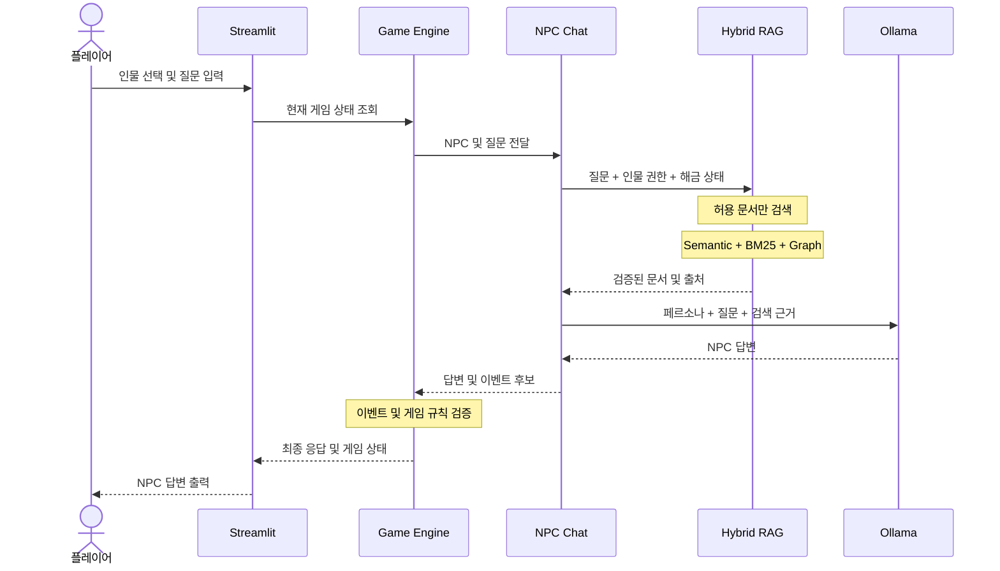
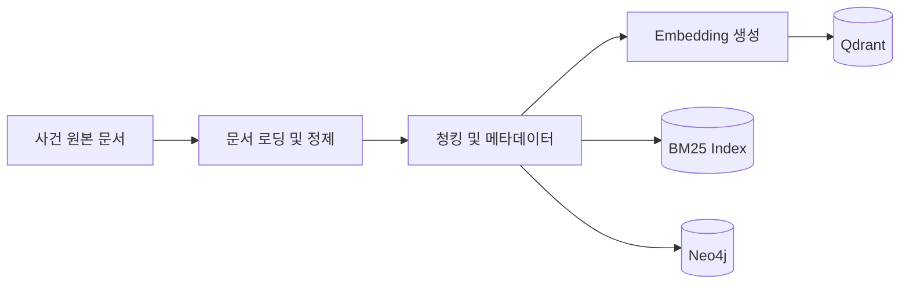

# AI 크라임씬 — 시스템 아키텍처 및 데이터 흐름

## 1. 전체 시스템 아키텍처



## 2. 주요 구성 요소

### Streamlit

플레이어가 게임을 진행하는 사용자 인터페이스이다.

- 사건 소개 및 게임 시작
- 등장인물 선택
- NPC 채팅
- 증거 보관함
- 진술 비교 및 추리 파일
- 범인 지목

### Game Engine

게임 진행 상태와 규칙을 관리한다.

- 현재 게임 상태 조회
- 플레이어 행동 검증
- 증거 수집률 계산
- NPC 해금 상태 관리
- 범인 지목 가능 여부 검증
- 게임 결과 판정

### NPC Chat Service

플레이어가 선택한 인물과의 대화를 처리한다.

- NPC 페르소나 적용
- 플레이어 질문 분석
- Hybrid RAG 검색 요청
- 대화 기록 관리
- Ollama 응답 생성
- 게임 상태에 따른 답변 조정

### Hybrid Retriever

질문과 관련된 사건 문서를 검색한다.

검색 방식은 다음 세 가지를 결합한다.

1. Qdrant Semantic Search
2. BM25 Keyword Search
3. Neo4j Graph Retrieval

검색 결과는 중복 제거와 재순위화를 거쳐 최종 컨텍스트로 구성한다.

### Access Policy

현재 NPC와 게임 진행 상태를 기준으로 접근 가능한 정보를 결정한다.

- 인물별 지식 범위 확인
- 증거 수집 상태 확인
- 해금된 정보 확인
- 검색 대상 문서 제한
- LLM 전달 전 접근 권한 재검증

### Ollama

검색된 사건 정보와 NPC 페르소나를 바탕으로 자연어 답변을 생성한다.

단, 게임 판정이나 증거 획득 여부를 직접 결정하지 않는다.

---

## 3. 사용자 질문 처리 흐름



## 4. 데이터 처리 흐름

RAG 데이터 구축은 게임 실행과 별도로 처리한다.



Neo4j에는 단순 문서 청크가 아니라, 전처리 과정에서 추출하거나 사전에 정의한 인물·사건·증거 관계를 적재한다.

## 5. 보안 및 정보 접근 제어

정보 접근 제어는 두 단계로 수행한다.

**1단계: 검색 이전**

현재 NPC와 플레이어의 진행 상태를 확인하고 허용된 문서만 검색 대상으로 지정한다.

**2단계: LLM 호출 이전**

검색 결과의 문서 및 관계 접근 권한을 다시 확인하고, 비공개 정보를 제거한 후 LLM에 전달한다.

LLM이 생성한 게임 상태 변경 요청은 별도 검증을 거쳐야 한다.

## 6. 향후 Django 확장

1차 프로젝트에서는 Streamlit이 Python Backend를 직접 호출한다.

4차 프로젝트에서는 Django API 계층을 추가할 수 있도록 설계한다.

```text
1차: Streamlit → Python Game Service → RAG / LLM

4차: React 또는 Django Templates
                  ↓
              Django API
                  ↓
          Python Game Service
                  ↓
               RAG / LLM
```

핵심 게임 로직과 AI 검색 기능은 프레임워크에 종속되지 않도록 구현한다.