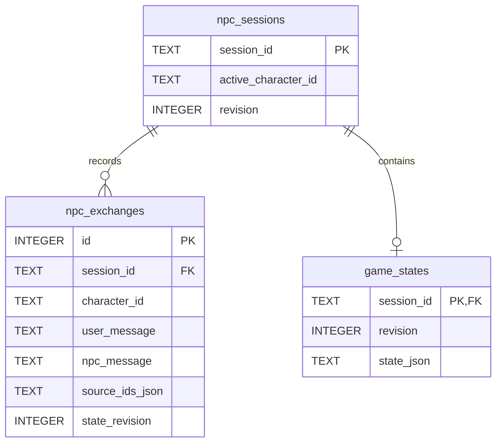

# CASE-001 — 데이터 저장 구조 및 게임 상태 관리

## 1. 개요

본 문서는 AI 크라임씬 《마지막 기록: 사라진 공동체》에서 사용하는 데이터 저장소의 역할과 게임 진행 상태 관리 방식을 설명합니다.

프로젝트는 데이터의 성격에 따라 Qdrant, Neo4j, SQLite 및 로컬 시나리오 파일을 분리하여 사용합니다.

주요 설계 원칙은 다음과 같습니다.

- 검색용 데이터와 플레이어별 게임 상태를 분리합니다.
- 게임의 실제 정답과 비공개 사건 정보는 일반 검색 데이터와 구분합니다.
- 게임 진행 상태는 서버에서 관리하고 SQLite에 영구 저장합니다.
- 데이터 변경 시 유효성 검사와 접근 권한 검증을 수행합니다.
- LLM은 데이터베이스의 게임 상태를 직접 수정하지 않습니다.

---

## 2. 데이터 저장소 구성

| 저장소 | 저장 데이터 | 주요 목적 |
|---|---|---|
| Qdrant | 문서 청크, 임베딩, 검색 메타데이터 | Dense·Sparse 검색 |
| Neo4j | 인물, 사건, 증거 및 관계 그래프 | 관계 기반 검색 |
| SQLite | 게임 세션, NPC 대화 기록, GameState | 게임 진행 상태 영구 저장 |
| JSON | 사건 설정, 증거 규칙, 접근 정책, 비공개 원장 | 원본 시나리오 및 게임 규칙 |
| BM25 | 한국어 토큰 기반 Sparse 벡터 | 키워드 검색 |

BM25는 별도의 관계형 데이터베이스가 아니라 Qdrant의 Sparse 검색 기능과 함께 사용합니다.

## 3. Qdrant — 벡터 데이터베이스

### 3.1 역할

Qdrant는 사건 문서와 NPC 지식 카드를 검색하기 위한 벡터 데이터베이스입니다.

사건 원본을 청킹한 뒤 임베딩을 생성하고, 검색에 필요한 메타데이터와 함께 저장합니다.

### 3.2 컬렉션 구성

현재 구현된 주요 설정은 다음과 같습니다.

| 설정 | 값 |
|---|---|
| 컬렉션 | `case001_rag_v1` |
| Dense Vector | `dense` |
| Dense 차원 | 1024 |
| 유사도 | Cosine |
| Sparse Vector | `bm25` |
| Sparse 설정 | IDF modifier |
| 임베딩 모델 | BGE-M3 |

관련 구현 파일:

- `backend/src/crimescene/db/qdrant_collection.py`
- `backend/src/crimescene/db/qdrant_points.py`
- `backend/src/crimescene/db/qdrant_ingest.py`

기존 컬렉션이 존재할 경우 설정을 검증하며, 정상적인 기존 데이터를 임의로 초기화하지 않습니다.

### 3.3 주요 Payload

Qdrant Point에는 다음과 같은 검색용 메타데이터가 저장됩니다.

| 필드 | 설명 |
|---|---|
| `source_id` | 원본 문서 식별자 |
| `source_type` | 문서 또는 지식 카드 유형 |
| `case_id` | 사건 식별자 |
| `policy_id` | 접근 정책 식별자 |
| `family` | 데이터 분류 |
| `access_scope` | 접근 범위 |
| `character_id` | 관련 NPC |
| `incident_year` | 관련 사건 연도 |
| `content_hash` | 콘텐츠 무결성 확인용 해시 |
| `search_text` | 검색에 사용하는 텍스트 |
| `body` | 청크 본문 |
| `parent_point_id` | 부모 Point 식별자 |
| `chunk_index` | 청크 순서 |
| `chunk_count` | 전체 청크 수 |

관리자 전용 내부 메타데이터는 허용 목록에 포함되지 않는 한 Payload에 저장하지 않습니다.

### 3.4 검색 방식

Qdrant에서는 두 가지 검색 방식을 결합합니다.

**Dense Search**

- BGE-M3 임베딩을 이용한 의미 검색
- Cosine 유사도 기반 문서 검색

**Sparse Search**

- Kiwi 형태소 분석 기반 한국어 토큰 처리
- BM25 가중치를 이용한 키워드 검색
- Qdrant Sparse Vector 검색

검색 후보는 Hybrid RAG에서 통합하며, NPC별 접근 정책 검증 후 사용할 수 있습니다.

---

## 4. Neo4j — 그래프 데이터베이스

### 4.1 역할

Neo4j는 사건의 인물, 증거, 사건 기록 및 연결 관계를 관리합니다.

문서 의미 검색만으로 파악하기 어려운 관계 정보를 검색하는 데 사용합니다.

### 4.2 주요 그래프 구조

현재 구현은 사건 엔티티와 관계를 중심으로 구성됩니다.

| 구성 요소 | 역할 |
|---|---|
| `CaseEntity` | 인물, 증거, 사건 등 사건별 엔티티 |
| `CASE_RELATION` | 엔티티 간 관계 |
| `AdminEvent` | 관리자 전용 사건 타임라인 |
| `AdminEntity` | 관리자 타임라인 관련 엔티티 |
| `ADMIN_MENTIONS` | 관리자 사건 기록의 엔티티 언급 관계 |

관리자 전용 그래프는 일반 플레이어가 접근하는 그래프 지식과 구분하여 처리합니다.

### 4.3 엔티티 식별

`CaseEntity`는 다음 두 값을 이용해 사건별 고유성을 관리합니다.

- `case_id`
- `entity_id`

`CASE_RELATION`은 다음 값을 기준으로 관계 중복을 방지합니다.

- `case_id`
- `edge_id`

관련 파일:

- `backend/src/crimescene/db/neo4j_schema.py`
- `backend/src/crimescene/db/neo4j_ingest.py`
- `backend/src/crimescene/db/neo4j_event_ingest.py`
- `backend/src/crimescene/db/neo4j_evidence_ingest.py`
- `backend/src/crimescene/db/neo4j_sync.py`

### 4.4 접근 권한

그래프에 존재하는 정보라고 해서 NPC가 모든 정보를 공개할 수 있는 것은 아닙니다.

현재 게임 상태와 선택된 NPC를 기준으로 공개 가능한 그래프 지식을 검증합니다.

- 인물별 지식 범위 검증
- 비공개 관계 정보 차단
- 게임 진행에 따른 정보 공개
- 관리자 전용 정보의 플레이어 노출 방지

---

## 5. SQLite — 게임 상태 및 대화 기록

### 5.1 역할

SQLite는 플레이어별 게임 진행 정보를 영구 저장합니다.

새로고침이나 재접속 이후에도 같은 세션의 상태를 복원할 수 있도록 구성했습니다.

현재 사용되는 핵심 테이블은 다음 세 개입니다.

| 테이블 | 주요 역할 |
|---|---|
| `npc_sessions` | 게임 세션과 현재 NPC 선택 상태 |
| `npc_exchanges` | NPC별 대화 기록과 출처 |
| `game_states` | 서버 관리 GameState 저장 |

### 5.2 실제 테이블 구조

**`npc_sessions`**

| 컬럼 | 타입 | 설명 |
|---|---|---|
| `session_id` | TEXT | 기본 키 |
| `active_character_id` | TEXT | 현재 선택된 NPC |
| `revision` | INTEGER | 상태 버전 |

**`npc_exchanges`**

| 컬럼 | 타입 | 설명 |
|---|---|---|
| `id` | INTEGER | 자동 증가 기본 키 |
| `session_id` | TEXT | 게임 세션 외래 키 |
| `character_id` | TEXT | 대화한 NPC |
| `user_message` | TEXT | 플레이어 메시지 |
| `npc_message` | TEXT | NPC 응답 |
| `source_ids_json` | TEXT | 응답 근거 문서 ID 목록 |
| `state_revision` | INTEGER | 대화 당시 게임 상태 버전 |

**`game_states`**

| 컬럼 | 타입 | 설명 |
|---|---|---|
| `session_id` | TEXT | 기본 키 및 세션 외래 키 |
| `revision` | INTEGER | 게임 상태 버전 |
| `state_json` | TEXT | 직렬화된 GameState |

### 5.3 테이블 관계



게임 상태의 증거, 플래그, 해금된 NPC 등은 각각 별도 테이블로 분리하지 않고 `state_json`에 포함됩니다.

### 5.4 대화 기록 저장

NPC 대화 기록에는 플레이어 질문, NPC 응답, 근거 출처 및 상태 버전이 함께 저장됩니다.

기본적으로 NPC별 최신 50개 대화 기록을 유지하도록 구성되어 있으며, 저장소 생성 시 제한을 변경할 수 있습니다.

관련 구현:

- `backend/src/crimescene/chat/npc_session_repository.py`
- `backend/src/crimescene/trigger/atomic_dialogue.py`

---

## 6. GameState — 게임 진행 상태

### 6.1 주요 구조

GameState는 `backend/src/crimescene/scenario/schemas/game_state.py`에서 Pydantic 모델로 정의합니다.

| 필드 | 역할 |
|---|---|
| `case_id` | 사건 식별자 |
| `session_id` | 게임 세션 식별자 |
| `phase` | 현재 게임 단계 |
| `unlocked_characters` | 해금된 NPC 목록 |
| `evidence` | 수집한 증거와 단계 |
| `flags` | 게임 진행 플래그 |
| `presented` | NPC별 증거 제시 기록 |
| `attempts_left` | 남은 범인 지목 기회 |
| `score` | 증거 수집 점수 |
| `outcome` | 게임 결과 |
| `deep_eligible` | 심층 엔딩 조건 |
| `revision` | 상태 변경 버전 |
| `disclosed_cards` | 공개된 NPC 지식 카드 |
| `document_grants` | 열람 권한을 획득한 문서 |

### 6.2 초기 게임 상태

아래는 초기 상태 생성 함수가 반환하는 구조를 예시 세션 ID로 표현한 것입니다.

```json
{
  "case_id": "CASE-001",
  "session_id": "example-session",
  "phase": "PROLOGUE",
  "unlocked_characters": ["C01"],
  "evidence": {},
  "flags": [],
  "presented": {},
  "attempts_left": 3,
  "score": 0,
  "outcome": null,
  "deep_eligible": false,
  "revision": 0,
  "disclosed_cards": [],
  "document_grants": []
}
```

초기 상태에서는 C01만 해금되며, 증거와 점수는 비어 있습니다.

### 6.3 게임 진행 단계

| 단계 | 설명 |
|---|---|
| `PROLOGUE` | 사건 도입 및 프롤로그 |
| `INVESTIGATION` | NPC 조사 및 증거 수집 |
| `ACCUSATION` | 범인 지목 |
| `FINISHED` | 게임 종료 |

단계 전환은 Python 게임 엔진에서 검증합니다.

종료된 게임에 대해서는 일반적인 조사나 추가 지목을 허용하지 않습니다.

### 6.4 증거 상태

증거는 `evidence` 객체로 관리하며, 증거 ID별 진행 단계가 저장됩니다.

예시:

```json
{
  "E01": {
    "stage": "found"
  },
  "E04": {
    "stage": "resolved"
  }
}
```

게임 엔진에서는 `found`, `resolved` 상태의 증거를 수집된 증거로 인정합니다.

### 6.5 증거 제시 기록

`presented`에는 NPC별로 제시된 증거 ID가 기록됩니다.

예시:

```json
{
  "C04": ["E04", "E05"],
  "C06": ["E02"]
}
```

특정 증거를 획득하려면 선행 증거뿐 아니라 정해진 NPC에게 증거를 제시해야 할 수도 있습니다.

---

## 7. 증거 수집 및 게임 진행 규칙

### 7.1 증거 수집

CASE-001에서는 총 10개의 증거를 관리합니다.

증거 획득 시 서버는 다음 조건을 확인합니다.

1. 현재 게임이 조사 단계인지 확인합니다.
2. 선택한 NPC가 해금되어 있는지 확인합니다.
3. 해당 NPC가 증거 보유자인지 확인합니다.
4. 선행 증거 수집 여부를 확인합니다.
5. 필요한 증거 제시와 지식 카드 공개 조건을 검증합니다.
6. 접근 정책을 통과하면 증거와 점수를 갱신합니다.
7. 추가로 해금할 NPC가 있는지 검사합니다.

### 7.2 증거 점수

| 항목 | 값 |
|---|---|
| 전체 증거 | 10개 |
| 전체 점수 | 21점 |
| 지목 최소 증거 | 5개 |
| 지목 최소 점수 | 11점 |

범인 지목에는 증거 수집 개수와 점수 조건을 모두 충족해야 합니다.

증거 점수는 서버가 증거 규칙을 기준으로 계산하며, 클라이언트가 임의로 전달한 점수를 신뢰하지 않습니다.

### 7.3 인물 해금

초기 해금 NPC는 C01입니다.

나머지 NPC는 수집한 증거와 게임 진행 조건에 따라 해금됩니다.

해금 여부는 게임 엔진에서 검증하고 GameState에 저장합니다.

---

## 8. 범인 지목 및 엔딩

### 8.1 범인 지목 조건

범인 지목은 다음 조건을 모두 충족해야 합니다.

- 현재 게임이 조사 또는 지목 단계여야 합니다.
- 증거를 5개 이상 수집해야 합니다.
- 증거 점수가 11점 이상이어야 합니다.
- 남은 지목 기회가 있어야 합니다.
- 게임이 아직 종료되지 않아야 합니다.

### 8.2 지목 결과

| 결과 | 처리 방식 |
|---|---|
| `CORRECT` | 성공 처리 및 게임 종료 |
| `INCORRECT` | 기회 차감, 남은 기회가 있으면 조사 재개 |
| `NOT_ENOUGH_EVIDENCE` | 지목 불가, 기회 차감 없음 |

최대 지목 횟수는 3회입니다.

정답 여부는 서버 전용 사건 원장을 기준으로 판정합니다.

### 8.3 엔딩 접근

엔딩 정보는 게임 종료 이후에만 접근할 수 있습니다.

실패 엔딩에서는 실제 사건 정답이 공개되지 않도록 제한합니다.

관련 구현:

- `backend/src/crimescene/scenario/accusation.py`
- `backend/src/crimescene/scenario/accusation_service.py`
- `backend/src/crimescene/scenario/case_truth.py`

---

## 9. 데이터 무결성 및 트랜잭션

### 9.1 revision 기반 상태 검증

GameState에는 `revision` 필드가 포함됩니다.

서버는 상태를 변경할 때 저장된 revision과 요청의 기준 revision을 비교합니다.

이를 통해 다음 문제를 방지합니다.

- 오래된 게임 상태를 이용한 요청
- 중복 요청에 의한 잘못된 상태 변경
- NPC 선택 상태와 게임 상태 불일치
- 동시에 들어온 요청의 충돌

### 9.2 SQLite 원자적 처리

대화 기록과 게임 상태는 SQLite 트랜잭션을 사용하여 일관성을 유지합니다.

일부 상태 변경 작업에서는 `BEGIN IMMEDIATE`를 사용하여 쓰기 트랜잭션을 시작합니다.

주요 원칙은 다음과 같습니다.

- 게임 상태 변경 중 실패하면 변경을 저장하지 않습니다.
- NPC 대화 기록과 상태 변경을 함께 저장합니다.
- 증거 수집과 NPC 해금을 일관되게 처리합니다.
- 잘못된 revision 요청은 저장하지 않습니다.

### 9.3 세션 분리

게임 진행 정보와 대화 기록은 `session_id`를 기준으로 구분합니다.

다른 세션의 대화 기록이나 게임 상태가 혼합되지 않도록 저장소에서 세션 식별자를 검증합니다.

---

## 10. 비공개 데이터 관리

### 10.1 데이터 분리

프로젝트에서는 다음 데이터를 구분하여 관리합니다.

| 구분 | 설명 |
|---|---|
| 공개 메타데이터 | 사건의 기본 정보 |
| 플레이어 문서 | 게임 진행 중 열람 가능한 문서 |
| NPC 지식 카드 | 등장인물별 허용된 정보 |
| 접근 정책 | 정보 공개 가능 조건 |
| 관리자 사건 기록 | 내부 검증용 사건 정보 |
| 사건 정답 원장 | 범인 판정 및 엔딩에 사용하는 비공개 데이터 |

### 10.2 보안 원칙

- 비공개 시나리오 원본은 공개 GitHub에 포함하지 않습니다.
- API Key와 비밀번호는 환경변수로 관리합니다.
- 정답 원장은 일반적인 NPC 검색 컨텍스트에서 제외합니다.
- NPC별 지식과 플레이어에게 공개할 수 있는 정보를 구분합니다.
- 접근 정책이 없거나 검증에 실패하면 해당 정보의 공개를 차단합니다.
- 클라이언트가 보낸 게임 상태를 신뢰하지 않습니다.

---

## 11. 주요 구현 파일

| 경로 | 역할 |
|---|---|
| `db/connections.py` | Qdrant·Neo4j 연결 |
| `db/qdrant_collection.py` | Qdrant 컬렉션 관리 |
| `db/qdrant_ingest.py` | 문서 임베딩 적재 |
| `db/neo4j_schema.py` | 그래프 제약조건 및 인덱스 |
| `db/neo4j_ingest.py` | 사건 엔티티 및 관계 적재 |
| `chat/npc_session_repository.py` | SQLite NPC 대화 기록 저장 |
| `trigger/atomic_dialogue.py` | 게임 상태와 NPC 대화의 원자적 저장 |
| `scenario/schemas/game_state.py` | GameState 모델 |
| `scenario/game_progress.py` | 게임 진행 상태 관리 |
| `scenario/evidence_collection.py` | 증거 수집 |
| `scenario/accusation.py` | 범인 지목 판정 |

위 경로는 모두 `backend/src/crimescene/`을 기준으로 작성했습니다.

## 12. 관련 문서

- [시스템 개요](./01-system-overview.md)
- [시스템 처리 흐름](./02-system-flow.md)
- [모듈 인터페이스](./03-module-interfaces.md)
- [프로젝트 README](../../README.md)