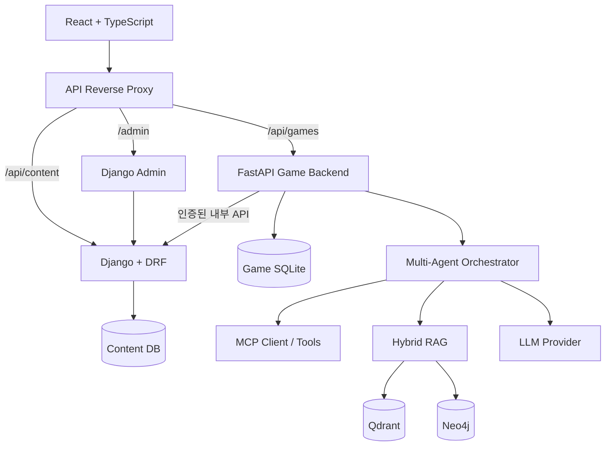

# Day 1 — Django·FastAPI 시스템 아키텍처 설계

## 1. 작업 정보

- 프로젝트: 마지막 기록: 졸업하지 못한 밤
- 날짜: 2026-11-20
- GitHub Issue: #93
- 브랜치: feature/93-django-architecture
- 기준 브랜치: dev
- 기준 커밋: ae30edd
- 문서 상태: 아키텍처 설계안 확정 / 구현 전

## 2. 설계 목표

기존 FastAPI 기반 게임 엔진과 Hybrid RAG를 유지하면서
Django + Django REST Framework를 콘텐츠 관리 서비스로 도입한다.

핵심 원칙:

1. FastAPI가 게임 진행 상태의 유일한 변경 주체이다.
2. Django는 콘텐츠 정의, 검증, 게시 및 관리자 기능을 담당한다.
3. 두 서비스의 데이터베이스 소유권을 분리한다.
4. 기존 /api/games 경로와 응답의 하위 호환성을 유지한다.
5. 비공개 사건 정답과 미해금 정보는 공개 API에서 제외한다.
6. Multi-Agent와 MCP는 게임 상태를 직접 수정하지 않는다.

## 3. 전체 시스템 아키텍처



위 구성은 목표 아키텍처이며 아직 구현된 상태가 아니다.

## 4. 서비스별 책임

### 4.1 Django + DRF

담당 기능:

- 사건 메타데이터 관리
- NPC 콘텐츠 관리
- 챕터와 목표 콘텐츠 관리
- 증거 메타데이터 및 조건 정의
- 스토리 이벤트 정의
- 콘텐츠 버전 검증 및 게시
- Django Admin 관리자 기능
- 공개 콘텐츠 조회 API
- 내부 콘텐츠 스냅샷 API

Django는 실제 플레이어의 게임 점수, 획득 증거,
해금 상태, 지목 결과를 변경하지 않는다.

### 4.2 FastAPI

기존 기능 유지:

- 게임 세션 생성과 복원
- NPC 선택 및 대화
- 증거 획득 판정
- 증거 해금 및 NPC 해금
- 게임 진행 단계 전환
- 범인 지목 및 엔딩 판정
- 플레이어 접근 권한 검증
- SQLite 게임 상태 영구 저장
- Hybrid RAG 검색 및 응답 검증

확장 예정:

- CH00~CH04 챕터 상태 관리
- 챕터별 수사 목표
- STORY_EVENT 생성 및 전달
- E01~E30 증거 지원
- Multi-Agent Orchestrator
- MCP Client 및 권한 검증
- endingKey 및 지목 차단 사유

기존 API 경로 /api/games/...는 유지한다.

## 5. Django 프로젝트 위치

```text
backend/
├── src/
│   └── crimescene/
│       ├── api/
│       ├── scenario/
│       ├── trigger/
│       ├── chat/
│       ├── retriever/
│       ├── ingest/
│       └── db/
├── tests/
├── pyproject.toml
├── uv.lock
│
└── django_service/
    ├── manage.py
    ├── pyproject.toml
    ├── uv.lock
    ├── config/
    ├── apps/
    │   └── content/
    └── tests/
```

django_service는 독립 Python 프로젝트로 구성한다.

- FastAPI 기존 의존성 유지
- Django 의존성 별도 관리
- 각 서비스별 가상환경 분리
- Django 설정은 환경변수 기반
- Django 버전은 실제 설치 시 확정

이 구조는 구현 예정 디렉터리 설계이다.

## 6. Django 콘텐츠 데이터 모델

초기 핵심 모델은 6개로 구성한다.

### 6.1 Case

- case_id: 사건 고유 ID
- title: 사건 제목
- description: 공개 소개
- status: 콘텐츠 관리 상태

역할: 사건별 콘텐츠 묶음 관리

### 6.2 Chapter

- case: Case 참조
- code: CH00~CH04
- order: 챕터 순서
- title: 챕터 제목
- summary: 콘텐츠 요약
- metadata: 추가 메타데이터

역할: 챕터 콘텐츠 정의

### 6.3 Character

- case: Case 참조
- character_id: C01~C10
- name: 인물 이름
- profile: 공개 가능한 프로필
- metadata: 내부 콘텐츠 메타데이터

역할: NPC 콘텐츠 관리

비공개 진범 원장과 관리자 전용 사건 진실은
Character 공개 프로필에 포함하지 않는다.

### 6.4 Evidence

- case: Case 참조
- evidence_id: E01~E30
- name: 증거 이름
- holder: 관련 NPC 참조
- score: 증거 점수
- prerequisites: 선행 증거 ID 목록
- metadata: 기타 증거 규칙

역할: 증거 정의와 획득 조건 관리

증거 획득 가능 여부는 FastAPI가 최종 판정한다.

### 6.5 StoryEvent

- chapter: Chapter 참조
- event_key: 이벤트 고유 ID
- trigger_type: 이벤트 발생 조건 유형
- conditions: 이벤트 조건
- payload: 이벤트 콘텐츠

역할: 챕터·증거·대화 연계 이벤트 정의

실제 이벤트 발생 여부와 상태 변경은 FastAPI 담당.

### 6.6 ContentRelease

- case: Case 참조
- version: 게시 버전
- manifest: 콘텐츠 스냅샷
- checksum: 무결성 검증값
- published_at: 게시 시각

역할: 검증된 콘텐츠 버전 고정 및 배포

게시된 버전은 불변으로 관리한다.

## 7. 데이터 소유권

| 데이터 | Owner | 저장소 |
|---|---|---|
| 사건 메타데이터 | Django | Content DB |
| 챕터 정의 | Django | Content DB |
| NPC 콘텐츠 | Django | Content DB |
| 증거 정의 | Django | Content DB |
| 이벤트 정의 | Django | Content DB |
| 게시 콘텐츠 버전 | Django | Content DB |
| 게임 세션 | FastAPI | Game SQLite |
| 게임 진행 상태 | FastAPI | Game SQLite |
| 증거 획득 상태 | FastAPI | Game SQLite |
| NPC 대화 기록 | FastAPI | Game SQLite |
| 지목 및 엔딩 결과 | FastAPI | Game SQLite |
| 비공개 사건 정답 | FastAPI | 서버 전용 저장소 |
| RAG 임베딩 | 검색 파이프라인 | Qdrant |
| 인물 및 증거 관계 | 검색 파이프라인 | Neo4j |

두 서비스는 상대 서비스 소유 DB를 직접 수정하지 않는다.

개발 환경에서는 Content DB와 Game DB를 각각
별도 SQLite 파일로 구성할 수 있다.

운영 환경의 Content DB는 PostgreSQL 사용을 우선 검토한다.

Game SQLite의 운영 확장은 동시 접속 규모와
배포 방식 검증 후 별도로 결정한다.

## 8. 서비스 간 통신

### 8.1 콘텐츠 게시

1. 관리자가 Django Admin에서 콘텐츠 작성
2. Django에서 필드 및 관계 검증
3. 참조 무결성과 콘텐츠 접근 등급 검증
4. 검증에 성공하면 콘텐츠 버전 생성
5. ContentRelease 스냅샷과 checksum 저장
6. 게시 버전을 내부 API로 제공

검증에 실패한 콘텐츠는 게시하지 않는다.

### 8.2 FastAPI 콘텐츠 로딩

1. FastAPI가 인증된 내부 API 요청
2. Django가 게시된 콘텐츠 스냅샷 반환
3. FastAPI가 기존 Pydantic 스키마와 확장 규칙 검증
4. checksum 및 참조 무결성 확인
5. 검증된 버전을 로컬 캐시에 보관
6. 새 게임 세션에 콘텐츠 버전 연결

실행 중인 게임은 지정된 콘텐츠 버전을 유지한다.

콘텐츠 조회 장애 발생 시 검증된 캐시를 활용하고,
유효한 버전이 없으면 게임 시작을 차단한다.

### 8.3 API 경로 구분

FastAPI:
- /api/games/...

Django 공개 콘텐츠 API:
- /api/content/...

Django 관리자:
- /admin/

Django 내부 콘텐츠 API:
- /internal/content/releases/{version}

내부 API는 외부 Reverse Proxy에서 공개하지 않는다.

위 Django API 경로는 구현 예정 계약이다.

## 9. 인증과 보안

### 9.1 플레이어 인증

- 기존 FastAPI HMAC 세션 소유권 검증 유지
- HttpOnly 쿠키 사용
- 운영 HTTPS 환경에서 Secure 활성화
- 게임 상태를 프론트엔드 입력만으로 변경하지 않음

### 9.2 Django 관리자

- Django 관리자 인증 사용
- Staff 및 권한별 접근 제한
- CSRF 보호 유지
- 관리자 API의 공개 접근 금지
- 운영 환경에서 SECRET_KEY 외부 주입

### 9.3 내부 서비스 인증

- FastAPI와 Django 간 서버 전용 인증
- 내부 네트워크 통신 제한
- 서비스 토큰을 환경변수 또는 Secret Manager로 관리
- 토큰 로그 출력 금지
- 요청 타임아웃 및 오류 처리
- 운영 환경에서 TLS 적용

### 9.4 콘텐츠 노출 방지

공개 API에서 제외할 정보:

- 진범과 사건 정답
- 관리자 전용 비밀 문서
- NPC의 비공개 지식
- 미해금 증거 원문
- 내부 해금 조건
- 사건의 비공개 관계 데이터

공개 콘텐츠 API는 별도 Serializer 허용 목록을 사용한다.

Django 내부 스냅샷도 인증된 서비스에만 제공한다.

## 10. Multi-Agent 확장 구조

Multi-Agent Orchestrator는 FastAPI 게임 엔진 내부에 둔다.

예정 역할:

- NPC Dialogue Agent
- Evidence Retrieval Agent
- Story Context Agent
- Response Validation Agent

Agent는 현재 게임 상태의 읽기 전용 컨텍스트를 사용한다.

게임 상태 변경이 필요하면 FastAPI 도메인 서비스에
검증된 변경 요청을 전달해야 한다.

LLM 출력만으로 증거 해금이나 엔딩을 확정하지 않는다.

## 11. MCP 확장 구조

FastAPI 내부에 MCP Client를 배치한다.

예정 Tool:

- search_evidence
- search_character_relations
- get_authorized_context
- get_chapter_context

MCP Tool은 호출 시 다음을 검증한다.

- 세션 소유권
- 현재 선택된 NPC
- 현재 게임 단계
- 증거 해금 상태
- 요청 데이터의 접근 등급

Tool의 입력으로 전달된 권한 정보는 신뢰하지 않는다.
서버가 검증한 상태를 기반으로 권한을 결정한다.

MCP 서버 및 Tool 구현은 Day 2 이후 진행한다.

## 12. 개발 환경 구성

| 서비스 | 개발 포트 |
|---|---|
| React / Vite | 5173 |
| FastAPI | 8000 |
| Django + DRF | 8001 |
| Qdrant | 6333 |
| Neo4j HTTP | 7474 |
| Neo4j Bolt | 7687 |
| Ollama | 11434 |

포트는 개발 환경 기준 설계값이다.

React는 기존 FastAPI 연결을 유지하고,
Django 콘텐츠 API는 별도의 프록시 경로로 연결한다.

개발 및 운영 환경의 CORS, 쿠키, 프록시 설정은
Django 초기 구성 및 배포 이슈에서 검증한다.

## 13. 기존 코드와의 호환성

현재 확인한 주요 제한:

- 일부 증거 입력 검증이 E01~E10으로 고정됨
- 해금 규칙 로더에서 증거 목록 고정 검증
- 증거 발견 카드 ID가 하드코딩됨
- 증거 총점 21점 하드코딩
- 현재 GameState에 chapter/objective 필드 없음

기존 SQLite GameState의 역직렬화 호환성을 유지해야 한다.

Django 콘텐츠 모델 추가만으로 E11~E30의
실제 획득과 해금 기능이 자동 지원되는 것은 아니다.

해당 기능은 별도 게임 엔진 확장 이슈에서 구현한다.

## 14. 후속 개발 항목

- API 계약 v3.0 작성
- Django 및 DRF 설치
- Django 콘텐츠 모델 구현
- Django Admin 및 Serializer 구현
- 콘텐츠 게시·검증 서비스 구현
- ContentRelease 내부 API 구현
- FastAPI 콘텐츠 클라이언트 구현
- 동적 증거/챕터 지원
- Multi-Agent 및 MCP 연동
- 통합 테스트와 실제 배포

## 15. 설계 결론

기존 FastAPI를 게임 상태의 단일 관리 주체로 유지한다.

Django는 콘텐츠 정의·검증·게시·조회와
관리자 기능을 담당하는 독립 서비스로 도입한다.

서비스 간 데이터 전달은 인증된 내부 API와
불변 콘텐츠 버전으로 처리한다.

기존 게임 엔진과 RAG를 재사용하며,
실제 기능 구현 및 테스트는 후속 하위 이슈에서 수행한다.
