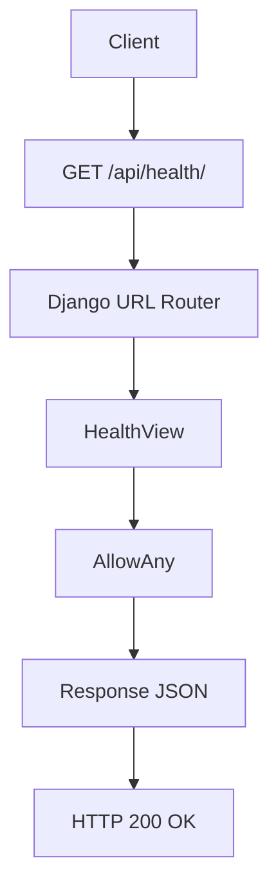

# Day 1 — Django Health API 구현 및 자동화 테스트

## 1. 작업 개요

| 항목 | 내용 |
|---|---|
| GitHub Issue | #99 |
| 작업 브랜치 | `feature/99-django-health-api` |
| 선행 작업 | #97 Django + DRF 초기 구축 |
| 목적 | Django 서비스 상태 확인 API 및 자동화 테스트 구현 |
| 개발 환경 | Python 3.13 / Django 5.2 / DRF 3.16 |
| 개발 포트 | 8001 |
| 작업 상태 | 구현 및 테스트 완료 |

### 개발 목표

기존 FastAPI와 독립적으로 실행되는 Django 서비스의 상태를 확인할 수 있는 Health API를 구현하고, API 계약을 검증하는 자동화 테스트를 추가합니다.

---

## 2. 구현 파일

| 파일 | 역할 |
|---|---|
| `backend/django_service/config/health.py` | Health APIView 구현 |
| `backend/django_service/config/urls.py` | Health API URL 라우팅 등록 |
| `backend/django_service/config/tests.py` | API 자동화 테스트 |

기존 FastAPI의 게임 진행 및 RAG 로직은 변경하지 않았습니다.

## 3. API 명세

### GET /api/health/

**요청**

```http
GET /api/health/ HTTP/1.1
Accept: application/json
```

**성공 응답**

HTTP Status: `200 OK`

Content-Type: `application/json`

```json
{
  "status": "ok",
  "service": "django"
}
```

### 접근 정책

- 별도 로그인 불필요
- `AllowAny` 사용
- 해당 API에서 세션 인증 처리 비활성화
- 다른 API의 전역 `IsAuthenticated` 설정은 유지

### 지원 메서드

| HTTP 메서드 | 처리 |
|---|---|
| GET | 200 OK |
| POST | 405 Method Not Allowed |

POST를 제외한 다른 메서드의 응답은 현재 자동화 테스트 범위에 포함되지 않았습니다.

---

## 4. API 처리 흐름



### 구현 방식

1. `config/urls.py`에서 `/api/health/` 경로를 등록합니다.
2. 요청을 `HealthView.as_view()`로 전달합니다.
3. `HealthView.get()`이 상태 정보를 생성합니다.
4. DRF `Response`를 통해 JSON 데이터를 반환합니다.

---

## 5. 자동화 테스트

테스트 프레임워크: `rest_framework.test.APITestCase`

### 테스트 케이스

| 테스트 | 검증 항목 | 기대 결과 | 실제 결과 |
|---|---|---|---|
| `test_health_get_without_authentication` | 비로그인 GET 요청 | 200 | PASS |
| `test_health_response_schema` | JSON 데이터 및 Content-Type | 지정된 응답 | PASS |
| `test_health_post_not_allowed` | POST 요청 | 405 | PASS |

### 실행 명령어

Django 프로젝트 디렉터리에서 실행합니다.

```powershell
uv run python manage.py test --verbosity 2
```

### 실제 실행 결과

```text
Found 3 test(s).
System check identified no issues (0 silenced).

test_health_get_without_authentication ... ok
test_health_post_not_allowed ... ok
test_health_response_schema ... ok

----------------------------------------------------------------------
Ran 3 tests in 0.011s

OK
```

**최종 결과: 3개 테스트 전부 통과**

### 테스트 데이터베이스

Django 테스트 실행기는 별도의 메모리 기반 SQLite 테스트 데이터베이스를 생성합니다.

```text
Creating test database for alias 'default'
('file:memorydb_default?mode=memory&cache=shared')

...

Destroying test database for alias 'default'
```

기존 개발용 `db.sqlite3`에 저장된 관리자 계정과 데이터를 사용하지 않고 독립적으로 실행됩니다.

---

## 6. 실제 HTTP 요청 검증

PowerShell에서 Django 서버에 직접 GET 요청을 보내 확인했습니다.

**검증 결과**

```text
HTTP Status: 200
Content-Type: application/json
Response: {"status":"ok","service":"django"}
Health API GET Test: PASS
```

이를 통해 Django 개발 서버 실행 상태, 비로그인 HTTP 요청 처리, JSON 응답 반환을 확인했습니다.

---

## 7. 검증 범위 및 제한 사항

### 검증 완료

- Django URL 라우팅
- DRF APIView 응답
- 비로그인 GET 요청
- JSON 응답 형식
- POST 요청에 대한 405 응답
- 테스트 자동 탐색
- Django 시스템 검사

### 현재 Health API의 범위

이 API는 Django 프로세스의 HTTP 응답 가능 여부를 확인하는 Liveness Check입니다.

다음 항목은 검사하지 않습니다.

- SQLite 데이터베이스 연결 상태
- 기존 FastAPI 서버 상태
- Qdrant 연결 상태
- Neo4j 연결 상태
- LLM 서비스 정상 여부
- 콘텐츠 API 데이터 정합성

외부 의존성의 준비 상태를 확인하는 Readiness Check는 별도 설계가 필요합니다.

---

## 8. 후속 작업

- 콘텐츠 데이터 모델 구현
- Django Admin 콘텐츠 등록 및 관리 기능
- DRF 콘텐츠 조회 API
- 내부 API 인증 및 접근 제어
- FastAPI ↔ Django 서비스 연동
- CI 환경에서 Django 테스트 실행

## 9. 완료 기준

- [x] Health API 구현
- [x] `/api/health/` 라우팅
- [x] HTTP 200 및 JSON 응답
- [x] 비로그인 접근
- [x] POST 405 검증
- [x] APITestCase 3개 통과
- [x] 전체 테스트 자동 탐색
- [x] Django 시스템 검사
- [x] 실제 HTTP 요청 검증
- [x] 테스트 결과 문서 작성

**구현 및 검증 완료. Git 커밋과 PR 병합은 별도 진행합니다.**