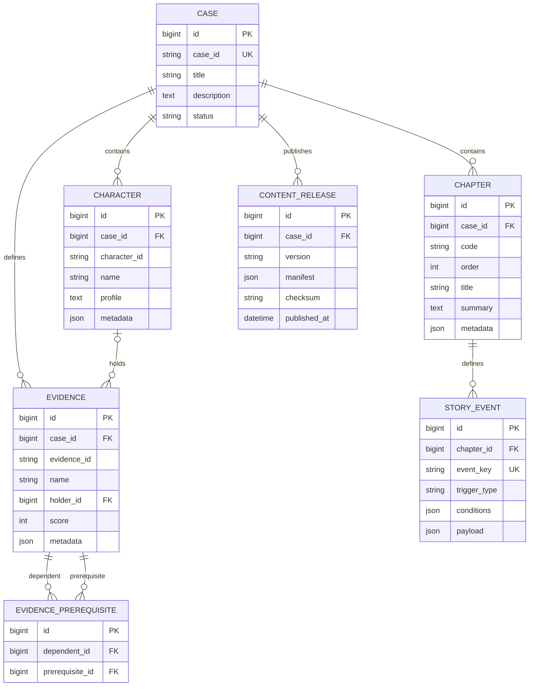
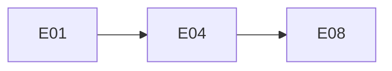
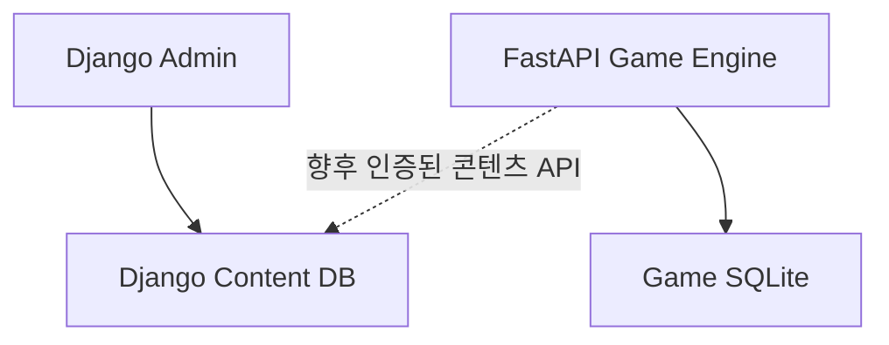

# Day 2 — Django 콘텐츠 데이터베이스 ERD

## 1. 문서 정보

- 프로젝트: 마지막 기록: 졸업하지 못한 밤
- GitHub Issue: #102
- 브랜치: feature/102-content-schema
- ORM: Django 5.2
- 개발 DB: SQLite
- 문서 상태: 구현 전 설계

관련 문서:
- [콘텐츠 스키마 정의서](./01-content-schema.md)
- [Day 1 아키텍처](../day1/02-django-architecture.md)
- [API Contract v3.0](../day1/03-api-contract-v3.md)

## 2. ERD 설계 목표

1. 사건별 콘텐츠를 독립적으로 관리한다.
2. PK와 비즈니스 식별자를 구분한다.
3. ForeignKey로 참조 관계를 명확히 한다.
4. 데이터 중복을 줄이고 정규화한다.
5. 잘못된 관계와 참조를 검증한다.
6. 게임 상태와 콘텐츠 정의를 분리한다.
7. 게시 버전의 무결성과 변경 이력을 보존한다.

## 3. 전체 ERD

### ERD 해석

- CASE는 사건 콘텐츠의 최상위 엔티티다.
- CHAPTER, CHARACTER, EVIDENCE는 CASE에 속한다.
- STORY_EVENT는 CHAPTER에 속한다.
- EVIDENCE는 선택적으로 CHARACTER를 참조한다.
- EVIDENCE_PREREQUISITE는 증거 간 선행 관계를 표현한다.
- CONTENT_RELEASE는 특정 사건의 게시 버전이다.

ERD의 `UK` 표기는 단일 컬럼 UNIQUE를 의미한다.
Chapter, Character, Evidence, ContentRelease의
복합 UNIQUE 제약은 아래 관계 및 제약조건 표에 별도 정의한다.

## 4. 테이블별 관계 정의

| 부모 | 자식 | 관계 | FK | 삭제 정책 |
|---|---|---|---|---|
| Case | Chapter | 1:N | chapter.case_id | PROTECT |
| Case | Character | 1:N | character.case_id | PROTECT |
| Case | Evidence | 1:N | evidence.case_id | PROTECT |
| Case | ContentRelease | 1:N | contentrelease.case_id | PROTECT |
| Chapter | StoryEvent | 1:N | storyevent.chapter_id | PROTECT |
| Character | Evidence | 1:N | evidence.holder_id | PROTECT |
| Evidence | EvidencePrerequisite | 1:N | dependent_id | 별도 정의 |
| Evidence | EvidencePrerequisite | 1:N | prerequisite_id | 별도 정의 |

Character와 Evidence 관계는 선택적이다.

Evidence.holder는 NULL을 허용한다.
NPC를 반드시 소유자로 지정할 필요는 없다.

## 5. Evidence 선행 관계 설계

### 5.1 개념

일부 증거는 다른 증거를 확보해야 획득할 수 있다.

예시:

- E01: 최초 조사로 수집 가능한 증거
- E04: E01을 확인한 뒤 획득 가능한 증거
- E08: E04를 확보한 뒤 획득 가능한 증거

위 관계는 설계 설명을 위한 예시이며,
확정된 CASE-001 스토리 데이터가 아니다.

### 5.2 관계도

### 5.3 테이블 구조

Evidence는 자기참조 M:N 관계를 가진다.

논리적 연결 테이블:

`content_evidence_prerequisite`

| 컬럼 | 설명 |
|---|---|
| id | 연결 레코드 PK |
| dependent_id | 획득 조건을 가지는 증거 |
| prerequisite_id | 먼저 확보해야 하는 증거 |

복합 UNIQUE:
- UNIQUE(dependent_id, prerequisite_id)

검증 규칙:
- 자기 자신을 선행 증거로 지정 금지
- 서로 다른 사건의 증거 참조 금지
- 중복 선행 관계 금지
- 순환 선행 관계 금지

### 5.4 Django 구현 고려사항

자기참조 ManyToManyField는 `symmetrical=False`가 필요하다.

복합 검증 및 삭제 보호를 위해
명시적 `through` 모델 도입을 우선 검토한다.

명시적 through 모델을 사용하면 주요 도메인 모델
6개 외에 연결용 Django 모델이 1개 추가될 수 있다.

참조 무결성만으로 교차 사건 관계나
순환 관계를 모두 방지할 수는 없다.

Django 모델 검증과 관계 추가 서비스에
별도의 검증이 필요하다.

자동 생성 M:N 테이블은 삭제 보호를
자동으로 보장하지 않으므로 구현 시 확인한다.

### 구현 결정

명시적 EvidencePrerequisite through 모델을 사용한다.

주요 콘텐츠 모델 6개와 별도로
선행 증거 관계 모델 1개를 구현한다.

연결 테이블명:
content_evidence_prerequisite

삭제 정책:
- dependent: PROTECT
- prerequisite: PROTECT

검증:
- 자기참조 금지: DB CheckConstraint
- 중복 관계 금지: DB UniqueConstraint
- 서로 다른 사건의 증거 연결 금지: 서비스 계층
- 순환 관계 금지: 서비스 계층

Django Admin과 애플리케이션 코드에서
동일한 관계 검증 규칙을 사용한다.

## 게시 콘텐츠 불변성 구현 경계

ContentRelease는 게시 완료 후 일반적인
모델 및 서비스 계층에서 수정·삭제를 차단한다.

Django Admin에서도 읽기 전용 정책을 적용한다.

단, QuerySet.update(), bulk 작업 및 직접 SQL은
일반적인 모델 검증을 우회할 수 있다.

DB 수준의 완전한 불변성을 보장하려면
별도의 DB 권한 정책이나 트리거가 필요하다.

Day 2에서는 ORM 및 관리자 접근 경로의
수정 차단을 구현·검증하고,
운영 DB의 강제 정책은 배포 설계에서 검토한다.

## 6. 복합 UNIQUE 제약조건

| 모델 | UNIQUE 조합 | 목적 |
|---|---|---|
| Case | case_id | 사건 ID 중복 방지 |
| Chapter | case, code | 사건별 챕터 ID 중복 방지 |
| Chapter | case, order | 챕터 순서 중복 방지 |
| Character | case, character_id | 사건별 NPC ID 중복 방지 |
| Evidence | case, evidence_id | 사건별 증거 ID 중복 방지 |
| EvidencePrerequisite | dependent, prerequisite | 선행 관계 중복 방지 |
| StoryEvent | event_key | 이벤트 키 전역 중복 방지 |
| ContentRelease | case, version | 사건별 버전 중복 방지 |

구현 시 Django Meta.constraints의
UniqueConstraint 사용을 기준으로 한다.

## 7. 정규화 검토

### 7.1 제1정규형(1NF)

각 컬럼은 정의된 데이터 타입에 맞는 값을 저장한다.

NPC 여러 명의 이름을 하나의 문자열 컬럼에
구분자로 연결해 저장하지 않는다.

### 7.2 제2정규형(2NF)

사건 정보는 Case에만 저장한다.

Chapter, Character, Evidence 등은
사건 제목을 중복 저장하는 대신 FK로 연결한다.

### 7.3 제3정규형(3NF)

다른 엔티티로 관리해야 하는 속성을
불필요하게 복제하지 않는다.

예를 들어 Evidence가 NPC 이름을 별도로 저장하는 대신
holder FK를 통해 Character를 참조한다.

### 7.4 JSONField 사용 원칙

JSONField는 다음과 같은 유연한 콘텐츠 설정에 사용한다.

- 추가적인 콘텐츠 메타데이터
- 스토리 이벤트 조건
- 이벤트 출력 payload
- 게시 버전의 불변 스냅샷

JSONField는 정규화를 자동 보장하지 않는다.

자주 조인하거나 제약조건을 적용해야 하는
핵심 관계는 FK 또는 연결 테이블로 관리한다.

## 8. 인덱스 설계

| 조회 대상 | 조회 조건 | 인덱스 검토 |
|---|---|---|
| Case | case_id | UNIQUE 인덱스 활용 |
| Chapter | case, order | 복합 UNIQUE 활용 |
| Character | case, character_id | 복합 UNIQUE 활용 |
| Evidence | case, evidence_id | 복합 UNIQUE 활용 |
| StoryEvent | chapter, trigger_type | 복합 인덱스 후보 |
| ContentRelease | case, version | 복합 UNIQUE 활용 |

이미 UNIQUE 또는 FK 인덱스가 존재한다면
동일한 용도의 중복 인덱스를 생성하지 않는다.

실제 조회 패턴과 EXPLAIN 결과에 따라
추가 인덱스를 결정한다.

## 9. 삭제 정책

### PROTECT

하위 데이터가 존재할 경우
상위 데이터 삭제를 제한한다.

적용 대상:
- Case에 연결된 Chapter
- Case에 연결된 Character
- Case에 연결된 Evidence
- Chapter에 연결된 StoryEvent
- Case에 연결된 ContentRelease

### Evidence 선행 관계

연결 테이블의 삭제 정책은
실제 through 모델 설계 시 확정한다.

선행 조건으로 사용되는 증거를 삭제할 때
다른 증거의 획득 규칙이 손상되지 않도록 보호한다.

### ContentRelease

게시된 콘텐츠는 수정·삭제할 수 없도록 설계한다.

Django Admin의 읽기 전용 설정만으로
DB 수준의 불변성이 보장되지는 않는다.

모델·서비스 계층의 수정 경로와
관리 명령 및 직접 업데이트 경로를 검토한다.

## 10. 데이터 소유권

### Django Content DB

정적인 콘텐츠 정의 및 게시 버전 관리

- Case
- Chapter
- Character
- Evidence
- StoryEvent
- ContentRelease

### FastAPI Game DB

플레이어별 게임 상태 및 실제 판정

- 세션
- 증거 획득
- NPC 해금
- 챕터 진행
- 이벤트 발생 이력
- 지목 결과
- 엔딩 결과

두 DB 사이에 직접 ForeignKey를 생성하지 않는다.

서비스 간 데이터 전달은
향후 인증된 API를 통해 처리한다.

## 11. 비공개 콘텐츠 보호

### 외부 공개 가능 정보

- 사건 제목
- 사건 공개 소개
- 공개 챕터 제목
- 공개 NPC 프로필

### 내부 전용 정보

- 진범 정답
- 비공개 증거 내용
- 증거 해금 조건
- NPC 내부 지식 카드
- 이벤트 발동 조건
- ContentRelease 전체 manifest

Django 공개 Serializer는 허용 필드 목록을
명시적으로 정의한다.

metadata, conditions, manifest 등은
기본 공개 대상에서 제외한다.

## 12. 예상 데이터 흐름

### 콘텐츠 작성

관리자
→ Django Admin
→ Django ORM
→ Content DB

### 콘텐츠 게시 (후속 구현)

관리자
→ 콘텐츠 검증
→ ContentRelease 생성
→ 체크섬 계산
→ 게시 버전 확정

### 게임 실행 (후속 구현)

FastAPI
→ 인증된 콘텐츠 조회
→ 콘텐츠 검증 및 캐시
→ GameState에 버전 고정
→ 플레이어 게임 진행

## 13. 테스트 설계

- [ ] Case 생성 및 중복 검사
- [ ] Chapter 관계 및 순서 중복 검사
- [ ] Character ID 중복 검사
- [ ] Evidence 점수 검사
- [ ] Evidence 선행 관계 검사
- [ ] Evidence 순환 참조 검사
- [ ] StoryEvent 조건 검증
- [ ] ContentRelease 버전 중복 검사
- [ ] 게시된 Release 수정 방지
- [ ] FK 삭제 보호 검사
- [ ] Django Migration 검사
- [ ] 기존 FastAPI 회귀 테스트

## 14. 설계 검토 결과

| 검토 항목 | 설계 결과 |
|---|---|
| 핵심 콘텐츠 모델 | 6종 |
| 선행 증거 관계 | 자기참조 M:N |
| 주요 콘텐츠 관계 | ForeignKey |
| 비즈니스 ID | 내부 PK와 분리 |
| 중복 방지 | UNIQUE 제약 |
| 삭제 보호 | PROTECT 중심 |
| 복합 규칙 검증 | 모델 및 서비스 계층 |
| 게시 버전 | 불변 정책 |
| Django/FastAPI DB | 분리 |
| 공개/비공개 데이터 | 별도 접근 정책 |

## 15. 후속 구현

- Issue #103: Case·Chapter·Character
- Issue #104: Evidence·StoryEvent
- Issue #105: ContentRelease
- Issue #106: Django Admin
- Issue #107: 통합 테스트 및 문서화

본 ERD는 구현 전 설계 문서이다.

실제 Migration에서 생성되는 물리적 테이블,
제약조건 및 인덱스는 ORM 구현 후 다시 검증한다.
