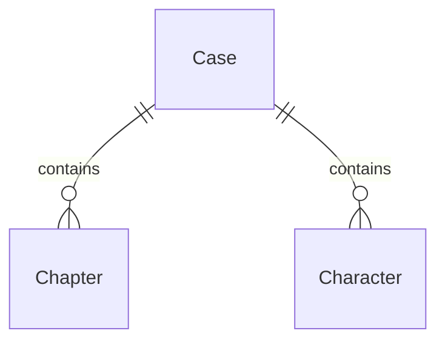

# Day 2 — Django 핵심 ORM 모델 구현 및 테스트

## 1. 작업 개요

| 항목 | 내용 |
|---|---|
| GitHub Issue | #103 |
| 작업 브랜치 | `feature/103-core-models` |
| 선행 이슈 | #102 콘텐츠 DB 설계 |
| 기술 스택 | Python 3.13 / Django 5.2 / SQLite |
| 구현 모델 | Case, Chapter, Character |
| Migration | `content.0001_initial` |
| 작업 결과 | 모델 구현 및 자동화 테스트 통과 |

## 2. 개발 목적

4차 단위 프로젝트의 Django 콘텐츠 관리 서비스에서 사건, 챕터, NPC의 기본 정보를 저장하고 관리할 수 있도록 ORM 모델을 구현합니다.

기존 FastAPI의 게임 상태 관리와 분리하여 Django가 콘텐츠 정의 및 메타데이터를 관리하도록 구성합니다.

## 3. 구현 모델

### 3.1 Case

테이블: `content_case`

| 필드 | 타입 | 설명 |
|---|---|---|
| id | BigAutoField | 내부 PK |
| case_id | CharField(20) | 사건 고유 ID |
| title | CharField(200) | 사건 제목 |
| description | TextField | 공개 사건 소개 |
| status | CharField(20) | 콘텐츠 관리 상태 |

구현 사항:

- `CASE-001` 형식의 ID 검증
- 사건 ID UNIQUE 제약
- DRAFT, REVIEW, PUBLISHED, ARCHIVED 상태 정의
- 상태값 DB CHECK 제약 적용

### 3.2 Chapter

테이블: `content_chapter`

| 필드 | 타입 | 설명 |
|---|---|---|
| id | BigAutoField | 내부 PK |
| case | ForeignKey(Case) | 소속 사건 |
| code | CharField(10) | 챕터 코드 |
| order | PositiveIntegerField | 챕터 순서 |
| title | CharField(200) | 챕터 제목 |
| summary | TextField | 챕터 요약 |
| metadata | JSONField | 추가 콘텐츠 설정 |

구현 사항:

- Case와 1:N 관계
- `on_delete=PROTECT`
- CH00~CH04 형식 검증
- UNIQUE(case, code)
- UNIQUE(case, order)
- JSONField 기본값 `dict`

### 3.3 Character

테이블: `content_character`

| 필드 | 타입 | 설명 |
|---|---|---|
| id | BigAutoField | 내부 PK |
| case | ForeignKey(Case) | 소속 사건 |
| character_id | CharField(10) | NPC 고유 ID |
| name | CharField(100) | NPC 이름 |
| profile | TextField | 공개용 프로필 |
| metadata | JSONField | 내부 메타데이터 |

구현 사항:

- Case와 1:N 관계
- `on_delete=PROTECT`
- C01~C10 형식 검증
- UNIQUE(case, character_id)
- 공개 프로필과 내부 메타데이터 분리

필드 분리만으로 API 접근 제어가 완성되는 것은 아니며, 공개 Serializer는 후속 이슈에서 구현해야 합니다.

## 4. 모델 관계



Case 하나에는 여러 Chapter와 Character가 연결될 수 있습니다.

## 5. Migration

생성 파일:

`backend/django_service/apps/content/migrations/0001_initial.py`

실행 명령:

```powershell
uv run python manage.py makemigrations content
uv run python manage.py sqlmigrate content 0001
uv run python manage.py migrate content
```

검증 결과:

```text
Applying content.0001_initial... OK

content
 [X] 0001_initial
```

실제 생성된 테이블:

- `content_case`
- `content_chapter`
- `content_character`

## 6. 자동화 테스트 결과

테스트 파일:

`backend/django_service/apps/content/tests.py`

| 테스트 | 결과 |
|---|---|
| 사건 생성 및 조회 | PASS |
| 잘못된 사건 ID 검증 | PASS |
| 챕터 관계 검증 | PASS |
| 챕터 코드 중복 방지 | PASS |
| 챕터 순서 중복 방지 | PASS |
| NPC 관계 검증 | PASS |
| NPC ID 중복 방지 | PASS |
| 연결된 사건 삭제 방지 | PASS |

### ORM 테스트

```powershell
uv run python manage.py test apps.content.tests --verbosity 2
```

결과:

```text
Ran 8 tests in 0.010s

OK
```

### Django 전체 테스트

```powershell
uv run python manage.py test --verbosity 2
```

결과:

```text
Ran 11 tests in 0.021s

OK
```

전체 구성:

- 콘텐츠 ORM 테스트: 8개
- 기존 Health API 테스트: 3개
- 성공: 11개
- 실패: 0개

## 7. 무결성 및 보안 설계

- 내부 PK와 비즈니스 ID 구분
- ForeignKey를 통한 관계형 데이터 관리
- UNIQUE 제약으로 중복 방지
- PROTECT 정책으로 ORM 삭제 보호
- JSONField 기본값에 `default=dict` 사용
- 공개용 NPC 프로필과 내부 메타데이터 구분

### 검증 범위의 한계

`RegexValidator`는 Django 모델 검증 단계에서 실행되므로 `full_clean()` 등을 호출해야 합니다.

`Model.save()`만으로 모든 필드 검증이 자동 수행되지는 않습니다.

이번 테스트에서는 사건 ID 형식, 주요 중복 제약 및 참조 삭제 보호를 검증했습니다. Chapter·Character의 잘못된 ID 형식과 사건 간 동일한 비즈니스 ID 허용 여부 등 추가 경계 조건은 향후 테스트를 보강할 수 있습니다.

## 8. 기존 시스템 영향

- 기존 FastAPI 게임 엔진 변경 없음
- 기존 게임 SQLite 변경 없음
- Django Content DB에 새로운 테이블 3개 추가
- Qdrant 및 Neo4j 검색 구조 변경 없음
- Django Health API 회귀 테스트 통과

기존 FastAPI 회귀 테스트는 이번 단계에서 별도로 실행하지 않았습니다.

## 9. 후속 작업

- #104 Evidence 및 StoryEvent 모델 구현
- #105 ContentRelease 모델 구현
- #106 Django Admin 관리 기능
- #107 통합 테스트 및 최종 문서화

## 10. 완료 기준

- [x] Case 모델 구현
- [x] Chapter 모델 구현
- [x] Character 모델 구현
- [x] 관계 및 UNIQUE 제약 설정
- [x] 초기 Migration 생성
- [x] Migration 적용
- [x] SQL 구조 검토
- [x] ORM 테스트 8개 통과
- [x] Django 전체 테스트 11개 통과
- [x] 구현 및 테스트 결과 문서 작성
- [ ] Git 커밋 및 PR 병합

**현재 상태: 구현 및 검증 완료, Git 반영 전**