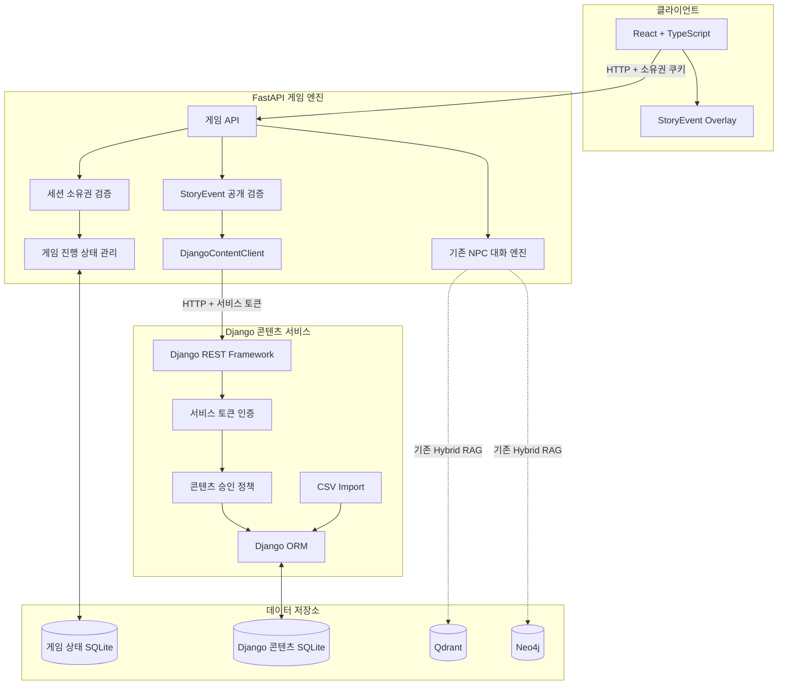
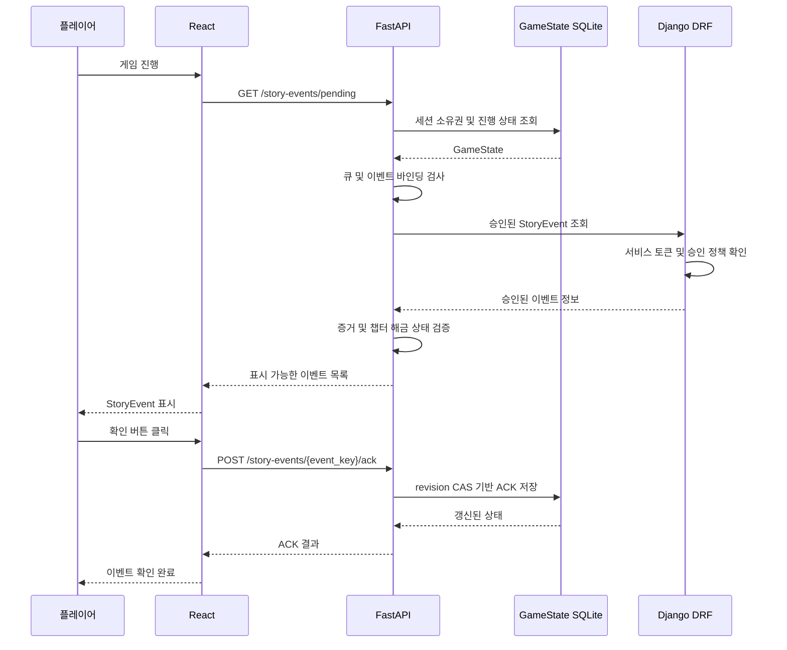
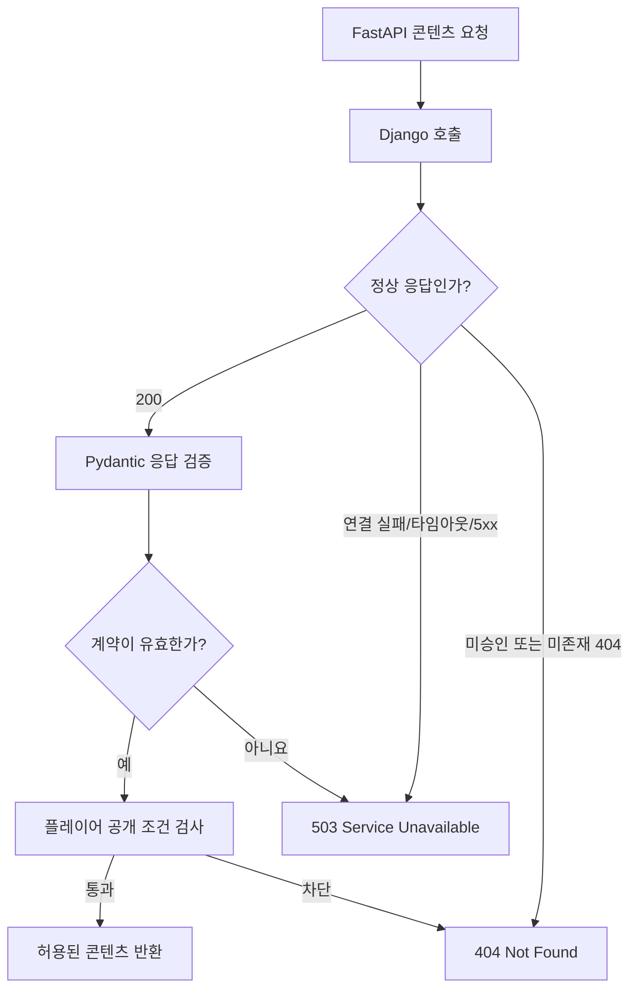

# Day 3 — Django–FastAPI 콘텐츠 통합 시스템 아키텍처

## 1. 아키텍처 설계 목적

기존 AI 추리 게임은 FastAPI 기반으로 게임 세션, NPC 대화, 증거 수집 및 엔딩 판정을 처리합니다.

Day 3에서는 콘텐츠 관리 기능을 Django로 분리하고, 기존 FastAPI 게임 엔진과 안전하게 연동하는 구조를 구현했습니다.

### 핵심 설계 원칙

1. **책임 분리:** Django는 콘텐츠 정의를, FastAPI는 플레이어 진행 상태를 관리합니다.
2. **최소 권한:** 내부 콘텐츠 API는 서비스 전용 토큰으로 보호합니다.
3. **기본 거부:** 검토·승인되지 않은 콘텐츠는 공개하지 않습니다.
4. **상태 기반 접근 제어:** 승인된 콘텐츠도 플레이어의 증거·챕터 진행 상태를 확인합니다.
5. **장애 격리:** Django 장애가 발생해도 미승인 콘텐츠를 대체 응답으로 공개하지 않습니다.
6. **기존 기능 호환:** 기존 Hybrid RAG 및 게임 API를 유지합니다.

## 2. 전체 시스템 아키텍처



### 구성 요소

| 계층 | 기술 | 담당 기능 |
|---|---|---|
| Presentation | React | 사용자 게임 화면 |
| Game API | FastAPI | 게임 세션과 진행 상태 |
| Content Client | httpx / Pydantic | Django 통신 및 응답 검증 |
| Content API | Django REST Framework | 내부 콘텐츠 조회 |
| Content Management | Django ORM | 콘텐츠 모델 및 승인 |
| Game Storage | SQLite | 세션 상태, 이벤트 ACK |
| Content Storage | SQLite | 사건, 인물, 증거, 이벤트 |
| Search | Qdrant / Neo4j | 기존 Hybrid RAG |

## 3. Django 콘텐츠 서비스

### 3.1 담당 기능

Django는 게임 콘텐츠의 원본 데이터와 관리 정책을 담당합니다.

관리 대상:

- Case: 사건 기본 정보
- Chapter: 챕터
- Scene: 스토리 장면
- Character: NPC
- Evidence: 증거
- EvidencePrerequisite: 증거 선행 조건
- EvidenceLink: 증거 간 추론 관계
- StoryEvent: 스토리 이벤트
- NPCCard: NPC 지식 카드
- NPCDialogueTrigger: 대화 트리거
- CharacterRelationship: 인물 관계
- Objective: 플레이어 목표
- ContentRelease: 콘텐츠 게시 버전

### 3.2 콘텐츠 공개 정책

콘텐츠를 외부에 반환하기 전 다음 기준을 검증합니다.

1. 콘텐츠가 존재하는지 확인
2. 사건의 게시 상태 확인
3. 콘텐츠 런타임 승인 여부 확인
4. 콘텐츠 유형별 공개 정책 검증
5. 허용된 필드만 응답에 포함

**주의:** Django의 승인 검증은 플레이어 개인의 해금 검증과 별도입니다.

예를 들어 Django에서 승인된 Scene이라도 `ENGINE_ONLY` 또는 `UNLOCKED_ONLY`라면 현재 플레이어용 Scene API가 그대로 반환하지 않습니다.

## 4. FastAPI 게임 엔진

### 4.1 담당 기능

FastAPI는 플레이어별 게임 상태를 관리합니다.

- 세션 생성 및 소유권 검증
- 챕터 진행 상태
- 증거 획득 상태
- NPC 해금 상태
- StoryEvent 큐
- 이벤트 확인 이력
- 게임 엔딩 판정
- 기존 NPC 대화 및 RAG 연동

### 4.2 Django 콘텐츠 클라이언트

파일:

`backend/src/crimescene/api/django_content_client.py`

역할:

- Django 내부 API에 서비스 토큰 전달
- URL 및 입력 식별자 검증
- HTTP 요청 타임아웃 적용
- 네트워크 연결 실패 처리
- 응답 크기 제한
- Pydantic 데이터 계약 검증
- 요청 ID와 응답 ID 일치 확인
- 내부 오류 메시지 및 비공개 필드 차단

주요 호출 메서드:

| 메서드 | 기능 |
|---|---|
| `get_case_overview()` | 사건 및 챕터 개요 |
| `get_player_scene()` | 승인된 플레이어용 Scene |
| `get_evidence_requirements()` | 증거 선행 조건 |
| `get_approved_npc_cards()` | 승인된 NPC 카드 |
| `get_approved_story_event()` | 승인된 StoryEvent |

### 4.3 StoryEvent 전달 검증

이벤트는 다음 조건을 모두 충족해야 합니다.

- 게임 상태가 올바른 CASE-001 세션인지 확인
- 현재 게임 단계가 조사 단계인지 확인
- 게임이 종료되지 않았는지 확인
- 이벤트가 서버의 StoryEvent 큐에 존재
- 서버에서 검증된 이벤트 바인딩 존재
- 관련 챕터가 해금되어 있고 현재 챕터와 일치
- Django에서 승인된 이벤트를 조회
- 이벤트에 필요한 증거를 획득
- 기존에 ACK 처리되지 않은 이벤트

조건이 충족되지 않으면 이벤트 본문을 반환하지 않습니다.

## 5. StoryEvent 전달 시퀀스



## 6. ACK 처리 구조

### 처리 목적

사용자가 같은 이벤트를 여러 번 확인하더라도 중복 저장이나 불필요한 revision 변경이 발생하지 않도록 합니다.

### 구현 방식

1. 기존 GameState 조회
2. 해당 이벤트의 ACK 여부 확인
3. 아직 ACK되지 않았다면 공개 조건 재검증
4. revision CAS 기반 상태 저장
5. 동시 요청이 발생하면 최신 상태 재조회
6. 이미 ACK된 경우 멱등 성공 반환

### 반환 데이터

```json
{
  "eventKey": "EVT-CH01-901",
  "acknowledged": true,
  "created": true,
  "revision": 3
}
```

위 값은 API 응답 구조를 설명하기 위한 예시입니다. 이벤트 ID와 revision은 실제 게임 상태에 따라 달라집니다.

## 7. 장애 대응

### Django 연결 실패



### 장애 처리 정책

| 장애 유형 | 처리 |
|---|---|
| 연결 실패 | 503 |
| 응답 타임아웃 | 503 |
| Django 인증 실패 | FastAPI에서 503 |
| 응답 JSON 오류 | 503 |
| 비공개 필드 포함 | 503 |
| 응답 크기 초과 | 503 |
| 미승인 StoryEvent | 404 또는 pending 목록에서 제외 |
| 게임 상태 충돌 | 409 |
| 세션 소유권 오류 | 404 |

Django 호출이 중간에 실패하면 이미 수집한 일부 이벤트만 반환하지 않습니다.

## 8. 서비스 간 보안

### 8.1 인증

FastAPI에서 Django로 요청할 때 다음 헤더를 사용합니다.

```http
X-Content-Service-Token: <SERVICE_TOKEN>
```

Django는 설정된 서비스 토큰과 전달된 값을 비교합니다.

- 미설정: 접근 거부
- 누락: 접근 거부
- 불일치: 접근 거부
- 관리자 로그인 세션만 보유: 내부 API 접근 거부

### 8.2 콘텐츠 정보 보호

- 미승인 이벤트는 원문을 반환하지 않습니다.
- 내부 메타데이터는 공개 API 응답에서 제외합니다.
- 플레이어에게 Django 서비스 토큰을 전달하지 않습니다.
- Pydantic 모델은 예상하지 않은 필드를 거부합니다.
- 비공개 정답 데이터는 프론트엔드에 포함하지 않습니다.

### 8.3 통신 보안

`DjangoContentClient`는 원격 서비스 URL에 HTTPS를 요구합니다.

로컬 개발용 HTTP는 다음 호스트에서만 허용합니다.

- `localhost`
- `127.0.0.1`
- `::1`

## 9. 환경변수

| 환경변수 | 설명 | 기본값 |
|---|---|---|
| `DJANGO_CONTENT_ENABLED` | Django 연동 사용 | `false` |
| `DJANGO_EVIDENCE_GATE_ENABLED` | Django 증거 게이트 사용 | `false` |
| `DJANGO_CONTENT_BASE_URL` | Django 내부 서버 주소 | `http://127.0.0.1:8001` |
| `DJANGO_CONTENT_TIMEOUT_SECONDS` | Django 요청 제한 시간 | `3.0` |
| `DJANGO_CONTENT_SERVICE_TOKEN` | 서비스 인증 비밀값 | 비어 있음 |

### 주의사항

실제 배포 환경에서는 서비스 인증 토큰을 안전하게 관리하고, 네트워크 접근 범위를 최소화해야 합니다.

기본값에서는 Django 콘텐츠 연동이 비활성화되어 있으며, 실제 StoryEvent가 자동으로 공개되지 않습니다.

## 10. 검증 범위와 제한

### 자동화 검증 완료

- Django ORM 및 DRF 테스트
- Import 정합성·멱등성·롤백
- FastAPI 콘텐츠 응답 계약
- Django 장애 응답 처리
- StoryEvent ACK 및 상태 보존
- React 빌드 및 스포일러 검사

### 추가 검증 필요

- 실제 서버 프로세스 간 네트워크 E2E
- 운영 환경 인증 토큰 전달
- 운영 DB Migration
- 실제 콘텐츠 승인 및 공개 정책 확인
- 실제 게임 플레이에서 이벤트 자동 발동
- Multi-Agent 및 MCP 추가 후 전체 시스템 회귀

## 11. 설계 결론

Django와 FastAPI의 책임을 분리하여 콘텐츠 관리 기능을 확장하면서 기존 게임 엔진을 유지하는 기반을 구축했습니다.

핵심은 **Django의 콘텐츠 승인과 FastAPI의 플레이어 진행 상태를 모두 통과한 콘텐츠만 공개하는 구조**입니다.

이번 단계에서는 이를 위한 API, 상태 저장 및 검증 로직을 구현했으며, 실제 정본 콘텐츠의 운영 활성화는 별도 승인 절차 이후 진행합니다.
