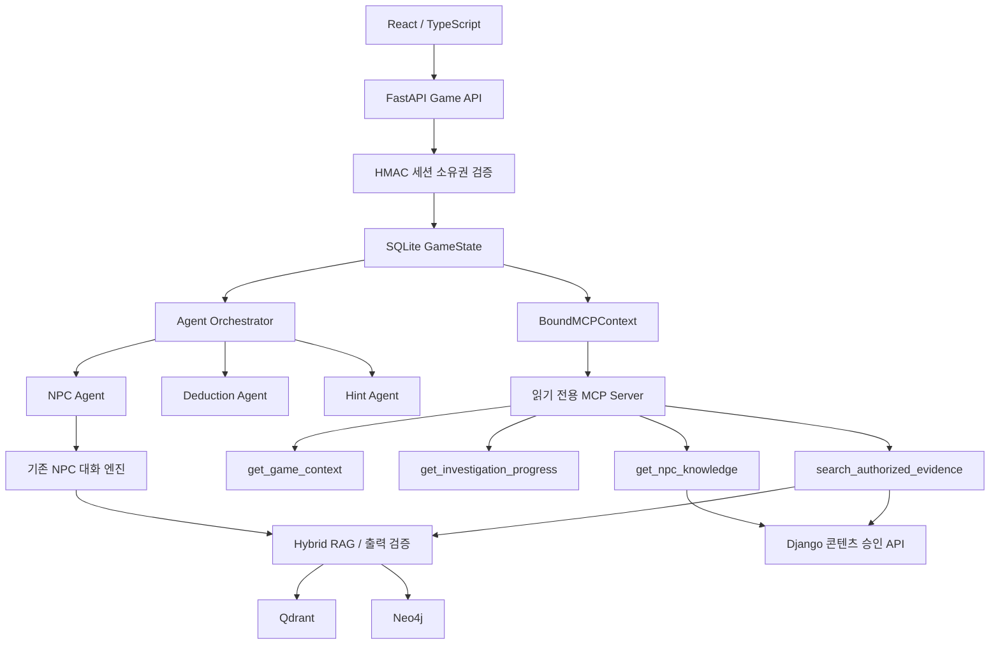

# Day 4 — Multi-Agent 및 MCP 통합 아키텍처

## 1. 개요

| 항목 | 내용 |
|---|---|
| 프로젝트 | 마지막 기록: 졸업하지 못한 밤 |
| 개발 단계 | 4차 단위 프로젝트 Day 4 |
| 관련 이슈 | #127, #129~#135 |
| Python | 3.13.15 |
| MCP | Python SDK 2.x |
| 작성 기준일 | 2026-11-23 |

### 개발 목적

기존 FastAPI·Django·Hybrid RAG 기반 AI 추리 게임을 Multi-Agent 구조로 확장하고, 서버 인증 및 게임 상태 접근 정책을 재사용하는 읽기 전용 MCP Server를 구축합니다.

기존 게임 엔진을 재작성하지 않고 NPC 대화, 추론, 힌트 제공의 책임을 분리합니다.

## 2. 최종 시스템 아키텍처



이 도식은 현재 존재하는 실행 구성요소와 내부 연결 지점을 나타냅니다.

**주의:** Agent가 MCP Tool을 직접 호출하는 협업 워크플로는 아직 구현되지 않았습니다. 현재 Orchestrator 경로와 MCP 경로는 동일한 서버 게임 상태를 공유하며, 통합 테스트에서 일관성을 확인했습니다.

## 3. 주요 구성요소

| 구성요소 | 구현 파일 | 역할 |
|---|---|---|
| FastAPI | `api/app.py` | 인증 및 게임 API |
| Agent 계약 | `agents/contracts.py` | 요청·컨텍스트·결과 스키마 |
| Agent Registry | `agents/registry.py` | 허용된 Agent 등록 및 조회 |
| Orchestrator | `agents/orchestrator.py` | 실행 전후 상태·근거 검증 |
| NPC Agent | `agents/npc_agent.py` | 기존 NPC 대화 엔진 Adapter |
| Deduction Agent | `agents/deduction_agent.py` | 보유 증거 기반 추론 지원 |
| Hint Agent | `agents/hint_agent.py` | 3단계 규칙 기반 힌트 |
| MCP Context | `mcp/context.py` | 서버 검증 상태 스냅샷 |
| MCP Server | `mcp/server.py` | 읽기 전용 Tool 4종 |
| NPC MCP 접근 제어 | `mcp/npc_tools.py` | 승인된 NPC 지식 제한 |
| Evidence MCP 접근 제어 | `mcp/evidence_tools.py` | 승인된 증거 문서 제한 |

위 Python 모듈의 기준 경로는 `backend/src/crimescene/`입니다.

## 4. Multi-Agent 실행 구조

### 4.1 Agent Orchestrator

실행 흐름:

1. 서버 저장소에서 최신 GameState 조회
2. AgentContext와 최신 상태 비교
3. 조사 단계 및 NPC 선택 상태 검증
4. AgentRegistry에서 대상 Agent 선택
5. Agent 실행
6. 읽기 전용 Agent의 게임 상태 변경 검사
7. 결과의 Agent 유형 및 근거 ID 검증
8. 검증된 결과 반환

읽기 전용 Agent는 `DEDUCTION`, `HINT`입니다.

NPC Agent는 기존 원자적 대화 처리 경로를 사용하므로 게임 상태 변경 가능성이 있습니다.

### 4.2 NPC Agent

`NPCAgent`는 기존 `run_case001_npc_dialogue_atomic()`을 Adapter 방식으로 호출합니다.

주요 책임:
- 서버에서 선택된 NPC 확인
- 증거 제시 조건 검증
- 기존 RAG 및 출력 검증 로직 재사용
- 기존 대화 결과 형식 유지
- 게임 상태와 NPC 세션의 저장 경로 유지

실제 FastAPI `/api/games/{session_id}/chat` 요청은 Orchestrator를 통해 NPC Agent로 전달됩니다.

### 4.3 Deduction Agent

플레이어가 확보한 증거와 공개 가능한 관계·문서를 기반으로 추론을 지원합니다.

제한사항:
- 미획득 증거의 ID를 근거로 사용하지 않음
- 비공개 관계 및 문서 제외
- 범인·모순 여부를 증거 없이 확정하지 않음
- GameState 변경 금지

현재 구현은 보유 증거의 관련성을 검토하는 규칙 기반 MVP입니다.

### 4.4 Hint Agent

현재 챕터와 확보한 증거를 사용해 3단계 힌트를 제공합니다.

| 단계 | 기능 |
|---|---|
| 1단계 | 현재 조사 방향 안내 |
| 2단계 | 확보한 증거 재검토 안내 |
| 3단계 | 해금된 NPC를 활용한 후속 질문 제안 |

미획득 증거와 미해금 NPC는 힌트 근거로 사용하지 않습니다.

## 5. MCP 아키텍처

### 5.1 인증 경계

MCP Server 생성 전 FastAPI의 기존 HMAC 쿠키 인증을 수행합니다.

```text
FastAPI Request
  → HMAC Cookie Validation
  → SQLite GameState
  → NPC Selection / Revision Validation
  → BoundMCPContext
  → Session-scoped MCP Server
  → MCP Client Tool Call
```

`BoundMCPContext`는 인증을 대신하지 않습니다. 반드시 서버가 소유권을 확인한 후 생성해야 합니다.

### 5.2 MCP Tool 4종

| Tool | 반환 정보 |
|---|---|
| `get_game_context` | 진행 단계, 현재 챕터, 해금 정보, 확보 증거, revision |
| `get_investigation_progress` | 증거 수집 현황, 점수, 진행률, 지목 가능 여부 |
| `get_npc_knowledge` | 현재 NPC에 대해 Django 승인과 게임 접근 정책을 통과한 지식 |
| `search_authorized_evidence` | 보유 증거에 연결된 승인 문서의 검색 결과 |

MCP Tool에는 세션 ID, 사건 ID, 서비스 인증 토큰을 입력 인자로 노출하지 않습니다.

### 5.3 증거 검색 경로

```text
검색어 검증
  → 서버 GameState 검증
  → Hybrid RAG 검색
  → 접근 허용 결과 필터링
  → 신뢰 원본 문서 대조
  → 수집 증거 여부 확인
  → Django 승인·선행 조건 확인
  → GameState 재검증
  → 검색 결과 반환
```

Qdrant 검색 결과는 단독으로 공개 권한을 부여하지 않습니다.

### 5.4 NPC 지식 검색 경로

```text
서버 검증 NPC 선택
  → Django 승인 카드 조회
  → 신뢰 원본과 내용 비교
  → NPC 접근 정책 평가
  → 최신 GameState 재검증
  → 허용된 지식만 반환
```

## 6. 상태 저장 및 동시성

SQLite의 `GameState.revision`을 이용해 오래된 상태에서 실행하는 것을 차단합니다.

- Orchestrator는 실행 전 최신 상태를 재조회합니다.
- Deduction·Hint 실행 중 상태 변경을 감지합니다.
- MCP는 바인딩된 상태 스냅샷과 현재 상태를 비교합니다.
- 검색 및 Django 조회 이후 상태를 재검증합니다.
- NPC 대화는 기존 원자적 저장 경로를 사용합니다.

## 7. 외부 노출 범위

현재 구현된 외부 API:

- 게임 생성 및 진행 API
- NPC 선택 API
- NPC 채팅 API
- 증거 조회·수집 API
- 진행률 및 범인 지목 API

현재 구현되지 않은 외부 인터페이스:

- 공개 `/mcp` HTTP 엔드포인트
- Deduction·Hint 전용 플레이어 HTTP API
- Agent가 자율적으로 MCP Tool을 선택·호출하는 협업 워크플로

MCP Server는 FastAPI 내부의 인증된 실행 컨텍스트에서 사용하도록 설계했습니다.

## 8. 결론

Day 4에서는 기존 게임 엔진 위에 NPC·Deduction·Hint Agent와 읽기 전용 MCP Server를 추가했습니다.

기존 Hybrid RAG, GameState, Django 콘텐츠 승인 정책을 재사용했으며, 실제 MCP 프로토콜 호출과 서버 인증 기반 통합 테스트를 수행했습니다.

향후 구현 과제는 Agent별 MCP 호출 정책 강제, 자율적인 Agent 협업 워크플로 및 실제 외부 서비스 기반 E2E 검증입니다.