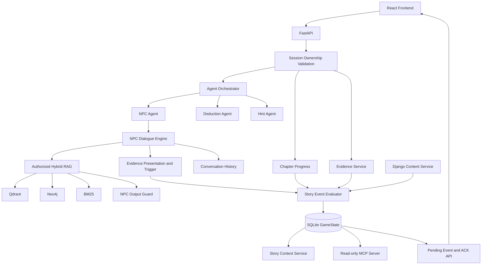

# Day 5 — NPC Dialogue & Story Architecture

## 1. 개발 개요

- 프로젝트: 마지막 기록: 졸업하지 못한 밤
- 개발 일자: 2026-11-24
- 상위 이슈: #143
- 기준 커밋: 770228d
- 개발 브랜치: test/148-day5-story-integration

## 2. 개발 목적

기존 Hybrid RAG 기반 AI 추리 게임에 NPC 대화 기억,
서버 기반 Story Context, 챕터 진행 및 연계 스토리
이벤트 기능을 통합한다.

플레이어의 입력이나 LLM의 생성 결과가 게임 진행 권한을
직접 변경하지 않도록 서버 중심의 진행 구조를 유지한다.

## 3. 전체 시스템 아키텍처

## 4. 기술 구성

| 계층 | 기술 | 역할 |
|---|---|---|
| Frontend | React, TypeScript, Vite | 게임 플레이 및 이벤트 UI |
| Game API | FastAPI | 게임 상태 및 진행 API |
| Content Service | Django | 콘텐츠 관리 및 공개 승인 |
| Agent | Multi-Agent Architecture | NPC, 추론, 힌트 역할 분리 |
| Tool | MCP Python SDK | 읽기 전용 게임 정보 조회 |
| Vector Database | Qdrant | 의미 기반 검색 |
| Graph Database | Neo4j | 인물 및 증거 관계 검색 |
| Retrieval | Dense, BM25, RRF | Hybrid RAG 검색 및 결과 결합 |
| State Storage | SQLite | 게임 상태 및 대화 저장 |
| Validation | Pydantic | 요청 및 콘텐츠 스키마 검증 |
| Testing | pytest, Django TestCase | 자동화 테스트 |
| Static Analysis | Ruff | Python 코드 품질 검사 |

## 5. Day 5 하위 이슈

| 이슈 | 구현 내용 |
|---|---|
| #144 | NPC 대화 일관성 및 기억 고도화 |
| #145 | Story Context 서비스 |
| #146 | Chapter Progress 및 Scene API |
| #147 | Story Event Queue 및 전달 연동 |
| #148 | 통합 테스트 및 문서화 |

## 6. NPC Dialogue 개선

### 6.1 처리 흐름

1. 플레이어 세션 소유권 검증
2. 현재 NPC 및 GameState 조회
3. AgentContext 생성
4. Agent Orchestrator 실행
5. NPC Agent 실행
6. 증거 제시 및 Trigger 검증
7. 접근 가능한 문서 및 NPC 지식 검색
8. 승인된 대화 이력 반영
9. LLM 응답 생성 및 출력 검증
10. 공개된 지식 카드 기록
11. Story Event 발생 조건 평가
12. SQLite 원자적 저장

### 6.2 대화 기억 관리

- 최근 최대 4개 대화 이력을 활용한다.
- 현재 승인된 근거와 일치하는 기억만 재사용한다.
- 대체된 과거 진술은 답변 기억에서 제외한다.
- 다른 NPC의 비공개 정보는 사용하지 않는다.
- 과거 사용자 입력을 시스템 명령으로 승격하지 않는다.
- 기존 NPC Output Guard를 유지한다.

## 7. Story Context Service

StoryContextService는 서버 GameState를 기반으로
현재 공개 가능한 게임 진행 정보를 구성한다.

| 데이터 | 설명 |
|---|---|
| session_id | 게임 세션 식별자 |
| revision | 상태 버전 |
| phase | 게임 진행 단계 |
| current_chapter | 현재 챕터 |
| unlocked_chapters | 해금된 챕터 |
| unlocked_characters | 해금된 NPC |
| collected_evidence_ids | 수집된 증거 |
| presented evidence | NPC별 증거 제시 기록 |
| flags | 서버 내부 진행 플래그 |
| disclosed_card_ids | 공개된 NPC 지식 카드 |

Story Context는 서버 내부 읽기 전용 객체이며,
전체 내부 필드를 플레이어에게 그대로 반환하지 않는다.

## 8. Agent 및 MCP 책임 분리

| 구성 요소 | 상태 변경 | 책임 |
|---|---|---|
| NPC Agent | 허용 | 대화 및 검증된 진행 처리 |
| Deduction Agent | 불허 | 보유 증거 기반 추론 |
| Hint Agent | 불허 | 진행 상황 기반 힌트 |
| MCP Tools | 불허 | 공개 가능한 게임 정보 조회 |
| Story Context | 불허 | 검증된 상태 스냅샷 제공 |

## 9. 상태 정합성

GameState revision을 기준으로 Agent, MCP 및
Story Context의 실행 시점 정합성을 검증한다.

이전 revision의 실행 컨텍스트는 재사용하지 않는다.

## 10. 현재 구현 범위 및 한계

- 현재 게임 엔진의 증거 수집 범위는 E01~E10이다.
- 챕터 전환은 CH00~CH04 순차 진행 구조이다.
- 운영 챕터 및 이벤트 활성화에는 승인된 설정이 필요하다.
- 대표 플레이 테스트는 CH00~CH01을 사용한다.
- 확장 시나리오 및 추가 엔딩은 별도 구현과 검증이 필요하다.
- 실제 LLM 및 검색 서비스 연결 검증과 Mock 기반 테스트를 구분한다.
