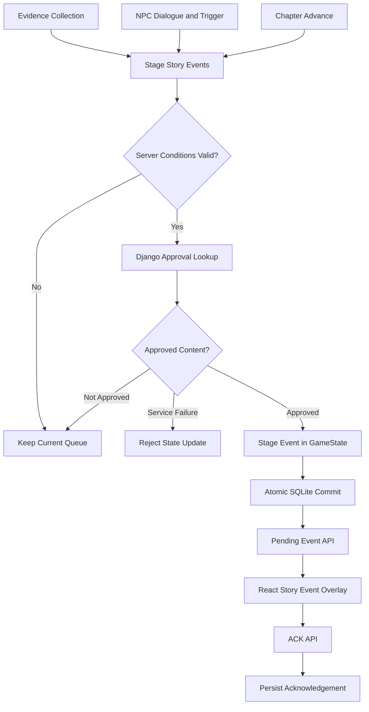
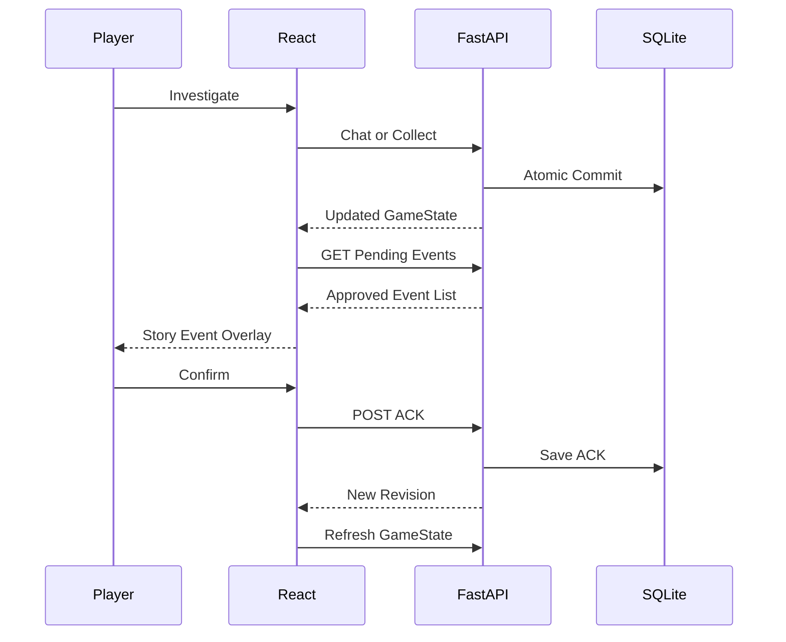

# Day 5 — Story Event Workflow

## 1. 목적

플레이어의 조사 활동과 게임 진행 상태를 기반으로
승인된 연계 스토리 이벤트를 생성하고 안전하게 전달한다.

## 2. 핵심 모듈

| 파일 | 역할 |
|---|---|
| story_event_bindings_loader.py | 이벤트 바인딩 검증 |
| story_event_conditions_loader.py | 발생 조건 검증 |
| story_event_progress.py | 이벤트 발생 조건 평가 |
| story_event_delivery_gate.py | 이벤트 공개 권한 검사 |
| story_event_delivery_service.py | Pending 조회 및 ACK 처리 |
| story_event_http.py | 플레이어용 HTTP API |
| story_context.py | 공개 가능 상태 및 이벤트 후보 조회 |
| chapter_progress.py | 챕터 해금 및 전환 |
| StoryEventOverlay.tsx | 프론트엔드 이벤트 표시 |

## 3. 이벤트 발생 경로



## 4. 서버 발생 조건

이벤트 큐 등록 전에 다음 조건을 검증한다.

- CASE-001에 속하는 게임 상태
- 조사 단계 여부
- 현재 챕터 및 해금 상태
- 필수 증거 획득 여부
- 필수 진행 플래그 충족 여부
- Story ID와 Event Key 매핑
- Django 콘텐츠 승인 여부
- 기존 큐 등록 여부

## 5. Event State 구조

| 필드 | 설명 |
|---|---|
| queued_story_events | 등록된 Story ID 목록 |
| acknowledged_story_events | 확인 완료된 Story ID 목록 |
| revision | 게임 상태 버전 |

이벤트 큐와 ACK 이력은 GameState에 저장한다.

ACK 이력은 등록된 이벤트의 부분집합이어야 한다.

동일 이벤트는 중복 등록하지 않는다.

## 6. 이벤트 설정

| 환경변수 | 역할 |
|---|---|
| CRIMESCENE_STORY_EVENT_BINDINGS_PATH | 이벤트 매핑 파일 |
| CRIMESCENE_STORY_EVENT_CONDITIONS_PATH | 이벤트 발생 조건 파일 |
| CRIMESCENE_CHAPTER_RULES_PATH | 챕터 해금 규칙 파일 |

이벤트 바인딩과 발생 조건은 함께 설정해야 한다.

설정이 누락되거나 유효하지 않은 경우 자동 이벤트
등록 및 콘텐츠 공개를 제한한다.

운영 시나리오 설정 파일은 GitHub에 포함하지 않는다.

## 7. API 계약

모든 게임 API는 세션 소유권 검증을 수행한다.

아래 경로의 공통 Prefix는 /api/games/{session_id}이다.

| Method | Endpoint | 역할 |
|---|---|---|
| POST | /prologue/complete | 조사 단계 시작 |
| POST | /characters/{character_id}/select | NPC 선택 |
| POST | /chat | NPC 대화 및 증거 제시 |
| POST | /evidence/{evidence_id}/collect | 증거 수집 |
| POST | /chapter/advance | 다음 챕터 진행 |
| GET | /content/scenes/{scene_id} | 현재 챕터 장면 조회 |
| GET | /story-events/pending | 미확인 이벤트 목록 |
| GET | /story-events/{event_key} | 이벤트 상세 |
| POST | /story-events/{event_key}/ack | 이벤트 확인 |
| POST | /accusations | 범인 지목 |
| GET | /ending | 서버 판정 엔딩 |

### 7.1 Chapter Advance Request

```json
{
  "expectedRevision": 5
}
```

현재 revision 및 다음 챕터의 서버 해금 규칙을 검증한다.

클라이언트는 목표 챕터나 해금 조건을 지정할 수 없다.

### 7.2 Pending Event Response

```json
{
  "items": [
    {
      "eventKey": "EVT-CH01-001",
      "chapter": "CH01",
      "title": "Test event",
      "text": "Synthetic approved content"
    }
  ]
}
```

### 7.3 ACK Response

```json
{
  "eventKey": "EVT-CH01-001",
  "acknowledged": true,
  "created": true,
  "revision": 6
}
```

동일 이벤트의 재확인 요청은 created=false를 반환하며
revision을 다시 증가시키지 않는다.

### 7.4 오류 처리

| HTTP Status | 처리 기준 |
|---|---|
| 403 | 증거 수집 또는 제시 권한 부족 |
| 404 | 소유권 검증 실패 또는 공개 불가 콘텐츠 |
| 409 | Revision 충돌 또는 게임 진행 조건 미충족 |
| 422 | 유효하지 않은 요청 데이터 |
| 503 | 콘텐츠 서비스 또는 서버 설정 오류 |

## 8. 프론트엔드 처리



- 세션 및 revision을 기준으로 이벤트 목록을 관리한다.
- 오래된 Pending 응답을 폐기한다.
- 중복 ACK 요청을 방지한다.
- 나중에 보기는 ACK를 생성하지 않는다.
- ACK 성공 이후 최신 GameState를 다시 조회한다.
- 콘텐츠는 React 텍스트 렌더링으로 표시한다.

## 9. 트랜잭션 및 장애 대응

게임 진행 상태와 이벤트 큐는 동일 SQLite 트랜잭션에서
저장한다.

NPC 대화의 경우 대화 이력과 상태 갱신을 함께 처리한다.

Django 승인 조회는 SQLite 쓰기 트랜잭션 이전에 수행한다.
따라서 Django와 SQLite 간 분산 트랜잭션을 보장하는
구조는 아니다.

## 10. 남은 정책 및 개선 사항

- 이전 챕터의 미확인 이벤트는 큐에 보존되지만
  현재 챕터가 아니므로 표시되지 않는다.
- 미확인 이벤트의 재열람 및 보관 정책이 필요하다.
- Story Context와 HTTP 전달 경로는 공개 결과의
  일치 여부를 검증했으며, 단일 조회 서비스로 통합하는
  작업은 후속 개선 대상으로 유지한다.
- 프론트엔드 Chapter 전환 UI는 별도 작업이 필요하다.
- 실제 운영 콘텐츠 활성화는 승인 이후 진행한다.
