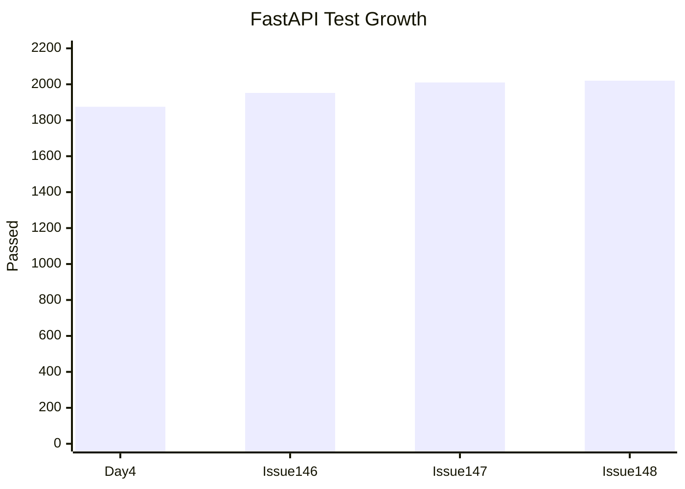

# Day 5 — Integration Test Results

## 1. 테스트 환경

| 항목 | 환경 |
|---|---|
| 테스트 일자 | 2026-11-24 |
| OS | Windows |
| Python | 3.13.15 |
| pytest | 9.2.0 |
| anyio | 4.16.0 |
| Vite | 5.4.11 |
| Branch | test/148-day5-story-integration |
| Base Commit | 770228d |

## 2. 최종 테스트 결과

| 구분 | PASS | FAIL | SKIP | 실행 시간 |
|---|---:|---:|---:|---:|
| FastAPI, Agent, MCP | 2020 | 0 | 9 | 44.71s |
| Django | 228 | 0 | 0 | 20.185s |
| 합계 | 2248 | 0 | 9 | 64.895s |

- 실행된 테스트 통과율: 100%
- 전체 테스트 수: 2257
- 기존 테스트 삭제 및 신규 임의 Skip 없음

## 3. Day 4 대비 테스트 증가

| 구분 | Day 4 | Day 5 | 증가 |
|---|---:|---:|---:|
| FastAPI | 1875 | 2020 | 145 |
| Django | 228 | 228 | 0 |
| 전체 PASS | 2103 | 2248 | 145 |
| FAIL | 0 | 0 | 0 |
| SKIP | 9 | 9 | 0 |

FastAPI 테스트 수는 Day 4 대비 약 7.73% 증가했다.

## 4. Issue #148 신규 테스트 결과

| 테스트 영역 | 신규 PASS | 전체 PASS | 시간 |
|---|---:|---:|---:|
| NPC 및 Story Context | 3 | 43 | 6.02s |
| Chapter, Scene, Event | 2 | 38 | 6.04s |
| Agent 및 MCP Security | 3 | 8 | 7.75s |
| Gameplay E2E | 2 | 2 | 4.85s |
| 합계 | 10 | 91 | 24.66s |

위 결과는 개별 집중 테스트 실행 기록이며
전체 회귀 테스트 결과와 별도로 합산하지 않는다.

## 5. 신규 테스트 상세

| 테스트 | 결과 |
|---|---|
| NPC Story Context Lifecycle | PASS |
| Story Context Persistence | PASS |
| NPC Failure State Preservation | PASS |
| Chapter Scene Event Lifecycle | PASS |
| Unapproved Content Protection | PASS |
| Chapter Stale Context Protection | PASS |
| ACK Stale Context Protection | PASS |
| Cross-session and Forged Cookie | PASS |
| Gameplay SUCCESS | PASS |
| Gameplay FAILURE | PASS |

## 6. 대표 플레이 테스트

테스트용 시나리오에서 다음 게임 진행을 검증했다.

| 진행 단계 | 결과 |
|---|---|
| 게임 세션 생성 | PASS |
| 프롤로그 조회 및 완료 | PASS |
| NPC 선택 및 대화 | PASS |
| 증거 수집 | PASS |
| NPC 해금 | PASS |
| 증거 제시 | PASS |
| NPC Trigger | PASS |
| 진행 플래그 발급 | PASS |
| CH00 Event Queue | PASS |
| Event ACK | PASS |
| CH01 Chapter Advance | PASS |
| CH01 Scene 조회 | PASS |
| 추가 증거 획득 | PASS |
| SQLite 저장 상태 복원 | PASS |
| Deduction Agent | PASS |
| SUCCESS Ending | PASS |
| FAILURE Ending | PASS |

실제 게임 API를 통해 증거 5개 및 점수 11점을 확보했다.
대표 플레이 테스트 중 GameState를 직접 수정하지 않았다.

## 7. 테스트 실행 방식 구분

| 구성 요소 | 검증 방식 |
|---|---|
| FastAPI | 실제 실행 |
| Agent Orchestrator | 실제 실행 |
| NPC Agent | 실제 실행 |
| Evidence Collection | 실제 실행 |
| NPC Trigger | 실제 실행 |
| Chapter Progress | 실제 실행 |
| Story Event Queue | 실제 실행 |
| Story Context | 실제 실행 |
| MCP Protocol | 실제 실행 |
| SQLite | 실제 저장소 |
| Accusation and Ending | 실제 실행 |
| Django 자체 테스트 | 실제 Django 테스트 DB |
| FastAPI-Django HTTP Client | MockTransport 및 Mock |
| 외부 LLM 및 RAG | 대표 플레이 테스트에서 Mock |
| 운영 시나리오 | Synthetic Fixture로 대체 |
| React Browser E2E | 미실행 |

## 8. Skip 분석

| 파일 | 건수 | 사유 |
|---|---:|---|
| test_neo4j_sync_integration.py | 6 | 별도 Neo4j 테스트 서버 환경변수 미설정 |
| test_ollama_embedder_integration.py | 3 | 실제 Ollama 통합 테스트 명시적 실행 필요 |
| 합계 | 9 | 기존 Skip 유지 |

### Neo4j Skip 위치

166, 198, 244, 276, 311, 345행

### Ollama Skip 위치

16, 30, 53행

실제 외부 서비스 연결에 대한 최종 검증은
배포 환경 구성 이후 별도로 수행해야 한다.

## 9. 프론트엔드 빌드 결과

| 항목 | 결과 |
|---|---:|
| TypeScript Compile | PASS |
| Vite Production Build | PASS |
| Transformed Modules | 2029 |
| Build Time | 4.76s |
| JavaScript Bundle | 395.83 kB |
| Gzip JavaScript | 136.24 kB |
| CSS Bundle | 74.60 kB |
| Gzip CSS | 15.31 kB |
| Spoiler Check | PASS |

## 10. 정적 검사

- Issue #148 신규 테스트 파일: Ruff PASS
- FastAPI 기존 Import 정렬 오류 1건: 수정 대상 반영
- Django 영역: 기존 Ruff 오류 114건
- 전체 프로젝트 Ruff 통과로 기록하지 않는다.

| Django 오류 코드 | 건수 |
|---|---:|
| RUF012 | 71 |
| I001 | 20 |
| F811 | 14 |
| SIM117 | 6 |
| SIM102 | 2 |
| F401 | 1 |
| 합계 | 114 |

Django Ruff 오류는 별도 코드 품질 개선 대상으로 관리한다.

## 11. 결론

Day 5에서 추가된 기능의 API 통합 테스트 및
기존 기능의 전체 회귀 테스트가 통과했다.

대표 플레이 기준 SUCCESS 및 FAILURE 엔딩에
정상적으로 도달했다.

다만 실제 운영 콘텐츠, 외부 서비스 연결 및
React 브라우저 플레이 검증은 별도 수행이 필요하다.
