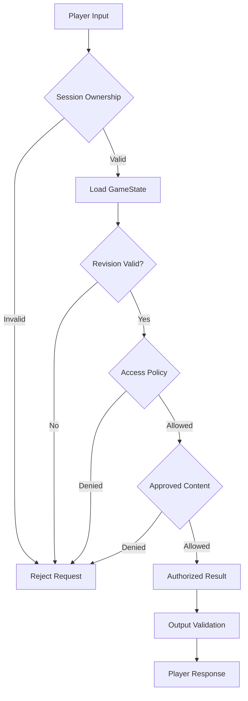

# Day 5 — Security Review

## 1. 보안 검토 목적

NPC 대화, Agent, MCP, Story Context, Chapter 및
Story Event 사이의 권한 경계를 검증한다.

플레이어 입력을 신뢰하지 않고 서버가 검증한
게임 상태만을 진행 판정에 사용한다.

## 2. 보안 아키텍처

## 3. 보안 테스트 결과

| 검증 항목 | 결과 |
|---|---|
| 다른 플레이어 세션 접근 차단 | PASS |
| 위조된 소유권 쿠키 거부 | PASS |
| 미해금 NPC 접근 제한 | PASS |
| 미획득 증거 제시 차단 | PASS |
| 증거 수집 조건 검증 | PASS |
| 미래 챕터 Scene 접근 차단 | PASS |
| 이전 챕터 Scene 접근 제한 | PASS |
| 미승인 Django 콘텐츠 차단 | PASS |
| 이벤트 중복 등록 방지 | PASS |
| ACK 멱등성 | PASS |
| 이전 Agent Context 재사용 차단 | PASS |
| 이전 MCP Context 재사용 차단 | PASS |
| 이전 Story Context revision 거부 | PASS |
| 미획득 증거 공개 요청 차단 | PASS |
| 읽기 전용 Agent 및 MCP 상태 불변성 | PASS |
| 게임 종료 전 엔딩 접근 차단 | PASS |
| 실패 엔딩의 실제 정답 비공개 | PASS |
| 게임 종료 후 상태 변경 차단 | PASS |

## 4. 세션 및 인증 정책

- 게임 세션 ID는 서버에서 생성한다.
- HMAC 기반 소유권 검증을 수행한다.
- 다른 플레이어의 세션 조회 및 수정을 차단한다.
- 소유권 검증 실패 시 콘텐츠 서비스 호출 이전에 거부한다.
- Django 내부 서비스 인증 토큰은 서버에서 관리한다.
- 실제 인증 토큰과 비공개 환경변수는 커밋하지 않는다.

## 5. Prompt Injection 대응

- 사용자 입력은 게임 진행 권한을 직접 변경할 수 없다.
- NPC 접근 정책은 서버에서 평가한다.
- 현재 승인된 근거만 NPC 대화에 사용한다.
- 과거 대화의 사용자 명령을 시스템 명령으로 사용하지 않는다.
- Deduction Agent는 미획득 증거 ID 사용을 거부한다.
- Hint Agent는 보유 증거를 기준으로 힌트를 제공한다.
- MCP Tool은 서버가 검증한 Context에 바인딩한다.

검증된 입력 유형에서의 방어 동작을 확인했으며,
모든 Prompt Injection 공격에 대한 완전한 방어를
보장하는 것은 아니다.

## 6. Revision 기반 동시성 제어

| 상황 | 처리 방식 |
|---|---|
| 이전 Chapter 요청 | HTTP 409 |
| 이전 Story Context 조회 | ValueError |
| 이전 Agent Context 실행 | RuntimeError |
| 이전 MCP Context 실행 | Tool Error |
| 동일 ACK 재요청 | 기존 확인 상태 유지 |
| SQLite 저장 충돌 | 변경 요청 거부 |

## 7. 트랜잭션 무결성

- 증거 수집 및 NPC 해금의 원자적 저장
- NPC 대화 및 이벤트 큐의 원자적 저장
- 챕터 전환 및 이벤트 큐의 원자적 저장
- SQLite 오류 시 부분 저장 방지
- 콘텐츠 조회 실패 시 진행 상태 보존
- 읽기 전용 조회의 상태 불변성

## 8. 프론트엔드 보안

- 세션 및 revision 기반 이벤트 표시
- 이전 세션의 비동기 응답 폐기
- 중복 ACK 요청 방지
- React 텍스트 렌더링 사용
- 스포일러 의심 문자열 검사 통과

스포일러 문자열 검사와 Production Build는 통과했으나
실제 브라우저의 모든 경쟁 상태를 검증한 것은 아니다.

## 9. 잔여 위험 및 기술 부채

| ID | 항목 | 우선순위 | 후속 대응 |
|---|---|---|---|
| R-01 | 실제 운영 콘텐츠 미활성화 | High | 승인 및 Runtime 설정 |
| R-02 | Neo4j 실제 연결 테스트 Skip 6건 | High | 별도 테스트 서버 구성 |
| R-03 | Ollama 실제 연결 테스트 Skip 3건 | High | 실제 모델 연결 검증 |
| R-04 | Chapter 전환 UI 미완성 | High | 프론트엔드 연동 |
| R-05 | React Browser E2E 미실행 | High | 실제 브라우저 플레이 |
| R-06 | 이전 챕터 미확인 이벤트 정책 | Medium | 재열람 및 보관 정책 |
| R-07 | Django Ruff 오류 114건 | Medium | 별도 품질 개선 이슈 |
| R-08 | 확장 증거 및 엔딩 미검증 | High | 시나리오 계약 확장 |
| R-09 | 콘텐츠 승인 조회와 DB 저장 간 경쟁 가능성 | Medium | 승인 버전 관리 검토 |
| R-10 | Story Context와 HTTP 전달 정책 중복 | Medium | 공통 조회 서비스 검토 |
| R-11 | Frontend 상태 갱신 경쟁 가능성 | Medium | 세션 및 revision 동시성 테스트 |

## 10. 정적 분석 기술 부채

Django 영역의 주요 Ruff 오류는 mutable class default,
Import 정렬, 중복 정의 및 중첩 구문이다.

정적 검사 오류를 제거하기 위해 Ruff 규칙을
비활성화하거나 unsafe fix를 일괄 적용하지 않는다.

## 11. 최종 평가

- 전체 자동화 테스트: 2248 PASS
- 테스트 실패: 0
- 외부 서비스 관련 기존 Skip: 9
- 신규 통합 테스트: 10 PASS
- 대표 SUCCESS 및 FAILURE 플레이: PASS
- 프론트엔드 빌드 및 스포일러 검사: PASS

Day 5 구현 범위에 대한 통합 안정성은 확인했다.

정식 배포 전에는 운영 콘텐츠, 실제 외부 서비스 연결,
브라우저 E2E 및 잔여 보안 위험에 대한 검증이 필요하다.
