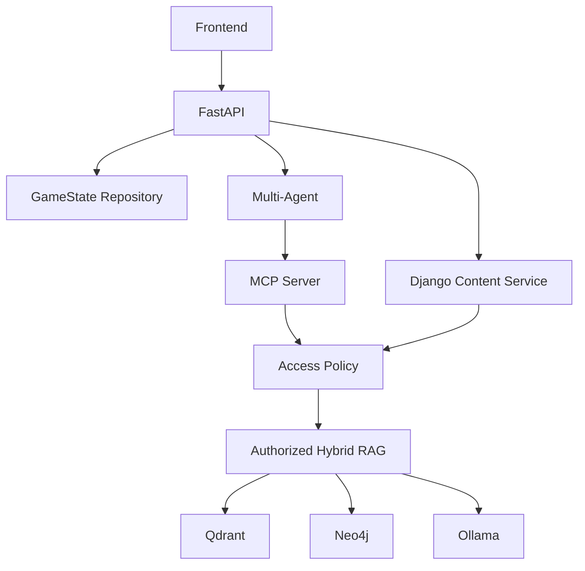

# Day 6 - Expanded System Architecture

## 1. 개발 목적

기존 CASE-001 AI 추리 게임을 확장하여 콘텐츠 관리,
Multi-Agent, MCP, Hybrid RAG 및 게임 진행 엔진을 통합한다.

## 2. 기술 구성

| Layer | Technology | Responsibility |
|---|---|---|
| API | FastAPI | 게임 API 및 세션 관리 |
| Content | Django 5.2.19 | 콘텐츠 승인 및 릴리스 관리 |
| Agent | Multi-Agent | NPC, 추론, 힌트 |
| Tool | MCP Python SDK | 읽기 전용 도구 호출 |
| Vector | Qdrant | Dense/Sparse 검색 |
| Graph | Neo4j | 인물 및 증거 관계 |
| Embedding | Ollama BGE-M3 | 문서 및 질의 임베딩 |
| State | SQLite | 게임 상태 및 Revision |
| Test | pytest 9.2.0 | 자동화 및 통합 검증 |

## 3. 논리적 아키텍처

## 4. Runtime 구성

- Content version: case001_1120
- Release: v0.15.0
- Evidence rules: 30
- Published evidence: 28
- Acquisition policies: 28
- Investigation actions: 22
- Approved NPC cards: 32
- Inference rules: 11
- Objective rules: 11
- Chapter rules: 4

## 5. 설계 원칙

- Django 콘텐츠 승인과 플레이어별 공개 권한을 분리한다.
- 게임 상태는 서버에서 관리한다.
- 콘텐츠 버전 및 릴리스 무결성을 검증한다.
- MCP 도구 호출은 읽기 전용으로 제한한다.
- Revision 기반 동시성 제어를 적용한다.
- 미승인 콘텐츠는 기본적으로 차단한다.

## 6. 남은 검증

프론트엔드 전체 연동, 실제 NPC 생성 응답 품질,
운영 배포 및 콘텐츠 최종 승인은 별도로 진행한다.
