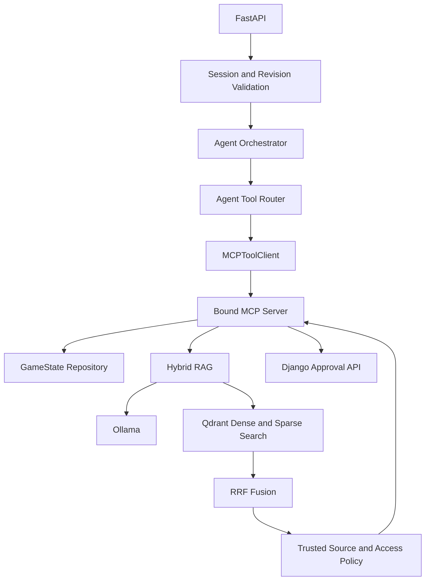

# Day 6 - MCP Client Architecture

> SKN36 · AI Crime Scene · CASE-001
>
> 작성일: 2026-11-25
> 관련 이슈: #154, #155, #156, #158, #159

## 1. 구현 목적

Agent가 데이터베이스나 검색 시스템에 직접 접근하지 않고
MCP Tool을 통해 검증된 게임 정보만 사용하도록 구성한다.

## 2. 기술 환경

| Component | Version |
|---|---|
| Python | 3.13.15 |
| MCP SDK | 2.3.0 |
| Pydantic | 2.14.2 |
| FastAPI | 0.162.2 |
| Django | 5.2.19 |
| Qdrant | 1.16.0 |
| Neo4j | 5.26.32 |
| Embedding | Ollama bge-m3 |

## 3. Architecture

## 4. 주요 구현 모듈

| Module | Responsibility |
|---|---|
| mcp/client.py | MCP 호출 및 요청·응답 검증 |
| mcp/context.py | 인증된 GameState 컨텍스트 바인딩 |
| mcp/server.py | 읽기 전용 MCP Tool 제공 |
| mcp/evidence_tools.py | 검색 결과 및 콘텐츠 승인 검사 |
| agents/tool_router.py | Agent별 Tool Allowlist |
| agents/mcp_orchestrator.py | 실행 순서 및 공유 상태 검증 |

경로는 backend/src/crimescene 기준이다.

## 5. Tool 권한

| Tool | Deduction | Hint |
|---|---|---|
| get_game_context | 허용 | 허용 |
| get_investigation_progress | 허용 | 허용 |
| search_authorized_evidence | 허용 | 차단 |

NPC Agent는 이번 Orchestrator의 지원 대상이 아니다.
기존 NPC 대화 경로는 별도로 유지한다.

## 6. MCP Client 설계

- 실제 MCP SDK Client 및 Server 사용
- In-process MCP 통신
- Tool Allowlist 적용
- Pydantic 기반 입력·출력 스키마 검증
- 증거 검색어 1~200자 제한
- 증거 검색 결과 1~5개 제한
- Tool 실행 기본 Timeout 15초
- 내부 오류 메시지 및 인증 정보 노출 방지

독립적인 공개 MCP HTTP 서버를 배포한 구조는 아니다.

## 7. 검색 결과 보안

검색 결과의 신뢰성은 검색 점수만으로 판단하지 않는다.

1. Qdrant Dense 및 BM25 검색
2. RRF 순위 통합
3. 신뢰 원본 Record 검증
4. GameState 접근 정책 확인
5. PlayerDocument 원본 본문 대조
6. 보유 증거 ID 검증
7. Django 콘텐츠 승인 및 선행 증거 검사
8. 허용된 근거만 Agent에 전달

보호된 사실과 엔딩 전용 문서는 MCP 증거 검색에서 제외한다.

## 8. 검증 결과

- MCP Client 신규 테스트: 55 PASS
- 실제 MCP SDK 증거 검색: PASS
- 실제 Django 승인 정보 연동: PASS
- 실제 Hybrid RAG 연결: PASS
- 승인 증거 E01 반환: PASS

Neo4j는 기존 그래프 및 NPC 검색 경로에서 사용한다.
이번 MCP 증거 검색 Tool이 Neo4j를 직접 호출하지는 않는다.
