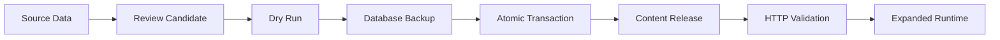

# Day 6 - Django Content Release

## 1. 릴리스 관리

| Release | Approved Evidence | NPC Cards | RAG |
|---|---:|---:|---|
| v0.14.0 | 25 | 32 | Revision1 |
| v0.15.0 | 28 | 32 | Revision2 |

기존 릴리스를 유지하면서 E26, E27, E29를 추가 승인하였다.

## 2. 신규 증거

| ID | Description | Score |
|---|---|---:|
| E26 | 파일 삭제 감사 로그 A 구획 | 3 |
| E27 | 회계 원본 버전 비교 | 3 |
| E29 | 복구 음성 메모 | 3 |

E07과 E30은 미공개 상태를 유지한다.
E26 B/C 구획은 승인 범위에 포함하지 않는다.

## 3. 발행 절차

## 4. 무결성 검증

- 원본 데이터 SHA-256
- 릴리스 Manifest SHA-256
- RAG Manifest SHA-256
- 증거 및 조사 계약
- 문서 본문 해시
- STORY_026 Payload SHA-256

## 5. 발행 결과

- v0.14.0 HTTP validation: PASS
- v0.15.0 HTTP validation: PASS
- 기존 릴리스 보존: PASS
- 신규 Runtime 초기화: PASS

## 6. 발행 범위

현재 발행은 LOCAL_INTEGRATION_TEST 범위이다.
정식 운영 콘텐츠 승인과 동일하게 취급하지 않는다.

로컬 DB와 원본 자료는 Git에 직접 포함하지 않는다.
배포 시 재현 가능한 안전한 콘텐츠 공급 절차가 필요하다.
