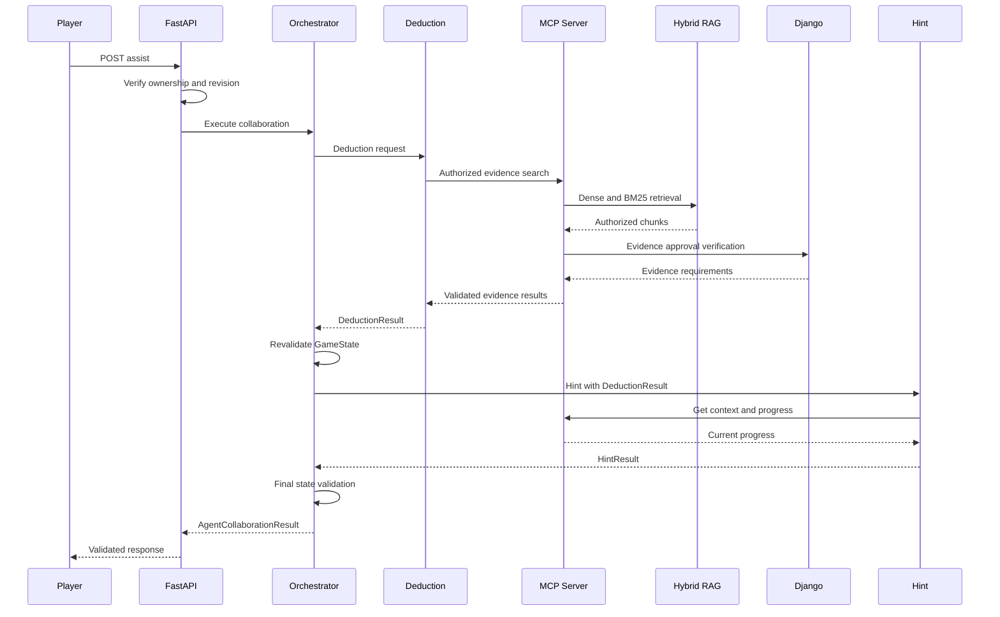

# Day 6 - Multi-Agent Workflow

> 관련 이슈: #156, #157, #158, #159

## 1. 설계 목표

추론과 힌트 제공 기능을 분리하고,
공유된 게임 상태에서 검증된 증거 근거를 전달한다.

## 2. Agent 역할

| Agent | Responsibility |
|---|---|
| Deduction Agent | 보유 증거 검색 및 규칙 기반 추론 |
| Hint Agent | 조사 진행 상태에 맞는 단계별 힌트 |
| MCPAgentOrchestrator | Agent 실행 순서 및 상태 검증 |
| 기존 NPC Agent | 별도 대화 및 NPC 지식 처리 |

## 3. Collaboration Sequence

## 4. 실행 제약

- CASE-001 사건만 지원
- INVESTIGATION 단계에서만 실행
- 종료된 게임에서는 실행 차단
- Agent 실행 전후 동일 GameState 검증
- 증거 수집·제시 등 상태 변경 금지
- Tool 실행 기본 Timeout 15초
- Orchestrator 실행 Timeout 60초
- 상태 변경 또는 검증 실패 시 결과 반환 차단

## 5. 근거 전달 방식

Deduction Agent는 MCP 검색 결과를 검증한 뒤
증거 ID를 기존 추론 로직에 전달한다.

검색된 원문을 실행 지시로 해석하지 않는다.

Assist에서는 DeductionResult를 Hint Agent에 전달하고,
추론 근거가 있는 경우 힌트가 그 근거 범위를 초과하지
않는지 검증한다.

## 6. Hint 정책

| Level | Behavior |
|---|---|
| 1 | 기본 조사 방향 안내, 증거 ID 및 추천 NPC 없음 |
| 2 | 보유 증거와 조사 진행 상태 기반 힌트 |
| 3 | 보다 구체적인 조사 안내 |

미해금 NPC 또는 미획득 증거는 추천하지 않는다.

## 7. 실제 실행 결과

| Operation | Status | Evidence | Elapsed |
|---|---:|---|---:|
| Deduction | 200 | E01 | 0.360s |
| Hint | 200 | E01 | 0.028s |
| Assist | 200 | E01 | 0.371s |

격리 Django DB 및 임시 GameState를 사용한 단일 측정값이다.

## 8. 구현 범위

이번 Multi-Agent 협업은 규칙 기반 Deduction 및 Hint Agent를
실제 MCP Tool과 연결한 구조이다.

Agent 간 자유 생성형 LLM 대화나 자율적인 작업 분배를
검증한 결과는 아니다.

OpenAI NPC 답변 생성과의 종합 연동은 별도 검증 대상이다.
