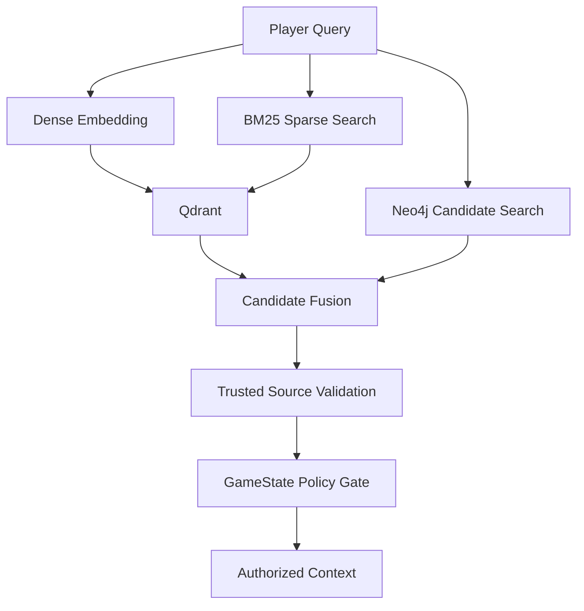

# Day 6 - Hybrid RAG Pipeline

## 1. 데이터 구성

| Resource | Count |
|---|---:|
| RAG records | 138 |
| Player documents | 29 |
| Published documents | 28 |
| NPC cards | 109 |
| Published NPC cards | 32 |
| Blocked NPC cards | 77 |
| Graph nodes | 42 |
| Graph edges | 111 |
| Published graph edges | 0 |

## 2. Collection

- Legacy: case001_rag_v1
- Revision1: case001_rag_1120_revision1
- Revision2: case001_rag_1120_revision2

## 3. 검색 파이프라인

Graph 검색 경로는 구현되어 있으나,
v0.15.0에서는 공개 승인된 확장 관계가 없다.

## 4. 접근 제어

- Case ID 및 Content Version 일치
- 증거 획득 여부
- 필수 선행 증거 확인
- Flag 및 증거 제시 조건 확인
- NPC별 허용 지식 확인
- 엔딩 및 보호 사실 제한
- 서버 신뢰 원본 검증

## 5. E26 정책

공개 가능 문서는 DOC-1120-E26-A 하나이다.

필수 조건:

- E20 획득
- E26 획득
- ACT_AUDIT_LOG_ACCESS_VERIFIED
- 서버의 A 구획 승인

E26 B/C 및 E30은 공개하지 않는다.

## 6. 실제 검색 검증

- Ollama Embedding HTTP: PASS
- Qdrant 검색 HTTP: PASS
- E26 획득 전 차단: PASS
- E26 획득 후 검색: PASS
- MCP 승인 문서 반환: PASS
- 감사 로그 Flag 누락 차단: PASS

검색 정확도 Benchmark와 전체 NPC 생성 응답 평가는
이번 통합 검증 범위에 포함하지 않는다.
