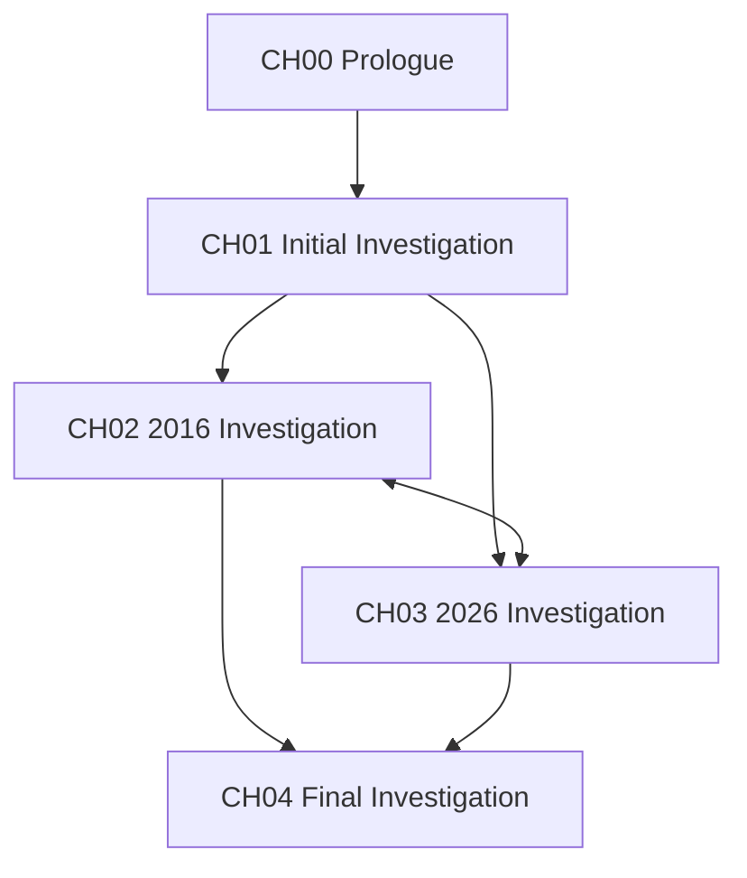
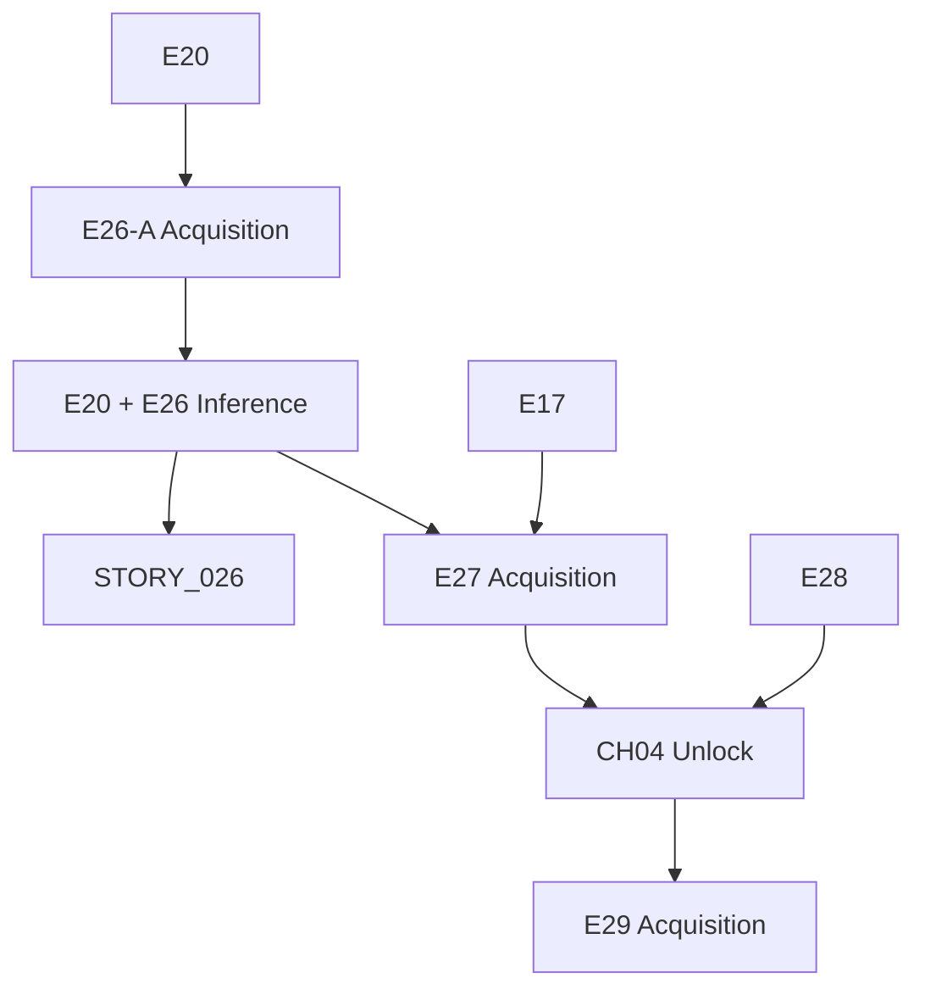

# Day 6 - Chapter Progression

## 1. 챕터 구성

## 2. 로컬 챕터 해금 정책

| Chapter | Required Conditions |
|---|---|
| CH01 | 프롤로그 완료 |
| CH02 | E11, E19, E20 |
| CH03 | E11, E19, E20 |
| CH04 | E17, E20, E26, E27, E28 및 필수 Flag |

CH04 진입에는 CH02 및 CH03 해금이 모두 필요하다.

필수 Flag:

- ACT_AUDIT_LOG_ACCESS_VERIFIED
- INF_POST_EVENT_DELETE
- ACT_ACCOUNTING_VERSIONS_COMPARED

## 3. 분기 재방문

CH02와 CH03을 자유롭게 선택할 수 있도록
이미 해금한 조사 분기 사이의 재방문을 허용한다.

CH04 진입 이후에는 해당 재방문을 제한한다.
챕터 이동으로 점수가 증가하지 않는다.

## 4. 확장 증거 진행

## 5. 실제 통합 결과

- CH01 이전 프롤로그 조건: PASS
- CH03 -> CH02 -> CH03: PASS
- 선행 조건 없는 CH04 접근 차단: PASS
- E26 추론 및 STORY_026: PASS
- E27 획득: PASS
- 실제 CH04 API 전환: PASS
- E29 획득: PASS
- 중복 점수 차단: PASS

| Stage | Score |
|---|---:|
| Initial fixture | 10 |
| E26 | 13 |
| E27 | 16 |
| E29 | 19 |

## 6. 제한사항

챕터 해금 계약은 로컬 통합 테스트용 제안 정책이다.
정식 콘텐츠 담당자 검토가 필요하다.

일부 선행 증거는 테스트 Fixture로 준비하였다.
전체 자연 획득 경로를 검증한 결과는 아니다.
