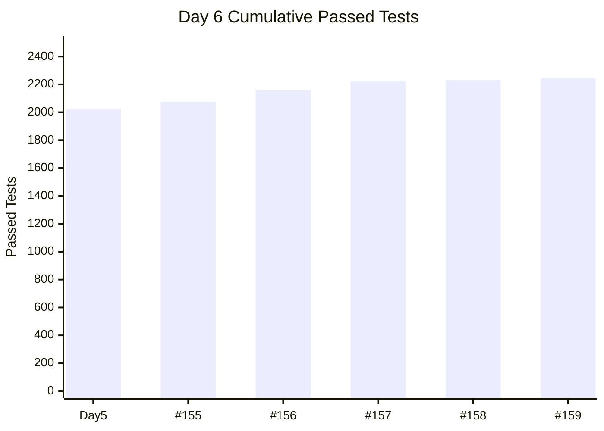
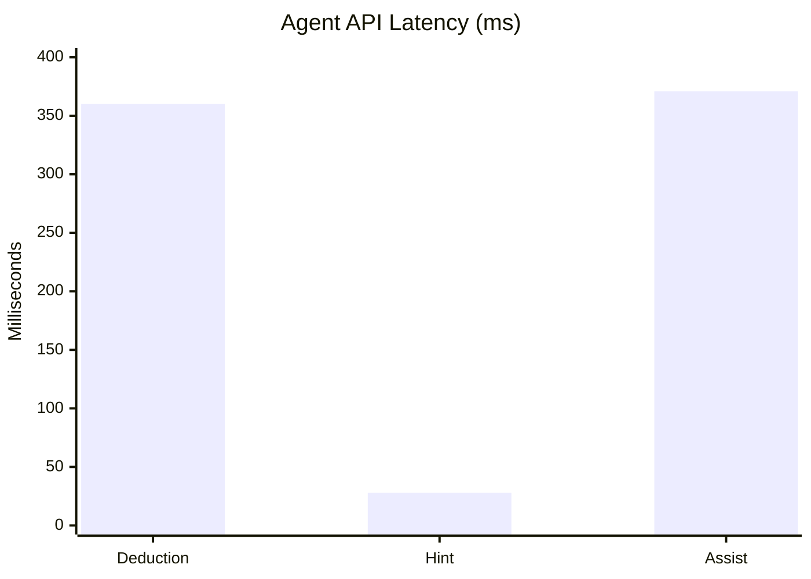

# Day 6 - Final Test Results

> 검증일: 2026-11-25
> 관련 이슈: #154~#159

## 1. Executive Summary

| Suite | Passed | Skipped | Failed | Elapsed |
|---|---:|---:|---:|---:|
| FastAPI | 2244 | 0 | 0 | 65.14s |
| Django (#158 run) | 228 | 0 | 0 | 11.831s |
| Total | 2472 | 0 | 0 | - |

FastAPI 수치는 모든 외부 서비스 옵션을 활성화한 결과이다.
Django 수치는 #158에서 실행한 전체 회귀 테스트 결과이다.

## 2. Test Growth

| Issue | New Tests | Passed | Skipped |
|---|---:|---:|---:|
| Day 5 Baseline | - | 2020 | 9 |
| #155 | 55 | 2075 | 9 |
| #156 | 86 | 2161 | 9 |
| #157 | 60 | 2221 | 9 |
| #158 | 10 | 2231 | 9 |
| #159 | 4 | 2244 | 0 |

Day 6 신규 테스트: 215개
기존 Skip 해소: 9개
Day 5 대비 PASS 증가: 224개

## 3. 실제 통합 테스트

| Test Group | Count | Result |
|---|---:|---|
| 최초 Live Integration | 10 | PASS |
| 실제 HTTP Read Timeout | 2 | PASS |
| 실제 Graph Policy | 2 | PASS |
| Neo4j Sync | 6 | PASS |
| Ollama Embedding | 3 | PASS |
| Total | 23 | PASS |

최종 전체 테스트에는 위 23개가 포함되어 있다.

## 4. Graph Policy

| Item | Count |
|---|---:|
| 전체 신뢰 원본 관계 | 37 |
| 실제 NPC 연결 관계 검증 | 29 |
| 조건 미충족 상태 차단 검증 | 27 |
| 조건 충족 후 조회 성공 | 29 |
| 증거 보유 관계 검증 | 10 |
| 기존 Graph 회귀 테스트 | 90 |

NPC 연결 관계가 아닌 나머지 8개는 신규 실제 관계 조회
테스트의 범위에 포함되지 않았다.

## 5. Hybrid RAG

| Scenario | Returned Chunks | Target Retrieved |
|---|---:|---|
| 증거 확보 상태 | 17 | Yes |
| 증거 미확보 상태 | 2 | No |

Target: CASE001-DOC-E01

검색 정확도 전체 평가가 아닌 접근 제어 시나리오 검증이다.

## 6. Performance Measurements

| Operation | Elapsed |
|---|---:|
| Ollama Embedding | 6.952s |
| RAG Runtime Initialization | 5.668s |
| Hybrid RAG Search | 1.728s |
| Deduction API | 0.360s |
| Hint API | 0.028s |
| Assist API | 0.371s |

각 측정값은 개별 실행 결과이며 평균, p95, 부하 테스트
또는 운영 환경 응답시간을 보장하는 수치가 아니다.

## 7. Static Analysis

- FastAPI src/tests Ruff: PASS
- Git Diff Check: PASS
- Django System Check: PASS
- Django 기존 Ruff 이슈는 별도 개선 대상

## 8. Test Evidence

| File | Coverage |
|---|---|
| tests/test_day6_live_service_integration.py | 실제 서비스 및 정책 |
| tests/test_neo4j_sync_integration.py | 그래프 동기화 |
| tests/test_ollama_embedder_integration.py | 실제 임베딩 |
| tests/test_agent_http.py | Agent API |

## 9. Limitations

- 실제 콘텐츠 정식 승인 및 게시 미완료
- OpenAI NPC 답변 생성 미검증
- FastAPI 실제 네트워크 서버 및 프론트엔드 미검증
- 동시 사용자 및 부하 테스트 미실시
- 운영 배포 환경 미검증
