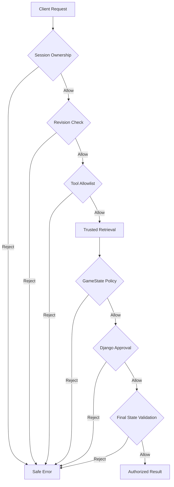

# Day 6 - Security Review

> 관련 이슈: #155~#159

## 1. Security Architecture

## 2. Authentication and Authorization

| Control | Result |
|---|---|
| Django 정상 인증 | 200 PASS |
| Django 미인증 접근 | 403 PASS |
| Django 위조 토큰 | 403 PASS |
| 타인 게임 세션 접근 | 404 PASS |
| Revision 불일치 | 409 PASS |
| 미획득 증거 요청 | 403 PASS |

## 3. MCP Security

- Agent별 Tool Allowlist
- 입력 및 출력 스키마 검증
- 서버 소유 GameState 컨텍스트
- 증거 근거 ID 검증
- Tool 및 Workflow Timeout
- Agent의 직접 상태 변경 금지
- 미승인 Tool 접근 차단
- 검색 원문을 실행 명령으로 사용하지 않음

## 4. RAG Security

- 신뢰 원본 데이터와 검색 결과 대조
- 다른 사건 데이터 차단
- 미획득 증거 차단
- 엔딩 전용 및 보호된 문서 제외
- Django 승인 및 선행 증거 검증
- 플레이어 문서와 NPC 지식 분리

## 5. Graph Security

- Neo4j에서 관계 ID를 조회하고 신뢰 원본과 대조
- 미해금 NPC 차단
- 미획득 증거 보유 관계 차단
- 조건부 관계 및 엔딩 조건 검증
- NPC별 명시적 지식 허용 목록 적용
- 기본 허용 목록이 비어 있을 경우 Fail Closed

실제 NPC 연결 관계 29개 및 증거 보유 관계 10개를
검증했다. 기존 Graph 관련 회귀 테스트 90개도 통과했다.

## 6. Failure Handling

| Failure | Expected Behavior | Result |
|---|---|---|
| Django 연결 실패 | HTTP 503 | PASS |
| Django ReadTimeout | HTTP 503 | PASS |
| 미승인 증거 | HTTP 503 | PASS |
| Revision 충돌 | HTTP 409 | PASS |
| 타인 세션 접근 | HTTP 404 | PASS |
| 잘못된 MCP 응답 | HTTP 502 | 기존 테스트 PASS |
| Agent 실행 Timeout | HTTP 504 | 기존 테스트 PASS |

실제 연결 실패와 HTTP ReadTimeout은 별도의 로컬
네트워크 테스트로 검증했다.

503 오류 시 일부 Agent 결과가 반환되지 않는지,
GameState가 유지되는지 확인했다.

## 7. Data Protection

- 원본 Django DB 승인 상태 유지
- 임시 GameState DB 사용
- Django 복제 DB에만 승인 Fixture 구성
- Neo4j 변경·삭제 테스트용 독립 컨테이너 사용
- 기존 Qdrant 및 Neo4j 데이터 유지
- 인증 토큰을 Git에 저장하지 않음

## 8. Residual Risk Register

| ID | Risk | Severity | Status |
|---|---|---|---|
| SEC-01 | 실제 콘텐츠 미승인 | High | Open |
| SEC-02 | 예상된 MCP 오류의 Traceback 로그 | Medium | Open |
| SEC-03 | 운영 환경 HTTPS 및 Cookie 설정 | High | Pending |
| SEC-04 | 동시 요청 및 Rate Limit 검증 부족 | Medium | Pending |
| SEC-05 | OpenAI 답변 정보 노출 검증 | High | Pending |
| SEC-06 | Django 기존 Ruff 이슈 | Low | Open |

위 등급은 프로젝트 내부 위험도 분류이며
외부 보안 감사나 CVSS 평가 결과가 아니다.

## 9. Conclusion

이번 개발 범위의 자동화 테스트는 모두 통과했다.

테스트 통과는 모든 공격에 안전하다는 의미가 아니며,
실제 콘텐츠 승인과 운영 환경 보안 검토는 별도로 필요하다.
