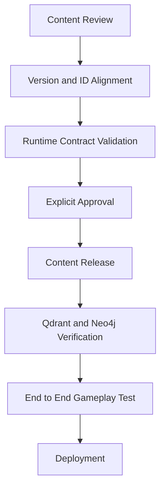

# Day 6 - Deployment Readiness

> 발표 예정일: 2026-12-04
> 프로젝트 완료 목표: 2026-12-02

## 1. Development Status

| Component | Status |
|---|---|
| Django Content Service | Implemented |
| MCP Server | Implemented |
| MCP Client | Implemented |
| Multi-Agent Orchestrator | Implemented |
| Agent HTTP API | Implemented |
| Actual Hybrid RAG Integration | Verified |
| Neo4j Sync and Graph Policy | Verified |
| Network Failure Handling | Verified |
| Content Publication | Blocked |
| Frontend Agent Integration | Pending |
| Production Deployment | Pending |

## 2. Deployment Blocker

현재 원본 Django 콘텐츠 상태:

- CASE-001: DRAFT
- ContentRelease: 0
- 런타임 승인: 0개

| Resource | Total | Approved |
|---|---:|---:|
| Scene | 30 | 0 |
| Evidence | 30 | 0 |
| NPC Card | 140 | 0 |
| Objective | 25 | 0 |

실제 승인된 콘텐츠가 없으므로 정상 서비스 공개 전
콘텐츠 검토 및 게시 절차가 필요하다.

## 3. Content Version Alignment

| Item | Django | RAG Runtime |
|---|---:|---:|
| Evidence | 30 | 10 |
| NPC Cards | 140 | 88 |

E01~E10은 기존 게임 엔진에 등록되어 있다.
E11~E30은 점수가 없고 런타임 비활성화 상태이다.

콘텐츠 수량 차이는 확장 예정 데이터 및 런타임 버전 차이와
관련될 수 있으며, 개별 데이터 정합성 확인이 필요하다.

## 4. Proposed Release Workflow

위 흐름은 배포 전 권장 절차이며 현재 자동화 완료된
게시 파이프라인을 의미하지 않는다.

## 5. Remaining Work

| Priority | Work |
|---|---|
| P0 | 실제 콘텐츠 검토 및 정식 게시 |
| P0 | Django와 RAG 데이터 버전 정합성 검증 |
| P0 | FastAPI 실제 서버 및 프론트엔드 Agent 연동 |
| P0 | OpenAI NPC 답변 생성 및 공개 정책 검증 |
| P0 | 배포 환경 구축과 전체 플레이 테스트 |
| P1 | 환경변수 및 Secret 관리 |
| P1 | HTTPS 및 Cookie 보안 설정 |
| P1 | 오류 로그 정리 및 모니터링 |
| P1 | 부하 및 동시 사용자 테스트 |
| P1 | 백업·복구 및 운영 장애 대응 |

## 6. Release Acceptance Criteria

- [ ] 실제 콘텐츠 승인 및 게시 완료
- [ ] 프론트엔드 Agent API 연동
- [ ] 실제 OpenAI NPC 대화 확인
- [ ] 전체 챕터 및 엔딩 플레이 검증
- [ ] 운영 환경 Secret 관리
- [ ] HTTPS 및 접근 권한 설정
- [ ] 배포 후 Health Check
- [ ] 운영 환경 통합 테스트
- [x] FastAPI 전체 2244 PASS
- [x] Django 전체 228 PASS (#158)
- [x] 실제 외부 서비스 및 그래프 보안 검증

## 7. Final Assessment

Day 6의 백엔드 MCP 및 Multi-Agent 핵심 구현과
실제 외부 서비스 연동 검증을 완료했다.

격리된 E01 승인 Fixture에서 정상 동작을 확인했으나,
실제 콘텐츠 게시 및 운영 배포는 완료되지 않았다.

Deployment readiness: CONDITIONAL / NOT RELEASED
