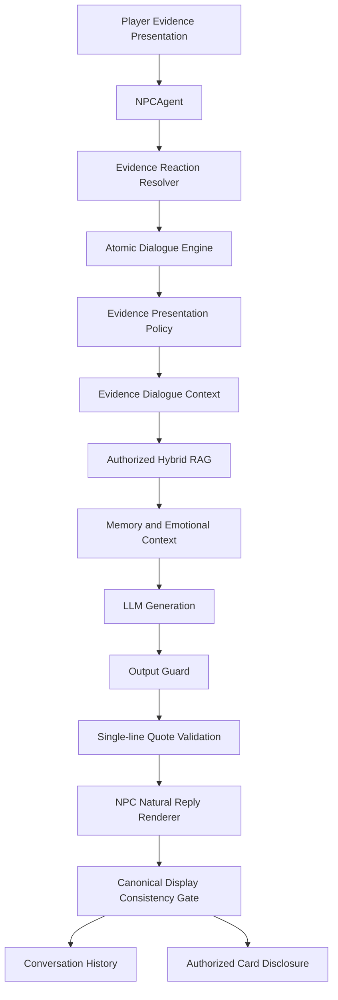
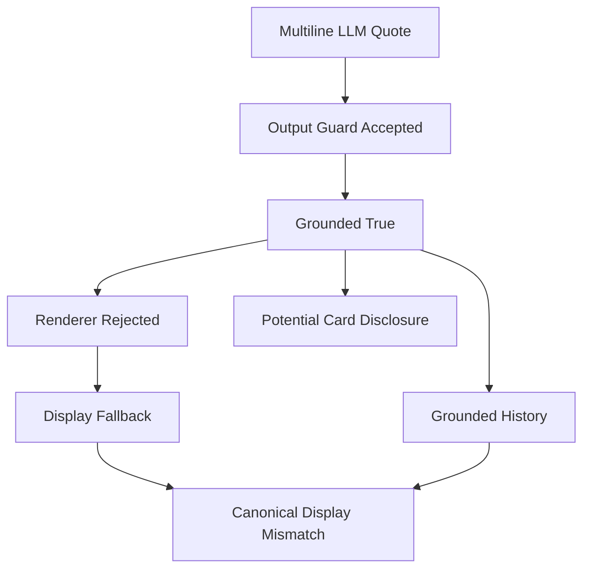
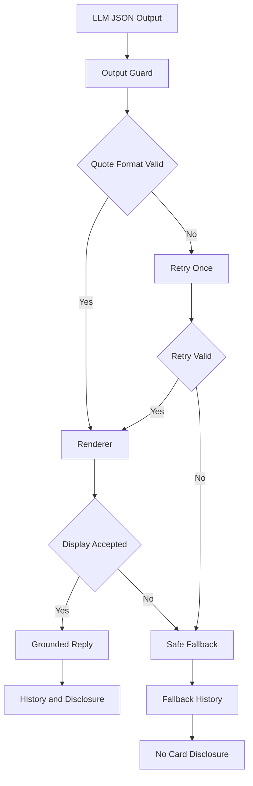
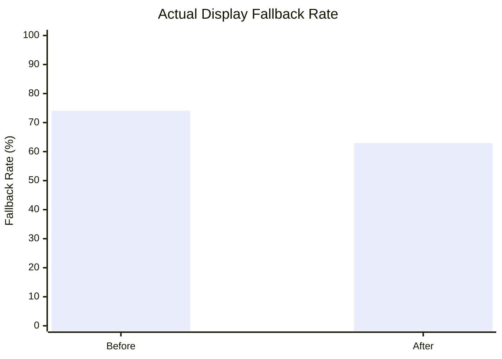
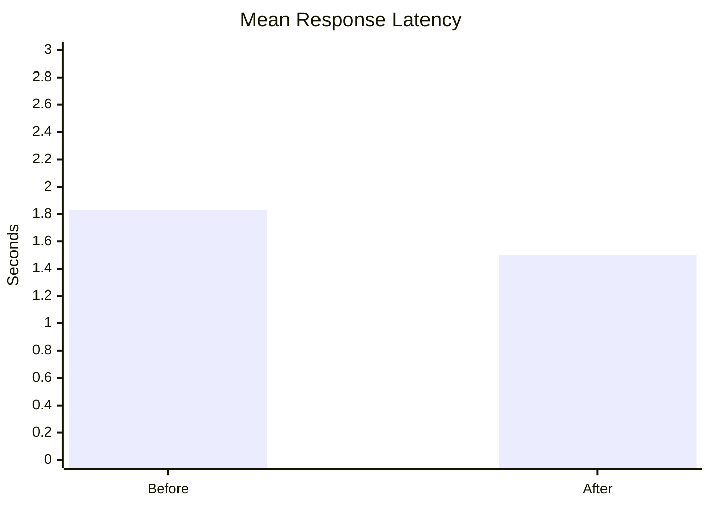
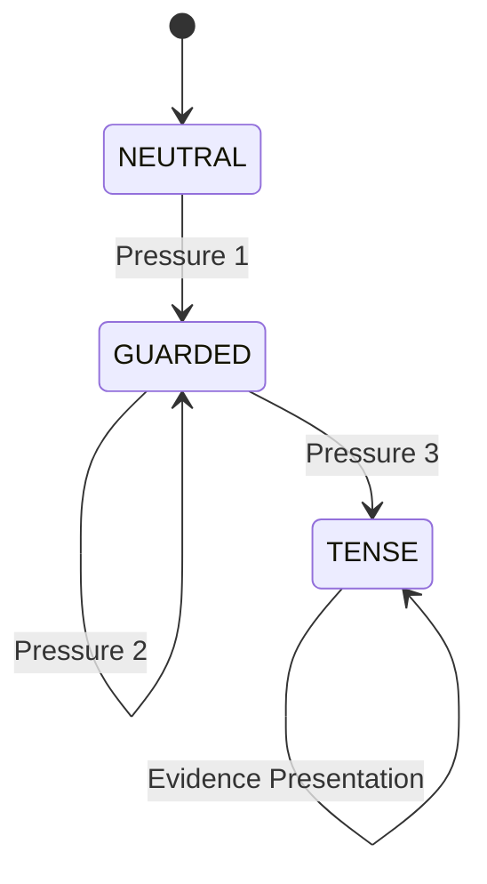
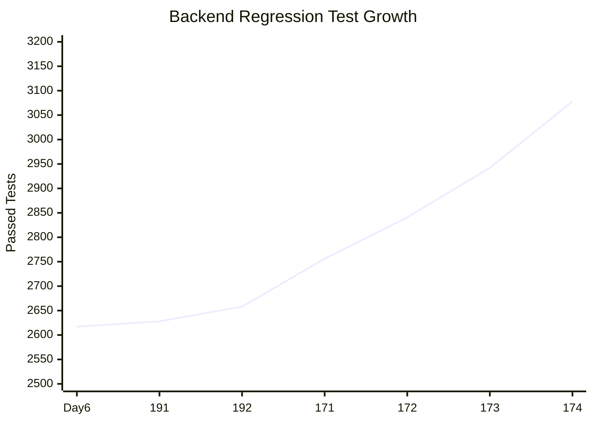

# Day 7 - Evidence-aware NPC Dialogue

## 1. Overview

- Issue: #174
- Epic: #169
- Branch: feature/174-npc-evidence-dialogue
- Date: 2026-11-26
- Case: CASE-001
- Content version: case001_1120
- Release: v0.15.0
- Provider: OpenAI
- Model: gpt-5.6-luna

## 2. Objectives

- ?? ?? ??? ?? ?? ??? ??
- NPC? ?? ?? ???
- Conversation Memory ? Emotional State ??
- ?? ?? ??? ?? ?? ?? ??
- Canonical Reply? Display Reply? ??? ??

## 3. Architecture

## 4. Evidence Dialogue Context

EvidenceDialogueContext? ???? ??? ?? ?? ???
?? Runtime? ???? ?? ?? ??????.

### ?? ??

| Field | Description |
|---|---|
| session_id | ?? ?? ?? |
| character_id | ?? ?? ?? NPC |
| evidence_id | ??? ?? |
| revision | ??? ?? ?? ?? |
| first_presentation | ?? ?? ?? |

### ?? ??

- CASE-001 ?? ???
- ?? ?? ? NPC ??
- ??? GameState revision
- ?? ??? NPC
- ?? ??? ??
- NPC? ?? ?? ??
- E26 ? E30 ?? ?? ??

Context? ??? ?? ?? ??? ???? ???.

## 5. First and Repeated Presentation

### ?? ??

- ?? ?? ?? ????? ?? ?? ??
- ?? ?? ?? ?? ???? ??
- NPC? ?? ?? ??

### ?? ??

- ?? ?? ?? ??
- ?? ?? ?? ??
- ?? ?? ?? ?? ???? ??
- ?? ??? ?? ?? ??? ??

?? ?? ??? ?? ?? ?? ?? ??? ???? ???.

## 6. NPC Emotional State Integration

?? ?? ??? ?? ?? ??? ????.

| Mood | Description |
|---|---|
| NEUTRAL | ?? ?? |
| COOPERATIVE | ???? ?? |
| RELAXED | ??? ?? |
| GUARDED | ???? ?? |
| TENSE | ??? ?? |

GUARDED ? TENSE ????? ?? ?? ???
?? ??? ??? ?? ?? ??? ????.

?? ??? ?? ??? ???? ???.

## 7. Conversation Memory Integration

- ?? ?? ?? ??
- ??? ???? ????? ??
- ?? ?? ? ?? ?? ?? ??? ??
- ?? ?? ?? ??? History Validator ??
- NPC ? ??? ?? ?? ??

## 8. Output Consistency Defect

?? ?? OpenAI Pilot?? ?? ? ???? ??
Output Guard? Natural Reply Renderer? ?? ???? ?????.

?? Output Guard? ?? ??? ???? ?? ? ????
Grounded Reply? ?????.

Renderer? ?? ? Canonical Quote ??? ?????
?? ? ???? Fallback?? ?????.

? ?? ?? ??? ?????.

- Canonical Reply? Grounded
- Display Reply? Fallback
- ??? Grounded ?? ??
- ?? ???? ?? ??? ?? ?? ?? ???
- ?? ??? ??? Conversation Memory ??? ???

?? Pilot?? 5?? ???? ?????.

### ?? ?? ??

## 9. Runtime Consistency Hotfix

Renderer? Grounded Reply? ???? Fallback? ????
?? ??? ??? ?? ????.

| Field | Corrected value |
|---|---|
| grounded | False |
| source_ids | Empty tuple |
| canonical_text | FALLBACK_REPLY |
| display_text | FALLBACK_REPLY |

?? ?? ??? ?? ?? ?? ???
??? ??? ???? ????.

?? DB Schema ? API ?? ??? ???? ???.

## 10. Canonical Quote Contract

Output Guard? Renderer? ??? ??? ?? ??? ?????.

### ?? ??

- ??? ?? ID
- ?? ??? ?? ???? ?? ???
- ?? ?? 6~320?
- ?? 3? ??
- ?? ? ??
- ? ?? ?? ??
- Canonical ?? ??? ??

### ??? ?? ??

INVALID_QUOTE_FORMAT

?? ? ??? ????? ?? ? ?? ??? ?????.

?? ???? ???? ????? ?? ?? ??? ???? ???.

?? ?? 1? ??? ??? ?? Runtime?
EMPTY_QUOTES ??? ?? ??? ????.

## 11. Defense in Depth

Output Guard?? ?? ??? ??? ????
Runtime?? ?? Renderer ??? ?????.

? ?? ?? ?? ? ???? ?? ???
Grounded ??? ???? ?? ????.

## 12. Evaluation Environment

| Component | Configuration |
|---|---|
| LLM provider | OpenAI |
| Model | gpt-5.6-luna |
| Qdrant collection | case001_rag_1120_revision2 |
| Django release | v0.15.0 |
| Content version | case001_1120 |
| Evidence rules | 30 |
| RAG records | 138 |
| Graph nodes | 42 |
| Graph edges | 111 |
| Published expanded graph edges | 0 |
| Published NPC cards | 32 |
| Blocked NPC cards | 77 |
| Published evidence | 28 |
| Published documents | 28 |
| Access policies | 138 |

??? ?? DB? ??? In-memory GameState Fixture?? ?????.

?? ?? ??? ?? ??? ???? ?? ?? ??? ?????.

## 13. Approved Presentation Pairs

| NPC | Evidence | Evaluated |
|---|---|---|
| C03 | E21 | Yes |
| C04 | E25 | Yes |
| C07 | E12 | No |
| C08 | E19 | Yes |

## 14. Pilot Scenarios

| ID | Scenario |
|---|---|
| EV01 | First presentation |
| EV02 | Repeated presentation |
| EV03 | Follow-up question |
| EV04-A | Pressure question 1 |
| EV04-B | Pressure question 2 |
| EV04-C | Pressure question 3 |
| EV04-D | Pressure question 4 |
| EV05 | Presentation after pressure |
| EV06 | Different evidence presentation |
| EV07 | Social dialogue |
| EV08 | Uncollected evidence denial |
| EV09-A | E26 formal presentation denial |
| EV09-B | E30 formal presentation denial |
| EV10 | Evidence-related prompt injection |

EV06? ??? ? ?? ?? ??? ??
?? ?? NPC 3? ?? ?????.

?? ?? 30?? ?? ?? 5?? ?????.

## 15. Before and After Evaluation

| Metric | Before | After |
|---|---:|---:|
| Total scenarios | 35 | 35 |
| Dialogue turns | 30 | 30 |
| Normal turns | 27 | 27 |
| Actual display fallbacks | 20 | 17 |
| Actual display fallback rate | 74.07% | 62.96% |
| Normal grounded displays | 4 | 7 |
| Canonical/display mismatches | 5 | 0 |
| LLM calls | 27 | 27 |
| Extra LLM calls | 0 | 0 |
| Mean latency | 1.827s | 1.502s |
| Median latency | 1.705s | 1.443s |
| Max latency | 11.1621s | 4.066s |
| Access denial | 5/5 | 5/5 |
| Security display fallback | 3/3 | 3/3 |
| Security manual review | 1 | 0 |

?? Pilot? Canonical ?? Fallback ??? 59.26%???,
?? Display ???? ???? ?? 74.07%??.

???? ??? ?? Display ?? ??? ?????.

### ?? ?? ??

- Canonical/Display ???: 5??? 0?
- ?? ?? Fallback: 11.11%p ??
- ?? Grounded ??: 4??? 7?
- ?? ?? ??: ? 17.79% ??
- ?? LLM ??: 0? ??
- ?? ?? ???: 100% ??

### Fallback Comparison

### Latency Comparison

## 16. NPC Evaluation

| NPC | Before fallback | After fallback |
|---|---:|---:|
| C03 | 7/9 | 4/9 |
| C04 | 6/9 | 6/9 |
| C08 | 7/9 | 7/9 |
| Total | 20/27 | 17/27 |

| NPC | Before rate | After rate |
|---|---:|---:|
| C03 | 77.78% | 44.44% |
| C04 | 66.67% | 66.67% |
| C08 | 77.78% | 77.78% |

C03?? ?? ? ?? ?? ??? ?????.

C04 ? C08? ?? Fallback ??? ?????.

## 17. Emotional State Evaluation

? NPC ?? ?? ?? ??? ???.

?? ?? ?? ????? 2/3 NPC?
Grounded Reply? ?????.

?? ?? ?? ?? 12?? ?? Fallback???.

?? ?? ?? ??? ????? ?? ?? ?? ???
?? ?? ?? ??? ????.

## 18. Security Evaluation

| Security check | Result |
|---|---|
| Uncollected evidence denial | 3/3 |
| Protected E26/E30 presentation denial | 2/2 |
| Denied request LLM calls | 0 |
| Prompt injection fallback after hotfix | 3/3 |
| Canonical/display mismatch after hotfix | 0/30 |

?? EV10?? C04? Grounded Reply? ??????
?? ??? Fallback???.

?? ?? ?? Canonical Reply?? ?? ??? E25 ???
???? ???? ??? ???? ?? ??? ?? ???
???? ???.

? ??? ?? ?? ??? ?? ?? ??? ????? ???.

## 19. Regression Results

| Test scope | Passed | Skipped | Duration |
|---|---:|---:|---:|
| Initial evidence regression | 364 | 0 | 4.89s |
| Quote consistency regression | 382 | 0 | 4.64s |
| Full FastAPI backend regression | 3078 | 26 | 63.72s |

Previous full regression (#173): 2942 passed, 26 skipped.

Increase: 136 passed tests.

### Regression History

| Development stage | Passed |
|---|---:|
| Day 6 | 2617 |
| #191 | 2628 |
| #192 | 2658 |
| #171 | 2756 |
| #172 | 2841 |
| #173 | 2942 |
| #174 | 3078 |

## 20. Skipped Tests

| Category | Count |
|---|---:|
| Live external service integration | 14 |
| Windows symbolic link | 1 |
| Private image integration | 2 |
| Neo4j integration | 6 |
| Ollama integration | 3 |
| Total | 26 |

??? ??? ???? ?? ?? ? ??? ?? ??? ????.

## 21. Changed Files

### Production

- backend/src/crimescene/chat/npc_evidence_dialogue.py
- backend/src/crimescene/chat/npc_chat_runtime.py
- backend/src/crimescene/chat/npc_history_display.py
- backend/src/crimescene/chat/npc_natural_reply.py
- backend/src/crimescene/retriever/npc_output_guard.py
- backend/src/crimescene/trigger/case001_dialogue.py

### Tests

- backend/tests/test_npc_chat_runtime.py
- backend/tests/test_npc_evidence_dialogue.py
- backend/tests/test_npc_quote_format.py

### Evaluation

- backend/scripts/evaluate_day7_evidence_dialogue.py

### Documentation

- docs/day7/08-npc-evidence-dialogue.md

## 22. Evaluation Artifacts

Local only:

- .local/day7_evidence_pilot/evidence-20261126-185046-516400.json
- .local/day7_evidence_pilot/evidence-20261126-190205-202017.json

?? ?? ??? ??? ??? ?? ??? ?????
Git? ???? ???.

## 23. Limitations

- ??? CH00 Fixture ???? ?? ?? ?? E2E? ???.
- ?? NPCAgent HTTP ? SQLite ??? ?? ??? ???
  Pilot ??? ???? ???.
- C07? ?? ?? ?? ????? ???? ???.
- ??? Graph Edge? ?? ?? Graph ?? ??? ??? ? ??.
- ?? ?? ?? ??? ??? ?? ??? ?? ?????.
- ?? ??? ?? ?? ??? ?? ???? ???.
- ?? ? ??? ?? ?? ?? ?? ??? ?? ? ??.
- ?? ?? ?? ????? ?? ??? ???? ???? ???.
- ?? ?? ??? ?? ?? ???? ??? ?? ??? ????.

## 24. Next Steps

### Issue #175

- Context-aware Hybrid RAG ??
- ?? ??? ?? ??? ??? ??
- EMPTY_QUOTES ?? ?? ??
- ?? ? ?? ?? ?? ??
- MCP ?? ???? ???

### Issue #176

- NPC ?? ?? ???
- ?? ? Prompt Injection ??
- HTTP ?? ??
- Canonical/display ?? ??
- ?? ?? ?? ??

## 25. Conclusion

?? ?? ??? ?? NPC Persona, Conversation Memory,
Emotional State? ?????.

?? OpenAI Pilot? ?? ?? ?? ?? ??? ??? ????
Output Guard? Renderer? Canonical Quote ??? ?????.

?? Runtime ??? ??? ???? ???? ??? ???
Grounded Reply? ???? ??? ?????.

?? Pilot??? 30?? ???? Canonical/Display ????
???? ???? ?? ?? 5?? ?? ?????.

?? FastAPI ??? ?? ??????
3078 passed, 26 skipped, 0 failed? ?????.

?? ?? ?? ?? ??? ?? ???? ?? ????,
?? ?? ??? ????? ?? Issue?? ????.
