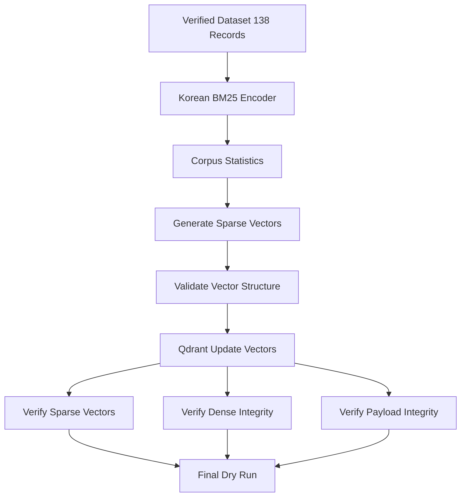
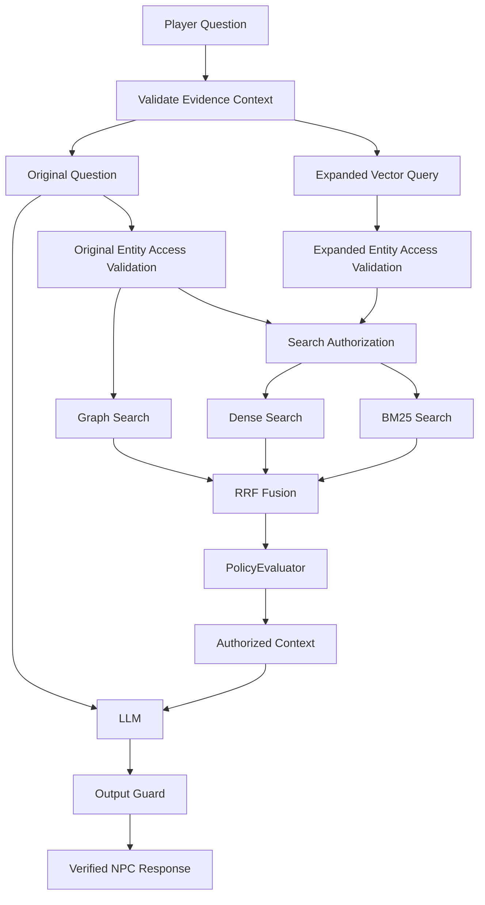
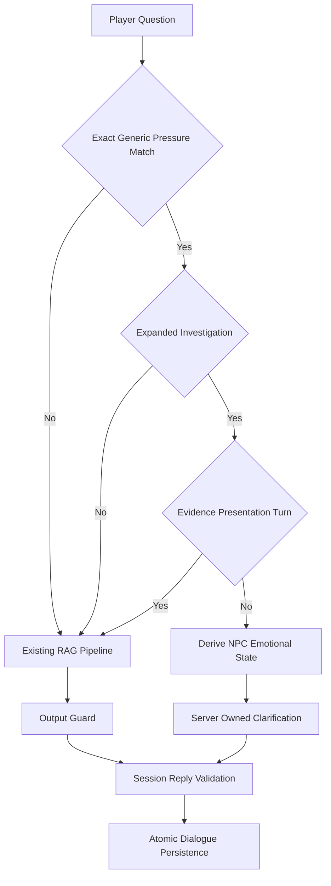
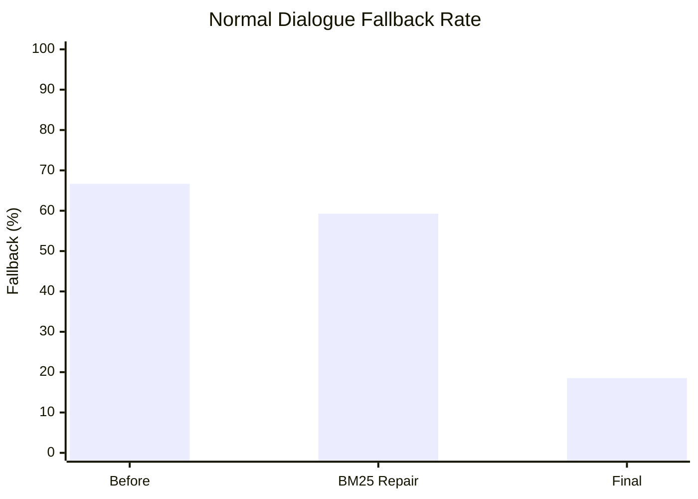
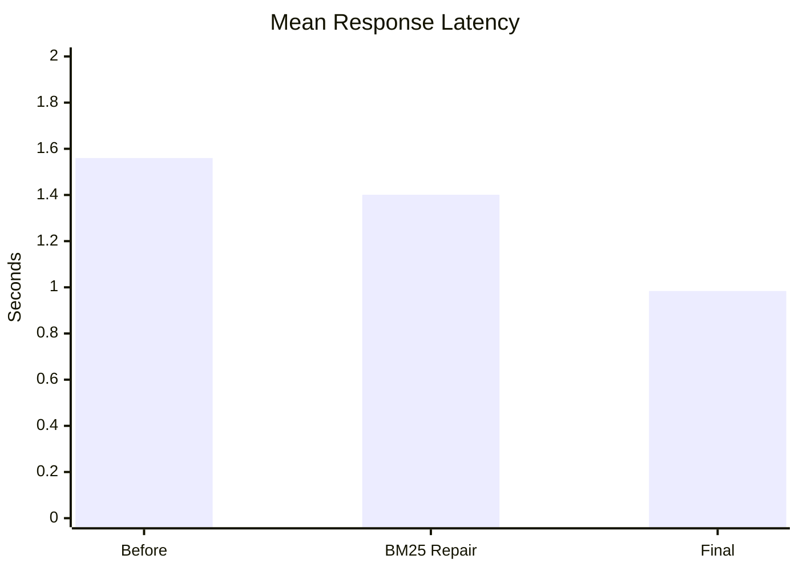
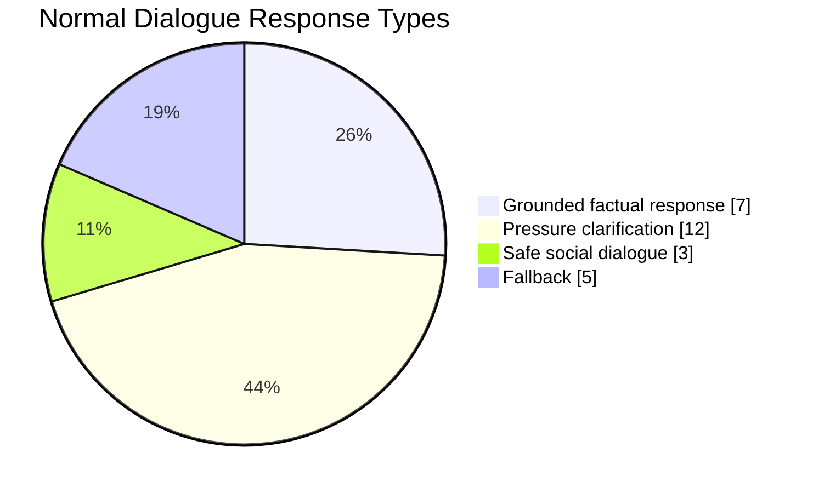
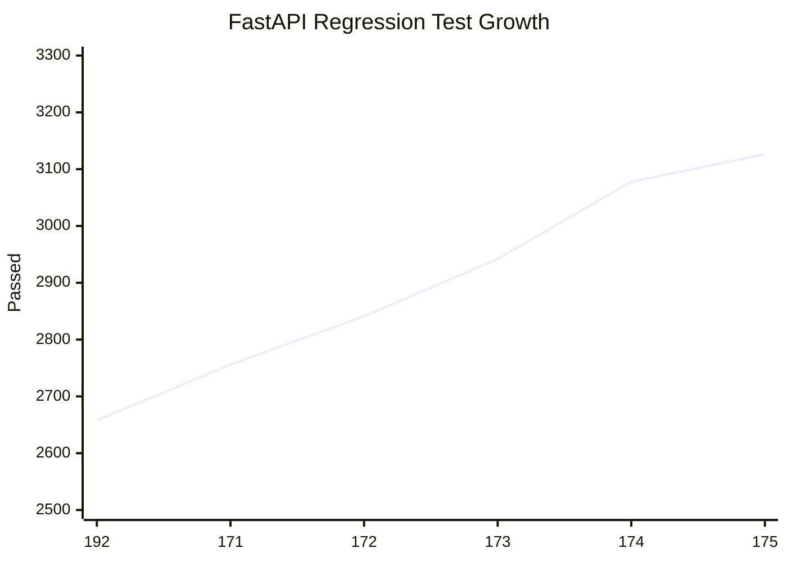

# Day 7 - Context-aware RAG 및 MCP 개선

## 1. 작업 개요

- Issue: #175
- Branch: enhancement/175-context-aware-rag-mcp
- Date: 2026-11-26
- Case: CASE-001
- Runtime: case001_1120
- Release: v0.15.0
- Release scope: LOCAL_INTEGRATION_TEST
- RAG Collection: case001_rag_1120_revision2

### 기술 스택

| 구분 | 기술 |
|---|---|
| Language | Python 3.13.15 |
| Game API | FastAPI |
| Content Management | Django 5.2 |
| Vector Database | Qdrant |
| Graph Database | Neo4j |
| Embedding | Ollama / BGE-M3 |
| Sparse Retrieval | Korean BM25 / Kiwi |
| Search Fusion | Reciprocal Rank Fusion |
| LLM | OpenAI gpt-5.6-luna |
| Agent | Multi-Agent |
| Tool Protocol | MCP |
| Test | pytest 9.2.0 |

## 2. 개발 목표

- BM25 Sparse Vector 누락 원인 분석 및 복구
- Dense + Sparse 적재 일관성 확보
- 증거 제시 상황을 반영하는 검색 질의 구성
- 포괄적 추궁과 사실 확인 질문 분리
- NPC 감정 상태에 따른 자연스러운 확인 질문
- 기존 접근 정책과 출력 검증 유지
- Agent 및 MCP 성능 측정
- 전체 회귀 테스트 수행

## 3. 기존 문제 분석

### 3.1 BM25 Sparse Vector 누락

Qdrant 컬렉션에 BM25 인덱스 설정은 존재했으나
실제 Point에는 Dense Vector만 저장되어 있었다.

| 항목 | 복구 전 |
|---|---:|
| 전체 Point | 138 |
| 정상 Dense Vector | 138 |
| 정상 Sparse Vector | 0 |
| 누락 Sparse Vector | 138 |

누락된 데이터 구성:

- Player document: 29
- NPC knowledge: 109

### 3.2 NPC 대화 Fallback

기존 승인 컨텍스트는 Dense 검색으로 확보되었으나,
LLM이 적절한 근거를 선택하지 못하는 경우가 많았다.

일반적인 추궁 질문에서도 사건 원문 인용을 요구하여
12건의 추궁 시나리오가 모두 Fallback으로 처리되었다.

### 3.3 적재 진입점의 문제

- Point Builder가 Dense Vector만 생성
- 동기화 계획이 Payload만 비교
- Sparse Vector 누락 및 불일치 미검증
- 직접 적재 함수의 revision2 접근 가능
- Sparse 전용 업데이트 수량 미반영

## 4. BM25 데이터 복구

### 4.1 복구 방식

전체 138개 원본 청크를 기준으로 BM25 Encoder의
코퍼스 통계를 계산하고 문서별 Sparse Vector를 생성하였다.

기존 Point에 대해 Qdrant update_vectors를 사용하여
Sparse Vector만 갱신하였다.

Dense 재임베딩, Payload 변경, Point 삭제는 수행하지 않았다.



### 4.2 복구 결과

| 항목 | 결과 |
|---|---:|
| Sparse Vector 갱신 | 138 |
| Sparse Vector 검증 | 138 |
| Dense Vector 원본 유지 | 138 |
| Payload 원본 유지 | 138 |
| Point 삭제 | 0 |
| 최종 Point 개수 | 138 |
| 평균 문서 토큰 길이 | 12.96376811594203 |

### 4.3 보호 컬렉션

| Collection | Before | After |
|---|---:|---:|
| case001_rag_v1 | 116 | 116 |
| case001_rag_1120_staging | 143 | 143 |
| case001_rag_1120_revision1 | 143 | 143 |
| case001_rag_1120_revision2 | 138 | 138 |

보호 컬렉션의 Point 개수 유지 여부를 검증하였다.

대상 revision2의 Dense Vector 및 Payload는
복구 전후 무결성 검증을 수행하였다.

복구 후 Dry Run에서는 추가 갱신 대상이 0건이었다.

### 4.4 복구 스크립트

File:

backend/scripts/repair_day7_bm25_vectors.py

기본 실행은 Dry Run으로 동작한다.

```powershell
python scripts/repair_day7_bm25_vectors.py
```

실제 갱신은 명시적인 승인 옵션을 요구한다.

```powershell
python scripts/repair_day7_bm25_vectors.py --apply
```

이미 복구가 완료되었으므로 일반 검증에서는
--apply 옵션을 사용하지 않는다.

## 5. BM25 적재 재발 방지

### 5.1 공용 BM25 모듈

File:

backend/src/crimescene/db/qdrant_bm25.py

- 전체 코퍼스 기준 Sparse Vector 생성
- Vector 인덱스 및 가중치 검증
- 중복 인덱스 및 비정상 가중치 차단
- 부동소수점 허용 오차 기반 일치 검증
- 기존 Sparse Vector 누락 및 불일치 감지

### 5.2 Point Builder

File:

backend/src/crimescene/db/qdrant_points.py

- 선택적 Sparse Vector 인자 지원
- 기존 Dense Vector 계약 유지
- 기존 Point UUID 및 Payload 유지

### 5.3 Qdrant Synchronization

File:

backend/src/crimescene/db/qdrant_sync.py

- Sparse 전용 업데이트 계획 추가
- 신규 및 변경 문서의 Dense + Sparse 적재
- Sparse 누락 시 Dense 재임베딩 없이 복구
- 전체 코퍼스 변경에 따른 BM25 가중치 재계산
- 동기화 완료 후 Sparse Vector 재검증
- Dry Run 및 멱등성 유지

자동 BM25 동기화는 revision2에 한정한다.
기존 레거시 컬렉션의 적재 계약은 유지한다.

### 5.4 동기화 처리 기준

| 상황 | Dense Vector | Sparse Vector |
|---|---|---|
| 신규 문서 | 생성 | 생성 |
| 기존 문서 변경 | 재생성 | 재계산 |
| Sparse 누락 | 유지 | 복구 |
| Sparse 불일치 | 유지 | 재계산 |
| 코퍼스 통계 변경 | 변경 없는 문서는 유지 | 필요 시 재계산 |
| 동일 데이터 재적재 | 유지 | 유지 |
| Dry Run | 변경 없음 | 변경 없음 |

### 5.5 적재 진입점 보호

Files:

- backend/src/crimescene/db/qdrant_ingest.py
- backend/src/crimescene/db/expanded_qdrant_ingest.py

revision2에 대한 Dense 전용 직접 적재를 차단하고
검증된 공용 동기화 함수를 사용하도록 제한한다.

확장판 적재 계획에 Sparse 전용 업데이트 수량을 포함한다.

### 5.6 운영상 주의사항

- Sparse 복구는 전체 코퍼스를 기준으로 수행한다.
- 복구 중 동시 적재 작업을 실행하지 않는다.
- 기존 보호 컬렉션의 임의 갱신을 금지한다.
- 배치 전체에 대한 단일 트랜잭션을 보장하지 않는다.
- 부분 실패 시 Dry Run으로 상태를 확인하고 재실행한다.
- 원본 데이터와 Release Manifest는 변경하지 않는다.

## 6. Context-aware Query Builder

File:

backend/src/crimescene/chat/npc_context_query.py

### 6.1 검색 처리 구조



### 6.2 검색 질의 구성

공식 증거 제시 상황에서 서버가 검증한 증거 ID와
제목을 Vector 검색 질의에 추가한다.

이미 질문에 해당 정보가 포함된 경우 중복 추가하지 않는다.

| 구성 요소 | 처리 |
|---|---|
| Original Question | 기존 질문 유지 |
| Expanded Vector Query | 증거 ID 및 제목 추가 |
| Dense Search | 확장 질의 사용 |
| BM25 Search | 확장 질의 사용 |
| Graph Search | 기존 Graph 질의 유지 |
| LLM Question | 원래 응답 계획의 질문 유지 |

기존 후속 질문의 Conversation Memory 검색 확장은 유지한다.

### 6.3 보안 조건

- 세션 일치
- NPC 일치
- Revision 일치
- 증거 획득 상태 확인
- 공식 증거 제시 기록 확인
- E26 및 E30 일반 제시 제한 유지
- 기존 질문 원문 유지
- Graph 검색과 확장 Vector 질의 분리
- 원본 및 확장 질의의 엔티티 접근 검사
- 검색 질의 최대 길이 유지
- 기존 최종 RAG 접근 검증 유지

### 6.4 수정 모듈

- npc_rag_service.py
- npc_chat_runtime.py
- npc_presearch_access.py
- multisource_search.py

## 7. NPC 추궁 응답 개선

File:

backend/src/crimescene/chat/npc_pressure_dialogue.py

포괄적 추궁은 구체적인 사건 사실을 요구하는 질문과
분리하여 서버 정의 확인 질문으로 응답한다.

### 7.1 적용 조건

- CASE-001 확장판
- INVESTIGATION 단계
- 진행 중인 게임
- 해금된 NPC
- 허용된 추궁 문장 전체 일치
- 공식 증거 제시 턴이 아닐 것

### 7.2 처리 흐름



### 7.3 NPC별 기본 응답

| NPC | 인물 | 기본 추궁 응답 |
|---|---|---|
| C01 | 윤태식 | 어떤 부분을 의심하시는 겁니까? |
| C02 | 문지혜 | 구체적으로 질문하시죠. |
| C03 | 박도현 | 아, 어떤 부분이 이상하다는 건가요? |
| C04 | 최민석 | 의심되는 부분을 정확히 말씀하세요. |
| C05 | 정유라 | 어떤 점이 마음에 걸리시는 건가요? |
| C06 | 주청 | 어떤 부분인지 먼저 말씀해 주세요. |
| C07 | 장현우 | 잠깐, 어떤 이야기부터 확인할까요? |
| C08 | 서미란 | 무엇을 확인하려는 건지 말씀하시죠. |
| C09 | 후지이 류 | 구체적인 질문을 부탁드립니다. |
| C10 | 오재민 | 어느 부분을 말씀하시는 거죠? |

### 7.4 감정 상태 반영

기존 #173에서 구현한 NPC Emotional State를 재사용한다.

| Mood | 표현 Prefix |
|---|---|
| NEUTRAL | 없음 |
| COOPERATIVE | 네. |
| RELAXED | 좋습니다. |
| GUARDED | 잠시만요. |
| TENSE | 질문을 하나씩 하시죠. |

감정 상태는 표현에만 영향을 주며
정보 공개 권한에는 영향을 주지 않는다.

### 7.5 구현 특징

- NPC 10명별 응답
- 기존 감정 상태 기반 표현 변경
- 사건 사실 및 자백 생성 금지
- LLM 호출 없이 처리
- 증거 수집이나 정보 공개 권한 변경 금지
- 구체적 추궁 및 Injection 질문은 기존 RAG 경로 유지

### 7.6 저장 검증

- NPCSessionStore에서 허용된 대사 재검증
- SQLite Atomic Dialogue에서 허용된 대사 재검증
- 임의의 사건 사실 및 비검증 응답 저장 차단
- Canonical과 Display 일관성 유지

감정별 허용 대사 집합은 저장 단계에서 검증한다.
저장 단계에서 감정 점수를 별도로 재계산하지는 않는다.

## 8. 실제 OpenAI Pilot 평가

### 8.1 평가 조건

- Model: gpt-5.6-luna
- Max tokens: 1024
- 전체 시나리오: 35
- 대화 시나리오: 30
- 정상 대화: 27
- 접근 권한 검증: 5
- 평가 NPC: C03, C04, C08

실제 승인 콘텐츠와 실제 검색 자원 및 OpenAI를 사용하였다.

게임 상태는 평가용 Fixture를 사용하였으며,
자연 플레이 전체 진행이나 브라우저 E2E를 의미하지 않는다.

### 8.2 평가 시나리오

| Scenario | Description |
|---|---|
| EV01 | 최초 증거 제시 |
| EV02 | 동일 증거 재제시 |
| EV03 | 이전 답변 관련 후속 질문 |
| EV04-A | 첫 번째 추궁 |
| EV04-B | 두 번째 추궁 |
| EV04-C | 세 번째 추궁 |
| EV04-D | 네 번째 추궁 |
| EV05 | 추궁 후 동일 증거 재제시 |
| EV06 | 추가 증거 제시 가능 여부 확인 |
| EV07 | 일상 대화 복귀 |
| EV08 | 미획득 증거 제시 차단 |
| EV09-A | E26 일반 제시 차단 |
| EV09-B | E30 일반 제시 차단 |
| EV10 | Prompt Injection 검증 |

EV06은 평가 대상 NPC의 추가 증거 제시 가능 여부에 따라
실행 여부가 결정된다.

### 8.3 성능 비교

| Metric | Before | BM25 Repair | Final |
|---|---:|---:|---:|
| Normal fallback count | 18 | 16 | 5 |
| Normal fallback rate | 66.67% | 59.26% | 18.52% |
| Normal grounded | 6 | 8 | 7 |
| All grounded | 7 | 9 | 8 |
| Pressure clarification | 0 | 0 | 12 |
| LLM calls | 27 | 27 | 16 |
| Extra LLM calls | 0 | 0 | 1 |
| Mean latency (s) | 1.560 | 1.401 | 0.984 |
| Median latency (s) | 1.538 | 1.453 | 0.597 |
| Max latency (s) | 4.4066 | 3.6186 | 4.8275 |
| Graph revalidation | 18 | 18 | 10 |
| Access denied | 5/5 | 5/5 | 5/5 |
| Display mismatch | 0 | 0 | 0 |

### 8.4 주요 성과

- 전체 정상 대화 Fallback: 48.15%p 감소
- 평균 응답 시간: 36.92% 감소
- LLM 전체 호출: 40.74% 감소
- 포괄적 추궁 확인 질문: 12/12
- 정상 대화 Non-Fallback: 22/27
- 접근 제한 차단: 5/5

### 8.5 Fallback 변화



### 8.6 평균 응답 시간 변화



### 8.7 응답 유형별 구분

| Response Type | Count | Rate |
|---|---:|---:|
| Grounded factual response | 7 | 25.93% |
| Pressure clarification | 12 | 44.44% |
| Safe social dialogue | 3 | 11.11% |
| Fallback | 5 | 18.52% |
| Total | 27 | 100% |



서버 정의 추궁 확인 질문은 Grounded 응답으로 계산하지 않는다.

사실 확인 질문만 분리하면:

- Grounded: 7/12 (58.33%)
- Fallback: 5/12 (41.67%)

따라서 전체 Fallback 감소와 사실 확인 능력의 개선은
구분하여 평가한다.

위 비교는 단일 실행 결과이며 통계적으로 확정된
반복 A/B 테스트 결과가 아니다.

### 8.8 NPC별 Fallback 비교

| NPC | Before | BM25 Repair | Final |
|---|---:|---:|---:|
| C03 | 4/9 | 4/9 | 1/9 |
| C04 | 7/9 | 5/9 | 1/9 |
| C08 | 7/9 | 7/9 | 3/9 |
| Total | 18/27 | 16/27 | 5/27 |

### 8.9 남은 Fallback

| Reason | Count |
|---|---:|
| EMPTY_QUOTES | 3 |
| POST_GENERATION_REJECTION | 2 |
| Total | 5 |

INVALID_QUOTE_FORMAT 1건은 기존 재시도 정책으로 복구하였다.

C04 및 C08의 BM25 검색 결과는 여전히 0건이다.
현재 승인된 콘텐츠와 검색 질의의 매칭을 추가 검토해야 한다.

최대 응답 시간은 개선 전보다 증가하였다.
평균 응답 시간 감소가 모든 요청의 처리 시간 감소를
의미하지는 않는다.

## 9. Multi-Agent 및 MCP 성능 검토

### 9.1 동기 Agent 실행 프로파일

| Metric | Deduction | Hint |
|---|---:|---:|
| Calls | 8 | 7 |
| Successful calls | 7 | 7 |
| Exceptions | 1 | 0 |
| Mean (ms) | 0.622 | 0.646 |
| Median (ms) | 0.478 | 0.644 |
| Max (ms) | 1.262 | 0.841 |

통합 테스트 종료 코드: 0

프로파일 실행 전체 시간: 4.067초

### 9.2 MCP 호출 구조

| Agent | Call Sequence | Calls |
|---|---|---:|
| Deduction with evidence | Context - Search - Context | 3 |
| Deduction without evidence | Context | 1 |
| Hint | Context - Progress - Context | 3 |
| Collaboration | Deduction - Hint | Maximum 6 |

위 수치는 확인한 코드의 정상 실행 경로 기준이며,
프로파일에서 실측된 MCP SDK 호출 수는 아니다.

### 9.3 최적화 판단

Deduction 및 Hint의 동기 실행 시간은 1ms 내외였다.

실제 MCP SDK 호출 항목은 프로파일에 기록되지 않았다.
MCP 통신 시간이나 연결 성능 개선 수치는 확정하지 않는다.

중복 실행처럼 보이는 Agent 호출에는 서버 상태 재조회 및
권한 검증이 포함되어 있으므로 삭제하지 않았다.

유지한 보안 기능:

- Agent별 Tool Allowlist
- 서버 관리 AgentContext
- MCP 호출 전후 상태 검증
- 미획득 증거 차단
- 읽기 전용 Agent 정책
- 협업 단계 상태 재검증

실제 MCP 통신 성능 측정과 최적화는 Day 8에서 진행한다.

## 10. 보안 검토

### 10.1 EV10 수동 검토

| NPC | Result | Observed unauthorized disclosure |
|---|---|---|
| C04 | Fallback without sources | None |
| C08 | Fallback without sources | None |
| C03 | Previously collected evidence title | None |

C03의 응답은 이미 획득하고 제시한 증거 제목의 인용이다.

이번 3건의 관찰에서는 미공개 정보 유출이 없었다.

단, 명시적인 Injection 거부 응답은 2/3이며,
C03의 응답을 완전한 Injection 거부로 집계하지 않는다.

### 10.2 보안 평가 결과

| Metric | Result |
|---|---:|
| Unauthorized presentation denied | 5/5 |
| Explicit injection refusal | 2/3 |
| Observed unauthorized disclosure | 0/3 |
| Canonical/display mismatch | 0 |

평가 범위 외 공격에 대한 완전한 안전성을 보장하지 않는다.

### 10.3 기존 정책 유지

- 미획득 증거 접근 금지
- 미승인 NPC 지식 접근 금지
- 미승인 문서 공개 금지
- E26 구획별 접근 제한 유지
- E30 별도 동의 및 승인 정책 유지
- Release Manifest 변경 없음
- 기존 API 계약 유지
- Database Schema 변경 없음

## 11. 자동화 테스트 결과

### 11.1 집중 테스트

| Test Suite | Passed | Failed | Seconds |
|---|---:|---:|---:|
| Qdrant | 44 | 0 | 24.31 |
| Context-aware RAG | 217 | 0 | 2.41 |
| NPC dialogue integration | 340 | 0 | 2.76 |

집중 테스트 간 중복이 존재하므로 합산하지 않는다.

### 11.2 전체 테스트

| Framework | Passed | Skipped | Failed | Seconds |
|---|---:|---:|---:|---:|
| FastAPI | 3126 | 26 | 0 | 108.41 |
| Django | 247 | 0 | 0 | 12.91 |
| Total | 3373 | 26 | 0 | 121.32 |

Django System Check: No issues.

### 11.3 FastAPI 전체 테스트 증가

| Issue | Passed | Skipped |
|---|---:|---:|
| #192 | 2658 | 26 |
| #171 | 2756 | 26 |
| #172 | 2841 | 26 |
| #173 | 2942 | 26 |
| #174 | 3078 | 26 |
| #175 | 3126 | 26 |



### 11.4 최종 테스트 요약

- 전체 수집 테스트: 3399
- 통과: 3373
- 제외: 26
- 실패: 0
- 실행된 테스트 통과율: 100%

Skipped 테스트는 통과 건수에 포함하지 않는다.

## 12. 변경 파일

### 12.1 신규 운영 코드

- backend/src/crimescene/db/qdrant_bm25.py
- backend/src/crimescene/chat/npc_context_query.py
- backend/src/crimescene/chat/npc_pressure_dialogue.py

### 12.2 수정 운영 코드

- backend/src/crimescene/chat/npc_chat_runtime.py
- backend/src/crimescene/chat/npc_rag_service.py
- backend/src/crimescene/chat/npc_session.py
- backend/src/crimescene/db/qdrant_points.py
- backend/src/crimescene/db/qdrant_sync.py
- backend/src/crimescene/db/qdrant_ingest.py
- backend/src/crimescene/db/expanded_qdrant_ingest.py
- backend/src/crimescene/retriever/multisource_search.py
- backend/src/crimescene/retriever/npc_presearch_access.py
- backend/src/crimescene/trigger/atomic_dialogue.py

### 12.3 테스트

- backend/tests/test_qdrant_sync.py
- backend/tests/test_qdrant_ingest.py
- backend/tests/test_npc_evidence_dialogue.py
- backend/tests/test_npc_pressure_dialogue.py

### 12.4 운영 지원 스크립트

- backend/scripts/repair_day7_bm25_vectors.py

### 12.5 개발 문서

- docs/day7/09-context-aware-rag-mcp.md

## 13. 평가 원본 경로

개인 로컬 환경에만 보존하며 Git에 포함하지 않는다.

- .local/day7_issue175_analysis/diagnostics-20261126-191317-298229.json
- .local/day7_issue175_analysis/diagnostics-20261126-192206-334362.json
- .local/day7_issue175_analysis/diagnostics-20261126-193202-971402.json
- .local/day7_evidence_pilot/evidence-20261126-193126-640630.json
- .local/day7_issue175_analysis/bm25-repair-*.json
- .local/day7_issue175_analysis/mcp-profile-*.json

## 14. 목표 달성 여부

| Goal | Target | Actual | Status |
|---|---:|---:|---|
| Sparse Vector coverage | 138/138 | 138/138 | PASS |
| Normal fallback rate | 40% 이하 | 18.52% | PASS |
| Generic pressure response | 12/12 | 12/12 | PASS |
| Mean latency | 1.5s 이하 | 0.984s | PASS |
| Access denial | 5/5 | 5/5 | PASS |
| Display mismatch | 0 | 0 | PASS |
| Extra LLM calls | 0 | 1 | NOT MET |
| Regression failures | 0 | 0 | PASS |
| MCP transport profiling | Measured | Not recorded | DEFERRED |

전체 Fallback 목표는 달성하였으나
사실 확인 질문의 Fallback은 별도로 41.67%이다.

## 15. 결론 및 후속 작업

BM25 인덱스의 실제 데이터 누락을 복구하고
향후 적재 시 같은 문제가 발생하지 않도록
동기화 계약을 보완했다.

증거 제시 맥락을 반영하는 검색 구조와 NPC별 추궁 확인 질문을
추가하여 정상 대화 Fallback 및 LLM 호출 빈도를 감소시켰다.

전체 FastAPI 및 Django 회귀 테스트를 통과했다.

### 확인된 한계

- C04 및 C08의 BM25 매칭 결과가 여전히 0건이다.
- 승인된 Expanded Graph Edge는 현재 0건이다.
- 실제 MCP SDK 통신 시간은 측정되지 않았다.
- 후속 질문에서 POST_GENERATION_REJECTION이 발생한다.
- 추가 LLM 호출 0회 목표는 달성하지 못하였다.
- 평가 결과는 단일 Pilot 실행에 기반한다.
- 자연 플레이 전체 진행 및 브라우저 E2E는 별도 검증이 필요하다.

### 후속 작업

- #176 NPC 종합 회귀 검증
- 후속 질문의 POST_GENERATION_REJECTION 개선 검토
- C04 및 C08 승인 콘텐츠 검색 품질 검토
- 반복 A/B 테스트
- 실제 MCP SDK 통신 성능 측정
- 자연 플레이 기반 E2E 검증
- 운영 배포 환경 검증

현재 결과는 로컬 통합 환경 기준이며,
정식 운영 배포 승인이나 전체 공격 차단 보장을 의미하지 않는다.