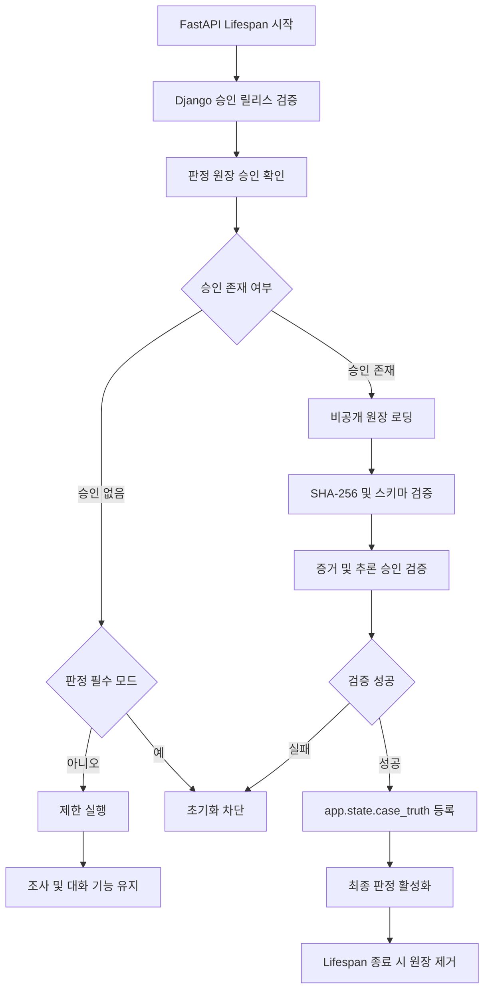

# Day 9 - 확장판 판정 원장 런타임 연결

## 1. 작업 개요

- 이슈: #230
- 브랜치: fix/230-expanded-case-truth-runtime
- 작업일: 2026-11-28
- 콘텐츠 버전: case001_1120
- Python: 3.13.15
- Django: 5.2.19
- 우선순위: P0

확장판의 최종 재구성 및 범인 지목에 필요한
ExpandedCaseTruth를 실제 FastAPI 초기화 과정에 연결하였다.

기존 판정 엔진은 테스트에서 원장을 직접 주입하여 사용했으나
실제 확장판 실행 진입점에는 원장 초기화가 누락되어 있었다.

## 2. 문제 분석

### 2.1 기존 문제

- 최종 재구성 요청 시 HTTP 503 발생
- 지목 조건 충족 후 범인 지목 시 HTTP 503 발생
- FULL 및 DEEP 엔딩 조회에 필요한 판정 원장 미등록
- 기존판 원장과 확장판 원장 간 데이터 구조 차이

### 2.2 정본 자료 확인

기존 비공개 사건 진실 원장이 존재하지만 다음 필드가 없다.

- content_version
- proof_axes

확장판 검토용 엔딩 계약은 REVIEW_REQUIRED 상태이며
runtime_enabled 값은 false이다.

최종 재구성 및 심화 엔딩의 목표 완료 조건은
원본 콘텐츠에서 담당자 확인이 필요한 상태이다.

따라서 기존 원장과 테스트용 증거 조합을 임의로 결합하지 않았다.

## 3. Django 릴리스 검증

기존 확장판 데이터베이스를 읽기 전용으로 연결하여
내부 콘텐츠 API를 검증하였다.

| 항목 | v0.14.0 | v0.15.0 |
|---|---:|---:|
| HTTP 응답 | 200 | 200 |
| Manifest 무결성 | 통과 | 통과 |
| 승인 증거 | 25 | 28 |
| 승인 추론 | 10 | 11 |
| 판정 원장 승인 | 없음 | 없음 |

기존 릴리스에 확장판 판정 원장 승인 정보가 없음을 확인하였다.

기존 Django 데이터베이스, 서비스 토큰 및 승인 릴리스는
변경하지 않았다.

## 4. 변경 파일

| 파일 | 역할 |
|---|---|
| expanded_case_truth_loader.py | 비공개 판정 원장 로딩 및 검증 |
| expanded_truth_runtime.py | 승인 릴리스 검증 및 원장 활성화 |
| expanded_main.py | 실제 FastAPI Lifespan 연결 |
| test_expanded_case_truth_loader.py | 원장 로더 테스트 |
| test_expanded_truth_activation.py | 승인 및 활성화 정책 테스트 |
| test_expanded_truth_lifespan.py | 실제 진입점 통합 테스트 |

## 5. 런타임 아키텍처



## 6. 원장 데이터 계약

확장판 전용 원장은 다음 조건을 만족해야 한다.

- 사건 ID: CASE-001
- 콘텐츠 버전: case001_1120
- 접근 범위: ENGINE_ONLY
- 유효한 NPC 식별자
- 유효한 범행 동기 및 사건 정보
- 최종 추리 4개 항목
- 항목별 승인 증거 조합
- 필요한 추론 검증 플래그

최종 추리 항목은 기존 판정 엔진의 다음 식별자를 유지한다.

- motive
- access
- timeline
- coverup

실제 사건 정답 및 증거 조합은 본 문서에 포함하지 않는다.

## 7. 승인 릴리스 계약

Django의 검증된 Manifest에 다음 승인 구조를 추가할 수 있다.

```json
{
  "approved_truth": {
    "status": "APPROVED",
    "content_version": "case001_1120",
    "release_version": "승인된 릴리스 버전",
    "access_scope": "ENGINE_ONLY",
    "sha256": "sha256:승인된 원장 체크섬"
  }
}
```

위 구조는 신규 계약이며 현재 v0.15.0에 발행된 상태가 아니다.

원장 파일 자체의 해시를 신뢰 기준으로 사용하지 않고
검증된 승인 릴리스에 기록된 해시와 비교한다.

## 8. 실행 정책

환경변수:

    CRIMESCENE_REQUIRE_EXPANDED_TRUTH

| 조건 | 처리 |
|---|---|
| false 및 승인 없음 | 제한된 개발 모드 실행 |
| true 및 승인 없음 | 초기화 실패 |
| 유효한 승인 및 원장 | 판정 원장 등록 |
| 잘못된 승인 | 초기화 실패 |
| 승인된 원장 파일 누락 | 초기화 실패 |
| SHA-256 불일치 | 초기화 실패 |
| 잘못된 실행 모드 | 초기화 실패 |

기본값은 false이다.

최종 배포 검증 시에는 true를 명시해야 한다.

승인된 원장이 없는 경우 최종 재구성 및
정답 원장이 필요한 지목 요청은 차단한다.

## 9. 보안 검증

- 기존판 원장 혼용 차단
- 사건 및 콘텐츠 버전 검증
- 명시적인 ENGINE_ONLY 범위 검증
- 파일 SHA-256 무결성 검증
- 최대 파일 크기 256KiB 제한
- 중복 JSON 키 차단
- 원장 파일 심볼릭 링크 차단 코드 적용
- 잘못된 NPC 식별자 차단
- 미승인 증거 조합 차단
- 미승인 추론 플래그 차단
- E26 구획 A 및 추론 승인 검사
- E30의 일반 최종 추리 조합 포함 차단
- 원장 오류 메시지의 정답 데이터 노출 방지
- 이전 초기화의 원장 재사용 방지
- Lifespan 종료 시 원장 제거

원장 데이터는 Git, 공개 API, NPC 프롬프트 및 RAG에
직접 포함하지 않는다.

심볼릭 링크 방어 코드는 적용되었으나
신규 로더에 대한 별도 심볼릭 링크 실증 테스트는 수행하지 않았다.

## 10. 자동화 테스트 결과

| 테스트 모듈 | 신규 통과 |
|---|---:|
| 원장 로더 | 16 |
| 원장 활성화 | 14 |
| Lifespan 통합 | 12 |
| 합계 | 42 |

Lifespan 테스트는 실제 FastAPI 진입점을 사용하되
외부 서비스와 정본 데이터는 테스트용 Fixture로 구성한다.

검증 범위:

- 승인 원장 초기화
- 최종 재구성
- 범인 지목
- FULL 엔딩 조회
- 미승인 상태 제한 실행
- 승인 오류 및 원장 변조 시 초기화 실패
- 실패 요청에 따른 게임 상태 변경 방지
- 종료 및 실패 시 자원 정리

## 11. 전체 회귀 테스트

| 항목 | 결과 |
|---|---:|
| 기존 통과 테스트 | 3225 |
| 신규 통과 테스트 | 42 |
| 최종 통과 | 3267 |
| 실패 | 0 |
| Skip | 26 |
| 실행 시간 | 142.04초 |

실행 명령:

    python -m pytest tests -q --tb=short -rs

Skip 구성:

- 실제 외부 서비스 통합: 14
- Neo4j 통합: 6
- Ollama 통합: 3
- 비공개 엔딩 이미지: 2
- 심볼릭 링크 환경 제한: 1

## 12. 실제 배포 차단 사항

다음 항목은 코드 구현 완료와 별도로 해결해야 한다.

1. 최신 스토리 정본 승인
2. 기존판 사건 정답의 확장판 적용 여부 확인
3. 최종 추리 4개 항목의 증거 조합 확정
4. 최종 재구성 선행 조건 확정
5. 증거 및 추론 조건의 실제 도달 가능성 검증
6. 서버 전용 확장판 판정 원장 생성
7. 신규 Django 승인 릴리스 발행
8. 실제 E26 보호 구획 활용 범위 검증
9. E30 동의 및 획득, DEEP 엔딩 조건 검증
10. 실제 콘텐츠 기반 자연 플레이 E2E 검증

기존 v0.15.0 릴리스는 LOCAL_INTEGRATION_TEST 범위이며
정식 운영 콘텐츠 승인과 동일하게 취급하지 않는다.

## 13. 완료 상태

판정 원장 로더 및 런타임 연결 코드: 완료.

자동화 회귀 테스트: 통과.

실제 콘텐츠 판정 활성화: 미완료.

P0 배포 차단 사항은 정본 승인 및 실제 플레이 검증이
완료될 때까지 유지한다.
